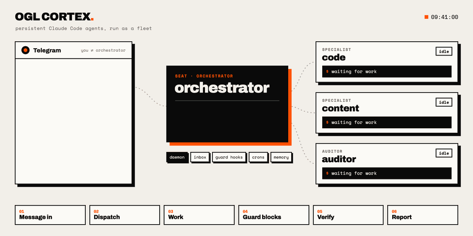
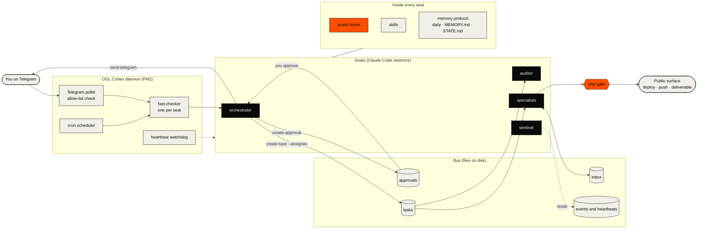

<div align="center">

<a href="docs/assets/readme/hero.mp4"></a>

**A fleet of persistent Claude Code agents you run from Telegram, with guard hooks, approval gates and a ship gate between them and anything that matters.**

[](LICENSE)
[](https://docs.anthropic.com/en/docs/claude-code)
[](https://github.com/grandamenium/cortextos)
[](GETTING-STARTED.md#prerequisites)

<sub>The animation is a GIF so it plays on GitHub. <a href="docs/assets/readme/hero.mp4">Watch the MP4</a> (12 s, 1920 x 960) or see the <a href="docs/assets/readme/hero.png">still</a>.</sub>

</div>

<a id="get-started"></a>

##  Get started

You need macOS or Linux, Node.js 20+, Claude Code (logged in), PM2, git, Python 3.9+, jq, curl, and a Telegram account. Full list: [Prerequisites](GETTING-STARTED.md#prerequisites).

**Path 1: Claude sets it up.** Clone the repo, open it in Claude Code, and run the setup command. Claude checks your machine, asks before every install, and stops at each step only you can do, such as logging in or creating a bot. It never asks you to paste a token into chat: you put secrets in the seat's `.env` file yourself. [Path A in the guide](GETTING-STARTED.md#path-a-let-claude-set-it-up) shows what it does.

```bash
git clone <this-repo-url> ogl-cortex
cd ogl-cortex
claude
```

Then, inside Claude Code:

```text
/cortex-setup
```

**Path 2: set it up by hand.** Run `bash scripts/install.sh --org <org>` for a dry run of the build and instance steps, then add `--apply`. It asks before every write outside the repository. Then follow [Path B in GETTING-STARTED.md](GETTING-STARTED.md#path-b-do-it-yourself) from Step 5: add an orchestrator seat, connect Telegram, start the daemon, add crons and a specialist, install the harness layer, then check everything with `bash scripts/doctor.sh --instance <instance>`.

[How it works](#architecture) · [How a message flows](#how-a-message-flows) · [Docs map](#docs-map) · [Troubleshooting](#troubleshooting)

---

<a id="how-it-works"></a>

## Agent = Model + Harness

The model writes code, reads files and makes decisions. The harness decides what it sees, what it may touch, what it remembers, and who has to say yes. **OGL Cortex is the harness.** Its framework keeps Claude Code sessions alive around the clock, and its harness adds the layer that makes a fleet safe to leave running:

The command-line tool is named `cortextos`.

| Layer | What it is | Where it lives |
|---|---|---|
| **Seats** | Long-running Claude Code sessions, one per role: an orchestrator you talk to, specialists that do the work, an auditor that checks it, a sentinel that watches the fleet. | `$CORTEX_HOME/orgs/<org>/agents/<seat>/` |
| **Daemon** | The OGL Cortex daemon under PM2. It polls Telegram, feeds each seat its messages and crons, watches heartbeats, and restarts a seat that dies. | `pm2 status` · `cortextos status` |
| **Bus** | Tasks, inbox messages, approvals, events and heartbeats, stored as files and driven by `cortextos bus <command>`. | `~/.cortextos/<instance>/` |
| **Hooks** | Small scripts that Claude Code runs at fixed points (before a tool call, after a tool call, at session start, after compaction). A PreToolUse hook that exits `2` blocks the call and tells the model why. | [`harness/hooks/`](harness/hooks/), installed to `<seat>/.claude/hooks/ogl/` |
| **Memory protocol** | Rules for what a seat writes down and when: daily memory, long-term `MEMORY.md`, a `STATE.md` checkpoint that survives compaction, plus a searchable knowledge base. | `<seat>/memory/`, `<seat>/MEMORY.md`, `<seat>/STATE.md` |
| **Gates** | Approval gates for actions a human must sign off, and a ship gate that blocks deploys and pushes until a security scan passes. | `cortextos bus create-approval`, [`harness/hooks/ship_gate.py`](harness/hooks/ship_gate.py) |

---

## What you get

 **A fleet, not a chat window.** Each seat is a folder of plain text (identity, rules, goals, skills, memory) plus a Claude Code session. Add one with `cortextos add-agent <seat> --template agent` and start it with `cortextos start <seat>`. Roles stay narrow so each session keeps a clean context.

 **Telegram as the control surface.** Every seat has its own bot. The daemon accepts messages only from the user ID in that seat's `.env` (`ALLOWED_USER`), injects them into the session, and seats reply with `cortextos bus send-telegram`. Permission prompts, plan reviews and questions can be forwarded to Telegram by hook, so you can approve from your phone.

 **Sessions that stay up.** The daemon restarts crashed seats, rotates long sessions, and keeps a heartbeat file per seat. `cortextos bus read-all-heartbeats` shows the whole fleet in one call.

 **Work you can see.** Every piece of work is a task with an owner, a status and an audit log: `create-task`, `claim-task`, `update-task`, `complete-task`, `task-history`. Dispatch is a task with `--assignee`, so nothing travels only as a chat message.

 **Guard hooks on every tool call.** The [harness](harness/README.md) ships these, each a Python file using the standard library only, with tests that check every block exits `2`:

| Hook | Blocks |
|---|---|
| `ship_gate.py` | `git push`, `vercel --prod`, `npm publish`, `wrangler deploy` and other ship commands, until `security/pentest-gate-report.json` says `"status": "pass"` |
| `shared_surface_guard.py` | changes to things every seat shares: `~/.claude`, the uv cache, global npm packages, `brew upgrade`, plus roots you add |
| `orwell_lint.py` | outgoing Telegram and email text that breaks Orwell's six rules of writing or uses em dashes |
| `brief_guard.py` | a task assigned to another seat without the four-line brief: TASK, FILES, BAR, RETURN |
| `future_time_guard.py` | a memory write, `STATE.md` write or send stamped with a UTC time ahead of the real clock |
| `compaction/` | nothing; it meters context use, hands `STATE.md` back after compaction and saves each summary |

The harness also ships four command-line tools in [`harness/tools/`](harness/tools/): `ship.sh` (gate, deploy, live re-check), `adversarial-pass.sh` (a fenced read-only attack on one claim), `brief_audit.py` (did a worker stay inside its brief) and `emit-truth-correction.sh` (the false-claim ledger).

The pentest gate that writes the ship gate's report is in [`harness/security/`](harness/security/): a built-in secret scan plus TruffleHog, Semgrep, `npm audit` and OWASP ZAP when they are available. Raw secret values never reach disk, and every check it could not run is listed as skipped with a reason.

The framework itself is vendored in [`framework/`](framework/VENDORED.md), pinned to a tested cortextOS commit with the OGL patches applied.

 **Approval gates.** External actions (sending email, deploying, deleting, spending) go through `cortextos bus create-approval` and wait for a human. `list-approvals` shows what is pending; the orchestrator surfaces it instead of letting it queue.

 **A memory protocol.** Seats write a daily log, keep a long-term index, and rewrite `STATE.md` at every checkpoint so a compaction or restart does not lose the thread. `cortextos bus kb-query` searches the org knowledge base.

 **Crons owned by the daemon.** Scheduled prompts live in `crons.json` per seat and survive restarts. Manage them with `cortextos bus add-cron`, `list-crons`, `update-cron`, `test-cron-fire` and `get-cron-log`.

 **A ship gate.** `ship_gate.py` blocks every push, publish and deploy until your security scan writes `security/pentest-gate-report.json` with `"status": "pass"`. Any scanner works if it writes that file. To ship over a failing scan, a human writes `security/pentest-risk-acceptance.md` and starts the session with `OGL_PENTEST_OVERRIDE=accepted-risk`; the agent cannot set that for itself. If the hook crashes, ship commands stay blocked.

---

## Architecture



<details>
<summary>Architecture in text</summary>

You send a Telegram message. The daemon's poller checks the sender, and the seat's fast-checker injects the message into the orchestrator's Claude Code session. The orchestrator writes tasks to the bus with an assignee. Specialists and the auditor pick up their tasks, work inside their own sessions behind guard hooks, and report through the bus. Actions that need a human go through an approval. Anything that leaves the machine passes the ship gate. The orchestrator replies on Telegram. A sentinel seat reads events and heartbeats to catch what went quiet.

</details>

---

<a id="how-a-message-flows"></a>

## How a message flows

The six steps in the animation, with the real mechanism behind each.

1. **Message in.** You write to the orchestrator's bot. The daemon's poller receives it, drops it unless the sender matches `ALLOWED_USER`, and the fast-checker types a block like `=== TELEGRAM from <name> (chat_id:<id>) ===` into the orchestrator's session. Voice notes are transcribed first.
2. **Dispatch.** The orchestrator breaks the ask into tasks and assigns each one: `cortextos bus create-task "<title>" --assignee <seat> --desc "<brief>"`. A task that must wait for another uses `--blocked-by <id>`. The assigned seat sees it on its next inbox check.
3. **Work.** The specialist claims the task (`cortextos bus claim-task <id>`), loads the skills it needs, and does the work in its own session with its own memory. Long jobs log progress with `update-task` and `log-event`.
4. **Guard blocks.** Every tool call passes the seat's PreToolUse hooks first. A hook that exits `2` stops the call, and its message goes back to the model, which changes course. In the animation the specialist runs `vercel --prod`, the ship gate blocks it because no passing security report exists, and the specialist runs the security scan, gets a pass and deploys. Actions above the seat's authority become an approval request instead.
5. **Verify.** A different seat checks the claim. The auditor opens the files and URLs the task names, runs the acceptance bar, and returns PASS or FAIL with evidence.
6. **Report.** The specialist closes the task with `cortextos bus complete-task <id> --result "<summary>"`. The orchestrator reads the result, replies to you with `cortextos bus send-telegram`, logs the event, and writes the outcome to memory.

---

<a id="docs-map"></a>

## Docs map

Every document comes in two editions: Markdown in [`docs/`](docs/) and a designed HTML page in [`docs/site/`](docs/site/). GitHub shows HTML as source, so open the HTML edition locally or from a static host; rebuild it with `python3 scripts/build-docs-site.py`. Start with [GETTING-STARTED.md](GETTING-STARTED.md), then 01, 04 and 14.

| # | Document | What it covers | HTML |
|---|---|---|---|
| **Core** ||||
| 01 | [Core system architecture](docs/01-core-architecture.md) | Components, glossary, seats, the life of one request | [page](docs/site/01-core-architecture.html) |
| 02 | [Execution engine](docs/02-execution-engine.md) | Daemon, sessions, context building, routing, conflict order | [page](docs/site/02-execution-engine.html) |
| 03 | [Configuration registry](docs/03-configuration-registry.md) | Every config file, seat archetypes, how prompts are assembled | [page](docs/site/03-configuration-registry.html) |
| 04 | [Fail-safes and boundaries](docs/04-failsafe-boundary-log.md) | What blocks an agent, what does not, fallbacks | [page](docs/site/04-failsafe-boundary-log.html) |
| **Strategy and governance** ||||
| 10 | [Product requirements (PRD)](docs/10-prd.md) | Goals, users, scope, non-goals | [page](docs/site/10-prd.html) |
| 11 | [AI safety and governance](docs/11-ai-safety-governance.md) | Rules, gates and who can override them | [page](docs/site/11-ai-safety-governance.html) |
| 12 | [Data privacy and compliance](docs/12-data-privacy-compliance.md) | What data the fleet holds and how to protect it | [page](docs/site/12-data-privacy-compliance.html) |
| 13 | [Vendor risk](docs/13-vendor-risk.md) | Third-party services and what happens when one fails | [page](docs/site/13-vendor-risk.html) |
| 14 | [README and quickstart](docs/14-readme-quickstart.md) | Running, changing and shipping from the harness | [page](docs/site/14-readme-quickstart.html) |
| **Design and data** ||||
| 20 | [Architecture decision records](docs/20-architecture-decision-records.md) | Why the harness is built the way it is | [page](docs/site/20-architecture-decision-records.html) |
| 21 | [Data models and schemas](docs/21-data-models-schema-registry.md) | Tasks, messages, events, crons and more, as JSON shapes | [page](docs/site/21-data-models-schema-registry.html) |
| 22 | [Prompt registry](docs/22-prompt-registry.md) | Every prompt surface and how to version it | [page](docs/site/22-prompt-registry.html) |
| 23 | [Evals and benchmarks](docs/23-evals-and-benchmarks.md) | What the harness measures and how | [page](docs/site/23-evals-and-benchmarks.html) |
| 24 | [Model lifecycle](docs/24-model-lifecycle.md) | Choosing and swapping models per seat | [page](docs/site/24-model-lifecycle.html) |
| **Operations** ||||
| 30 | [SRE runbooks](docs/30-sre-runbooks.md) | Step-by-step fixes for common failures | [page](docs/site/30-sre-runbooks.html) |
| 31 | [Observability and alerting](docs/31-observability-alerting.md) | Logs, events, heartbeats and who gets alerted | [page](docs/site/31-observability-alerting.html) |
| 32 | [Security model and red-team practice](docs/32-security-red-team-log.md) | Threat model, hardening, how to test the guards | [page](docs/site/32-security-red-team-log.html) |
| 33 | [Cookbook](docs/33-cookbook.md) | Common asks, end to end | [page](docs/site/33-cookbook.html) |
| 34 | [Changelog](docs/34-changelog.md) | Harness changes by version | [page](docs/site/34-changelog.html) |
| **Capacity, support and legal** ||||
| 40 | [FinOps and capacity](docs/40-finops-capacity.md) | Limits that bind, machine sizing, cost model | [page](docs/site/40-finops-capacity.html) |
| 41 | [Support, known issues and FAQ](docs/41-support-known-issues-faq.md) | Known limitations and answers | [page](docs/site/41-support-known-issues-faq.html) |
| 42 | [Chaos, telemetry and determinism](docs/42-chaos-telemetry-determinism.md) | Failure drills and reproducible runs | [page](docs/site/42-chaos-telemetry-determinism.html) |
| 43 | [Legal, IP, licences and training](docs/43-legal-ip-training.md) | Licences, IP and an operator curriculum | [page](docs/site/43-legal-ip-training.html) |

---

<a id="troubleshooting"></a>

## Troubleshooting

Run `bash scripts/doctor.sh --instance <instance>` first. It is read-only and prints a PASS, WARN or FAIL line for each check. Then open [TROUBLESHOOTING.md](TROUBLESHOOTING.md), which goes symptom by symptom (daemon, Telegram, crons, hooks, deploys, leaked secrets). For deeper fixes see [SRE runbooks](docs/30-sre-runbooks.md) and [Support, known issues and FAQ](docs/41-support-known-issues-faq.md).

## Known limitations

- Seats run as your user account. There is no sandbox; hooks and approval gates are the fence. Give the machine its own user account and enable disk encryption.
- Claude Code blocks a tool call only when a hook exits `2`. Any other non-zero exit shows a warning and the call goes ahead. Test every guard you add by making it fire once.
- Hooks load per project. A Claude Code session started outside a seat folder does not run that seat's guards.
- Usage limits on your Claude plan apply to the whole fleet. Many seats share one limit.

## Security

Read [SECURITY.md](SECURITY.md) before you connect real accounts. It covers how to report a vulnerability, what the guards do and do not cover, and a hardening checklist. The threat model is in [docs 32](docs/32-security-red-team-log.md).

## Contributing

See [CONTRIBUTING.md](CONTRIBUTING.md). In short: work on a branch, run `python3 harness/tests/run_all.py` and the doctor, give every hook change a must-block and a must-allow test, and keep secrets, chat IDs and home-directory paths out of commits.

## Credits

OGL Cortex is built on [cortextOS](https://github.com/grandamenium/cortextos) (MIT, Cortext LLC). The README layout takes its cue from [ruflo](https://github.com/ruvnet/ruflo).

<a id="licence"></a>

## Licence

OGL Cortex is released under the [MIT licence](LICENSE). The upstream framework keeps its own MIT licence (Cortext LLC), included in `framework/LICENSE`. Credits for adapted patterns are listed in `harness/README.md`.
