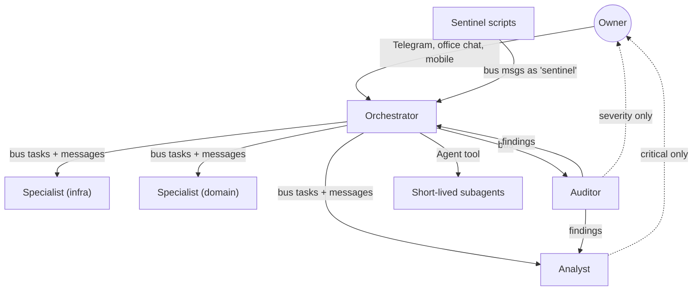
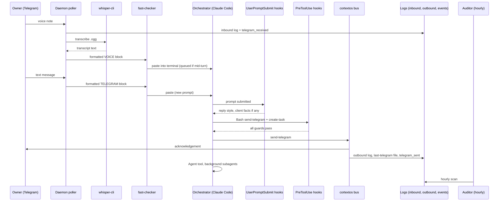
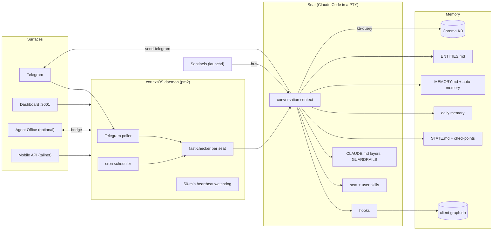

# 01. Core System Architecture

This document explains what OGL Cortex is made of, how the parts relate, and how one request travels from the owner's phone to an agent and back. Document 02 covers the execution engine, 03 the configuration files, and 04 the guardrails.

## Conventions

These placeholders appear in every OGL Cortex document:

| Placeholder | Meaning |
|---|---|
| `$CORTEX_HOME` | The framework checkout (the cortextOS repo) |
| `<instance>` | The runtime instance name passed to the daemon with `--instance` (default `default`) |
| `$CTX_ROOT` | The runtime state folder, `~/.cortextos/<instance>` |
| `<org>` | An organisation folder under `$CORTEX_HOME/orgs/` |
| `<seat>` | One agent's folder, `$CORTEX_HOME/orgs/<org>/agents/<seat>` |
| `<project-slug>` | Claude Code's per-project folder name under `~/.claude/projects/` (the seat path with `/` replaced by `-`) |

OGL Cortex uses neutral role names: **orchestrator**, **specialist**, **auditor**, **analyst** and **sentinel**. Seat names in config examples (for example `boss`) are placeholders you choose.

---

## 1. Overview

OGL Cortex runs a fleet of Claude Code sessions on one host. A background program, the **cortextOS daemon**, keeps each agent session alive, feeds it the owner's Telegram messages and its scheduled jobs, and restarts it when it exits. Each agent, called a **seat**, is a folder of text files (rules, memory, skills) plus one Claude Code terminal session.

One seat is the **orchestrator**. The owner talks to it. It hands work to other seats over a file-based message bus, or to short-lived helper agents (**subagents**) inside its own session. Small scripts called **hooks** check each seat's actions before they happen, for example blocking an outgoing Telegram message that breaks the writing rules. Memory is spread across layers, from the live conversation to a vector database.

OGL Cortex has two parts:

- **cortextOS** (MIT, upstream `github.com/grandamenium/cortextos`): the daemon, PTY layer, bus CLI, Telegram integration, cron scheduler, dashboard and seat templates.
- **The OGL layer**: guard hooks, the compaction kit, memory protocol, approval gates, the ship gate, sentinels and additional skills.

---

## 2. Component glossary

### 2.1 Memory

"Memory" means anything an agent can read later to recall a fact. Each layer has its own writer, reader and lifespan.

- **Short-term**: lives inside the current conversation or until the next restart.
- **Episodic**: a dated record of what happened.
- **Long-term**: distilled facts and rules meant to hold for months.

| # | Layer | What it is | Where | Kind | Writer / reader |
|---|---|---|---|---|---|
| 1 | Conversation context | The live session text. Seats restart with `--continue`, so one conversation can span days | `~/.claude/projects/<project-slug>/<session-id>.jsonl` | Short-term | Claude Code / seat |
| 2 | Auto-compaction window | Claude Code compresses the conversation when it passes a token limit | `<seat>/.claude/settings.json` key `autoCompactWindow` | Short-term | Claude Code |
| 3 | STATE.md and compaction kit | A seat-written "where the work stands" file. A context-meter hook nudges the seat to update it as the window fills. After compaction a hook pastes it back in; another saves the compaction summary | `<seat>/STATE.md`; `<seat>/.claude/hooks/kem-compaction/` (`compaction.json`, `meter.py`, `after_compact.py`, `save_summary.py`); summaries in `<seat>/compactions/` | Short-term bridge | Seat writes / hooks re-inject |
| 4 | Pre-compaction checkpoints | A PreCompact hook copies the last ~120 transcript lines to a checkpoint. A SessionStart hook re-injects the newest checkpoint if it is under 72 hours old, plus the tail of today's daily memory | `<seat>/.claude/hooks/precompact-checkpoint.sh`, `sessionstart-inject.sh`; `<seat>/memory/checkpoints/` | Short-term bridge | Hooks only |
| 5 | Daily memory | One markdown file per day, an append-only work log | `<seat>/memory/YYYY-MM-DD.md` | Episodic | Seat / SessionStart hook injects the last 3,000 characters |
| 6 | Session digests | At session end and before compaction, a hook filters the transcript, runs a headless Claude (`sonnet`) to write a digest, and indexes it into a local search index | `<seat>/tools/kem-memory/digest/`; output `<seat>/memory/digests/`; index `<seat>/tools/kem-memory/rag/rag.db` | Episodic | Hook / seat on demand |
| 7 | Incidents log | Narrative record of failures and the lessons drawn from them | `<seat>/memory/topics/incidents.md` | Episodic | Orchestrator, auditor |
| 8 | Seat MEMORY.md | Long-term rules and lessons, read at boot | `<seat>/MEMORY.md` | Long-term | Seat; the auditor may add coaching rules |
| 9 | Claude auto-memory | Claude Code's per-project memory folder: one index file plus one file per lesson. Only the index loads, capped at 200 lines | `~/.claude/projects/<project-slug>/memory/` | Long-term | Claude Code and seat |
| 10 | ENTITIES.md | Noun index: one entry per person, place or thing, with source rank and as-of date | `<seat>/ENTITIES.md` | Long-term | Orchestrator, behind a written write gate |
| 11 | Org knowledge.md | Shared facts for every seat in the org, read at boot | `orgs/<org>/knowledge.md` | Long-term | Any seat |
| 12 | Knowledge base (RAG) | `cortextos bus kb-query` searches a Chroma vector database. Embedding model, dimensions and chunk size are set in the KB `config.json`; there is one collection per seat plus a shared one | `$CTX_ROOT/orgs/<org>/knowledge-base/` (`config.json`, `chromadb/`) | Long-term | `kb-ingest` crons write / any seat reads |
| 13 | External knowledge stores (optional) | Owner tools such as a note vault or a graph database, wired in through MCP servers | Owner-defined | Long-term | Owner and agents |
| 14 | Client memory graph (optional) | A SQLite graph of clients and people with quoted, dated facts. A UserPromptSubmit hook reads it | `<seat>/tools/ops-graph/graph.db` | Long-term | Built offline / hook reads |
| 15 | Truth-correction ledger | When a seat is caught, or catches itself, stating something false, a guarded script logs a `truth_correction` event | `<seat>/tools/emit-truth-correction.sh` (calls `cortextos bus log-event action truth_correction`); events in `$CTX_ROOT/orgs/<org>/analytics/events/` | Episodic | Any seat / auditor scores it |
| 16 | Telegram logs | Every message in and out | `$CTX_ROOT/logs/<seat>/inbound-messages.jsonl`, `outbound-messages.jsonl` | Episodic | Daemon and `send-telegram` |
| 17 | Session facts | `cortextos bus recall-facts` returns facts extracted at compaction | `src/hooks/hook-extract-facts.ts` | Episodic | Requires the extract hook to be registered in the seat's settings |

Short-term: layers 1 to 4. Episodic: 5, 6, 7, 15, 16, 17. Long-term: 8 to 14.

### 2.2 Skills

A **skill** is a folder with a `SKILL.md` file: written instructions for one kind of job, for example a morning review. Claude Code lists skill names and one-line descriptions at session start. The full text loads only when the agent invokes the skill, or when a cron prompt tells it to read the file ("Read .claude/skills/morning-review/SKILL.md and ...").

| Source | Where |
|---|---|
| Seat skills | `<seat>/.claude/skills/` (seeded from the seat's template) |
| User-level skills, visible to every Claude session on the host | `~/.claude/skills/` |
| Plugin skills | Plugins enabled in `~/.claude/settings.json` `enabledPlugins` |
| Subagent definitions | `<seat>/.claude/agents/*.md`, for example a read-only `auditor` on `sonnet` |

`cortextos bus list-skills --format json` lists the seat skills it can parse. A `SKILL.md` without `name` and `description` frontmatter does not appear.

### 2.3 Tools

| Kind | What it covers | Where configured |
|---|---|---|
| Built-in Claude tools | Bash, Read, Edit, Write, WebFetch, WebSearch, Agent (subagents) and others | `<seat>/.claude/settings.json` `permissions.allow`; launch flags (see 02) |
| MCP servers, user scope | Browser automation, workspace, design, CRM and other connectors | `~/.claude.json` `mcpServers` |
| MCP servers, project scope | Servers needed by one seat | `~/.claude.json` `projects.<path>.mcpServers` |
| cortextOS bus CLI | `cortextos bus <cmd>`: tasks, messages, Telegram, crons, KB, approvals, heartbeats, hooks | `src/cli/bus.ts` |
| cortextOS CLI | `cortextos <cmd>`: `start`, `stop`, `restart`, `status`, `add-agent`, `goals`, `crash-alert` and more | `src/cli/` |
| Seat scripts | Helper scripts the seat runs through Bash | `<seat>/tools/` |
| Crons | Daemon-scheduled prompts | `$CTX_ROOT/.cortextOS/state/agents/<seat>/crons.json` |
| LaunchAgents | macOS scheduled scripts (sentinels, backups) | `~/Library/LaunchAgents/*.plist` |
| pm2 apps | `cortextos-daemon`, `cortextos-dashboard`, optional watchdogs | `$CORTEX_HOME/ecosystem.config.js` |

Manage crons through `cortextos bus list-crons`, `add-cron`, `update-cron` and `remove-cron`. These commands always use the path the scheduler reads (`src/bus/crons-schema.ts`).

### 2.4 Rules

Rules come in two strengths:

- **Prose rules**: text the model reads and weighs.
- **Mechanical rules**: hooks that run code and can block a tool call.

Claude Code loads every `CLAUDE.md` from the working folder up to the home folder. The bootstrap files load because the boot prompt tells the seat to read them.

| File | Scope |
|---|---|
| `~/.claude/CLAUDE.md` | Every Claude session on the host: memory read order, ship gate, coding guidelines |
| `$CORTEX_HOME/CLAUDE.md` | Framework contributor notes |
| `<seat>/CLAUDE.md` | The seat's operating manual |
| `<seat>/AGENTS.md` | Session start checklist and memory protocol |
| `<seat>/GUARDRAILS.md` | Red-flag table and named gates |
| `orgs/<org>/GUARDRAILS.md` | Fleet cardinal rule, for example "label every claim Proven, Inferred or Open" |
| `<seat>/MEMORY.md`, auto-memory index | Lessons, read at boot |

Mechanical rules live in the `hooks` object of `<seat>/.claude/settings.json` and `~/.claude/settings.json`. The reference orchestrator hook set:

| Event | Matcher | Command | What it does | Blocks? |
|---|---|---|---|---|
| PermissionRequest | ExitPlanMode | `cortextos bus hook-planmode-telegram` | Sends plan approval to Telegram | Waits for reply |
| PermissionRequest | any | `cortextos bus hook-permission-telegram` | Sends permission prompts to Telegram | Waits for reply |
| PreToolUse | AskUserQuestion | `cortextos bus hook-ask-telegram` | Routes questions to Telegram | No |
| PreToolUse | Bash | `~/.claude/hooks/orwell-lint.py` | **Send guard.** Lints the text of any `cortextos bus send-telegram` against Orwell's six rules and a no-em-dash rule. One pass token per seat | Yes |
| PreToolUse | MCP send, reply, forward, draft and post tools | `~/.claude/hooks/orwell-lint.py` | Same lint on email and social sends | Yes |
| PreToolUse | `mcp__google-workspace__.*` | `~/.claude/hooks/gws-account-guard.py` | **Account guard.** Blocks calls for accounts on a deny list, and blocks re-auth flows that could overwrite stored credentials | Yes, no pass token |
| PreToolUse | Bash | `SURFACE_CODE_MODE=warn ~/.claude/hooks/shared-surface-guard.py` | **Shared-surface guard.** Blocks once on commands that change things every seat depends on: `uv cache` prune, global npm installs, `brew upgrade`, writes to `~/.claude*` and shared credential folders. Code-write checks run in warn mode | Yes, once |
| PreToolUse | Bash | `<seat>/.claude/hooks/brief_guard.py` | **Brief guard.** `create-task --assignee <other seat>` must carry TASK, FILES, BAR and RETURN lines | Yes |
| PreToolUse | Bash, Write, Edit | `<seat>/.claude/hooks/future_time_guard.py` | **Future-time guard.** Refuses an `HH:MM UTC` stamp more than 3 minutes in the future in memory files, STATE.md or sends. Fails open | Yes |
| PreToolUse | Bash | `<seat>/.claude/hooks/attribution-lint.py` | **Attribution lint.** Blocks owner-bound sends that present an estimate as a measured number without a receipt. Tier B logs only | Tier A only |
| PreToolUse | Bash | `ship_gate_hook.py` (user level, from the pentest-gate skill) | **Ship gate.** Blocks `git push`, `gh release` and similar unless a passing pentest report exists | Yes |
| PostToolUse | any | `kem-compaction/meter.py` | Context meter: nudge, then warning | No |
| PostToolUse | Bash | `tools/adversarial-trigger/fix_commit_hook.py` | After a `git commit` whose subject says fix, guard or hook, starts a background adversarial review | No |
| UserPromptSubmit | any | `tools/ops-graph/recall_hook.py` | **Client memory graph.** Injects dated quoted facts (max 6,000 chars) when the prompt names a known client or person. Skips cron prompts | No |
| UserPromptSubmit | any | `tools/prompt-router/router.py` | **Reply-style router.** Runs `claude --print --model haiku` to pick one of six reply styles and injects it. Logs to `decisions.jsonl` | No |
| Stop | any | `cortextos bus hook-idle-flag` | Writes `last_idle.flag` so the daemon knows the turn ended (drives the typing indicator) | No |
| Stop | any | `~/.claude/skills/aa-dream/dream-hook.sh` | Starts background memory consolidation after 24 h and 5 sessions | No |
| SessionEnd | any | `cortextos crash-alert` | Crash notice | No |
| SessionEnd, PreCompact | any | `kem-memory/digest/session_end.py` | Session digest (layer 6) | No |
| PreCompact | any | `cortextos bus hook-compact-telegram`, `precompact-checkpoint.sh` | Telegram notice and checkpoint (layer 4) | No |
| SessionStart | any | `sessionstart-inject.sh` | Re-injects checkpoint and daily memory tail | No |
| SessionStart | compact | `kem-compaction/after_compact.py` | Hands STATE.md back | No |
| PostCompact | any | `kem-compaction/save_summary.py` | Saves the summary to `compactions/` | No |

Specialist seats carry a subset: the Telegram hooks, the send guard and the shared-surface guard. An infrastructure seat can run the shared-surface guard in strict mode by omitting `SURFACE_CODE_MODE=warn`. The cortextOS templates also ship `cortextos bus hook-loop-detector` as a PreToolUse hook (`src/hooks/hook-loop-detector.ts`).

A hook script on disk does nothing until a settings file registers it.

---

## 3. Roles

### 3.1 Seats

A seat folder lives at `orgs/<org>/agents/<seat>`. `cortextos bus list-agents` lists registered seats. `cortextos status` shows which are running. A seat can exist on disk while disabled.

| Role | Template | Responsibility | Reports to |
|---|---|---|---|
| **Orchestrator** | `templates/orchestrator` | Routes the owner's directives, briefs the owner, runs approvals, dispatches work | Owner |
| **Analyst** | `templates/analyst` | Fleet health, metrics, upstream drift checks, improvement cycle, nightly local commits | Orchestrator; owner on critical signals |
| **Auditor** | `templates/analyst` plus auditor skills | Hourly claim checks; writes coaching rules into a seat's MEMORY.md after a false claim | Orchestrator and analyst; owner above a severity threshold |
| **Specialist** | `templates/agent` | One domain: infrastructure, content, outreach, code. Can run without its own Telegram bot | Orchestrator, over the bus |
| **Sentinel** | not a seat | Scheduled shell scripts that check the host and message the orchestrator | Orchestrator |

### 3.2 Non-seat actors

| Actor | What it is | Code / location |
|---|---|---|
| **cortextOS daemon** | One Node process. Starts each seat's Claude session in a pseudo-terminal (PTY), polls Telegram, runs crons, restarts crashed seats | pm2 app `cortextos-daemon` runs `$CORTEX_HOME/dist/daemon.js --instance <instance>`; `src/daemon/agent-manager.ts` |
| **fast-checker** | A loop inside the daemon, one per seat, polling every 1 s. Injects queued Telegram and bus messages into the seat's terminal, watches context size, sends the typing indicator | `src/daemon/fast-checker.ts` |
| **Heartbeat watchdog** | Part of the fast-checker. Every 50 minutes it writes an "alive, idle session" heartbeat for the seat | `src/daemon/fast-checker.ts` |
| **Sentinels** | Bash scripts run by LaunchAgents every 10 minutes to daily: disk, heartbeat, session liveness, daemon restart storms, domain expiry, credential identity. They send bus messages to the orchestrator as `sentinel` | `<sentinel-dir>/*.sh`, `~/Library/LaunchAgents/` |
| **Auth sentinel** | A pm2 loop that checks Claude login health | `<seat>/tools/claude-auth-sentinel-loop.sh` |
| **Agent Office bridge** (optional) | Copies fleet state into a visual office and carries office chat lines and Approve clicks back to the orchestrator | See 14 |
| **Owner** | The principal. Sends Telegram text, voice notes and photos; approves actions | `<seat>/USER.md`; `ALLOWED_USER` in the seat `.env` |
| **Interactive Claude sessions** | Claude.app or Claude Code opened by the owner on the same host. Shares `~/.claude` (user hooks, skills, MCP config) with the seats; gets a seat's hooks only when opened in that seat's folder | n/a |

---

## 4. Surfaces

| Surface | What it is | How it runs | Default reach |
|---|---|---|---|
| **Telegram** | The main channel to the orchestrator. Other seats can have their own bots | The daemon polls Telegram (`src/telegram/poller.ts`); seats reply with `cortextos bus send-telegram` | Phone, anywhere |
| **Dashboard** | Next.js app: tasks, agents, approvals, crons, KB, skills, analytics, workflows (`dashboard/src/app/(dashboard)/`) | pm2 app `cortextos-dashboard`. Login required (`dashboard/src/middleware.ts`); admin credentials in `$CTX_ROOT/dashboard.env`. Run a production build bound to localhost | Local, or tailnet through `tailscale serve` |
| **Agent Office** (optional) | Visual office: seats at desks, wall boards for the needs-owner queue, Telegram thread, deploy gate, crons and projects | Local Node server on 127.0.0.1 with password login, fed by a bridge script | Local and tailnet |
| **Mobile control** (optional) | Phone web app and home-screen widgets: approve or reject, fleet actions, panic stop, start-all | Small HTTP API bound to the host's Tailscale IP, bearer token required, run by a LaunchAgent | Tailnet |
| **Files** | Deliverables sent as Telegram documents | `cortextos bus send-telegram <chat_id> "<caption>" --file <path>` | Telegram |

Bind every control surface to localhost or the tailnet address and require auth on each.

---

## 5. Lifecycle of one request

This trace follows a common request: the owner sends a voice note and then a text message asking the orchestrator to produce a set of documents. Times are typical offsets from the voice note arriving.

### 5.1 Hop by hop

| # | Time | Hop | Code |
|---|---|---|---|
| 1 | 0 s | The daemon's Telegram poller receives the voice message, checks the sender against `ALLOWED_USER`, and logs `telegram_received` | `src/daemon/agent-manager.ts`, `src/telegram/poller.ts` |
| 2 | 0 to 4 s | The media handler downloads the `.ogg` into `<seat>/telegram-images/`, converts it with `ffmpeg`, and transcribes it with `whisper-cli` and the model in `~/.cortextos/models/` | `src/telegram/media.ts`, `src/telegram/transcribe.ts` |
| 3 | ~4 s | The fast-checker formats a `=== TELEGRAM VOICE from ... ===` block with the transcript and pastes it into the seat's terminal. If the seat is mid-turn, Claude Code queues it | `src/daemon/fast-checker.ts` |
| 4 | ~10 s | The text message arrives and becomes the next prompt; the queued voice block rides along | fast-checker, Claude Code queue |
| 5 | ~12 s | UserPromptSubmit hooks run. The reply-style router injects `[reply style: act] ...`. The client-graph hook injects facts only if a known name appears | `tools/prompt-router/router.py`, `tools/ops-graph/recall_hook.py` |
| 6 | | Context available this turn: CLAUDE.md layers, bootstrap files read at boot, the auto-memory index, STATE.md and the SessionStart injection. The seat may also run `kb-query` | n/a |
| 7 | ~25 s | The seat runs one Bash call: `send-telegram` plus `create-task`. Every PreToolUse Bash hook checks it first: send guard, shared-surface guard, brief guard (no `--assignee`, so not a dispatch), future-time guard, attribution lint, ship gate | `<seat>/.claude/settings.json` |
| 8 | ~26 s | `send-telegram` posts the acknowledgement, appends to `outbound-messages.jsonl`, overwrites `$CTX_ROOT/state/<seat>/last-telegram-<chat_id>.txt`, and logs `telegram_sent`. `create-task` writes a task record | `src/cli/bus.ts`, `src/telegram/logging.ts` |
| 9 | ~60 s | The seat writes a shared brief and launches background subagents with the Agent tool | Claude Code Agent tool |
| 10 | after each tool call | PostToolUse hooks: context meter, fix-commit trigger | settings.json |
| 11 | turn end | Stop hooks: idle flag (stops the typing indicator), dream check | `src/hooks/hook-idle-flag.ts` |
| 12 | hourly | The auditor's audit cron scans the last 60 minutes of fleet events | auditor skill |
| 13 | nightly | The auditor's catch-rate cron reads the full `outbound-messages.jsonl` | auditor script |

### 5.2 Sequence diagram

### 5.3 Component map

---

## 6. Known limitations

1. **Heartbeats show daemon liveness, not reasoning.** The fast-checker writes an "alive" heartbeat every 50 minutes whether or not the session is working (`src/daemon/fast-checker.ts`). Pair it with a check on recent tool activity or transcript growth. Any process that calls `cortextos bus update-heartbeat` without `CTX_AGENT_NAME` set writes under a default name.
2. **The default transcription model is English-only.** `src/telegram/transcribe.ts` defaults to `ggml-tiny.en.bin`, which ignores the language setting. Install a multilingual whisper model for other languages. The inbound log stores voice notes with empty text; the transcript appears only in the session.
3. **`last-telegram-<chat_id>.txt` holds one message.** `send-telegram` overwrites it on each send (`src/telegram/logging.ts`). Audits that need every send must read `outbound-messages.jsonl`.
4. **Seat hooks run inside subagents.** A subagent working in a seat folder inherits that seat's hooks. A hook that reads the parent transcript reports the parent's state to the subagent. Scope such hooks to the main session, or tell subagents in their brief to ignore state-file instructions.
5. **The auto-memory index loads at most 200 lines.** Lines past the cap are dropped without error. Keep MEMORY.md files as indexes of short lines.
6. **Several files can describe the same thing.** CLAUDE.md, AGENTS.md and the daemon's boot prompt each touch boot behaviour; FLEET-style indexes duplicate `enabled-agents.json`. Document 03 lists one owner file per setting.
7. **`recall-facts` returns nothing unless the extract hook is registered.** Templates do not register `hook-extract-facts` by default.
8. **A plist on disk is not a loaded job.** LaunchAgents run only after `launchctl load`. Check `launchctl list` for each sentinel and backup job.

---

## Source files

- `src/daemon/agent-manager.ts`
- `src/daemon/fast-checker.ts`
- `src/telegram/poller.ts`, `src/telegram/media.ts`, `src/telegram/transcribe.ts`, `src/telegram/logging.ts`
- `src/cli/bus.ts`
- `src/bus/crons.ts`, `src/bus/crons-schema.ts`, `src/bus/knowledge-base.ts`
- `src/hooks/hook-loop-detector.ts`, `src/hooks/hook-idle-flag.ts`, `src/hooks/hook-extract-facts.ts`
- `src/types/index.ts`
- `dashboard/src/middleware.ts`
- `ecosystem.config.js`
- `templates/orchestrator/`, `templates/analyst/`, `templates/agent/`
