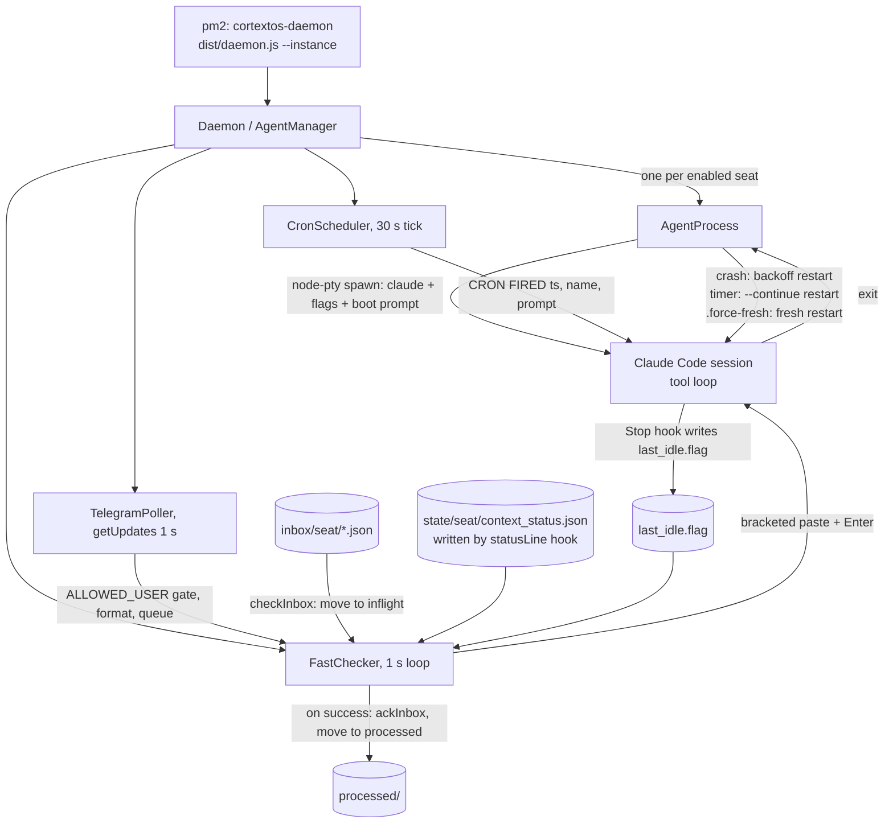
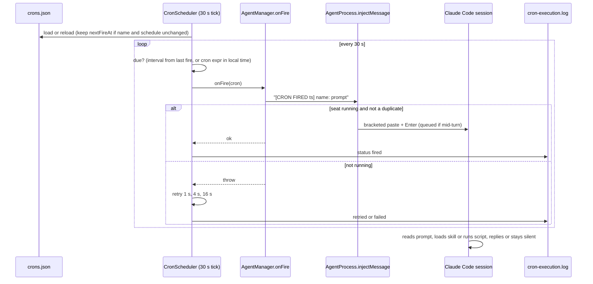

# 02. Execution Engine Spec

How a seat runs: the process tree, the agent loop, what enters the model's context and when, how tools and skills are chosen, how crons and messages reach a live session, and which rule wins when two rules disagree.

Placeholders (`$CORTEX_HOME`, `$CTX_ROOT`, `<instance>`, `<org>`, `<seat>`) are defined in 01.

---

## 1. Summary

1. One Node process, the **OGL Cortex daemon**, runs under **pm2** (a process supervisor that restarts a crashed program). The daemon starts one **Claude Code** CLI process per enabled seat inside a **pseudo-terminal** (PTY, a fake terminal so the program behaves as if a person were typing). No tmux is involved.
2. Every seat runs Claude Code's normal **tool loop**: the model reads its context, calls a tool (Bash, Read, Edit, an MCP tool, a subagent), receives the result, and repeats until it ends its turn. No custom planner sits in front of it.
3. The daemon talks to a session by **typing into the PTY**. Telegram messages, agent-to-agent messages, cron fires and context warnings all arrive as pasted text. If the model is mid-turn, Claude Code queues the paste and shows it at the next step.
4. **Hooks** add context to prompts, re-inject state after compaction, and block bad tool calls. A blocking hook returns its reason to the model as the tool result; the model rewrites and retries. Hooks are mechanical, so they outrank written instructions.

---

## 2. Process tree: pm2, daemon, PTY, Claude Code

### 2.1 Processes

`$CORTEX_HOME/ecosystem.config.js` defines the pm2 apps:

| pm2 app | Script | Args | Notes |
|---|---|---|---|
| `cortextos-daemon` | `$CORTEX_HOME/dist/daemon.js` | `--instance <instance>` | Instance defaults to `default`. `max_restarts` 10 and `restart_delay` act as the crash-storm circuit breaker |
| `cortextos-dashboard` | `$CORTEX_HOME/dashboard` (Next.js) | port 3001 | Run a production build for long-lived use |
| optional watchdogs | for example an auth-health loop | none | Separate from the daemon |

The command-line tool is named `cortextos`.

Every `cortextos` command reads `CTX_INSTANCE_ID` to find the runtime root. Outside a seat terminal it defaults to `default`. If your daemon runs another instance name, pass `--instance <instance>` (for example `cortextos restart --instance <instance>`), or the CLI reports "Daemon is not running".

Each live Claude Code process is a direct child of the daemon:

```
claude --continue --dangerously-skip-permissions --model <model> --append-system-prompt "<contents of local/*.md>" "<boot prompt>"
```

The PTY layer is `node-pty` (`src/pty/agent-pty.ts`). `src/pty/inject.ts` writes input with bracketed paste.

### 2.2 How a session launches

`AgentProcess.start()` in `src/daemon/agent-process.ts`:

1. Waits `startup_delay` seconds (from the seat `config.json`).
2. Picks the mode. `continue` if a Claude transcript already exists for the working folder, else `fresh` (`shouldContinue`). A `.force-fresh` marker in `$CTX_ROOT/state/<seat>/` forces fresh and is deleted on read.
3. Builds the prompt: `buildStartupPrompt` or `buildContinuePrompt`.
4. Spawns the runtime. For `runtime: "claude-code"` that is `AgentPTY` (`src/pty/agent-pty.ts`).

`AgentPTY.spawn` builds the environment and arguments:

- **Environment.** Sets `CTX_INSTANCE_ID`, `CTX_ROOT`, `CTX_FRAMEWORK_ROOT`, `CTX_AGENT_NAME`, `CTX_ORG`, `CTX_AGENT_DIR`, `CTX_PROJECT_ROOT`. Loads `orgs/<org>/secrets.env`, then the seat `.env` (seat keys win). Adds `CTX_TELEGRAM_CHAT_ID`, `CTX_TIMEZONE` and `TZ` from `config.json` `timezone`, and `CTX_ORCHESTRATOR_AGENT` from `orgs/<org>/context.json`.
- **Arguments** (`buildClaudeArgs`):
  - `--continue` in continue mode.
  - `--dangerously-skip-permissions` unless `config.dangerously_skip_permissions` is exactly `false`.
  - `--model <config.model>` when set.
  - `--append-system-prompt <all local/*.md joined>` when `<seat>/local/` holds Markdown files. Use this for a short operator contract that must sit in the system prompt.
  - The boot prompt last.
- **Terminal.** `xterm-256color`, 200 columns by 50 rows, cwd = `working_directory`.
- **Trust prompt.** At 5 s and 8 s after spawn, if recent output contains "trust" or "Yes", it presses Enter to accept Claude Code's folder-trust prompt.

### 2.3 Boot prompts

| Shape | When | What it tells the model |
|---|---|---|
| Full startup | Fresh session | Current UTC time; "Read AGENTS.md and all bootstrap files listed there"; crons are daemon-managed, do not call CronCreate; overdue reminders; the deliverables rule if `context.json` sets `require_deliverables`; "send a Telegram message saying you are back online" unless `telegram_polling` is `false` |
| Handoff | Fresh session after a context handoff | The startup prompt plus a block telling the seat to read its handoff document first |
| Continue | `--continue` restart | "SESSION CONTINUATION ... Re-read AGENTS.md and all bootstrap files ... Check inbox" |

### 2.4 Restarts

| Kind | Trigger | Mode | Code |
|---|---|---|---|
| Session timer | `max_session_seconds` elapsed. Default 255,600 s (71 h) | `--continue` (history kept) | `agent-process.ts` |
| Soft | `cortextos bus self-restart --reason "<why>"` | `--continue` | `src/cli/bus.ts` |
| Hard | `cortextos bus hard-restart --reason "<why>" [--handoff-doc <path>]` (writes `.force-fresh`; the handoff doc is injected into the next boot prompt) | fresh | `src/cli/bus.ts` |
| Context handoff | fast-checker sees context above `ctx_handoff_threshold` | fresh, handoff prompt | `src/daemon/fast-checker.ts` |
| Crash | PTY exits unexpectedly | Backoff `min(5 s x 2^(n-1), 300 s)`; halts after `max_crashes_per_day` | `agent-process.ts` |

The session timer re-reads `config.json` each time it fires, so a config change takes effect without a daemon restart. Timer values are clamped to the 32-bit `setTimeout` limit (about 24.8 days). Each restart appends a line (`HARD-RESTART`, `SELF-RESTART`, `CRASH`) to `$CTX_ROOT/logs/<seat>/restarts.log`.

Stopping is graceful: Ctrl-C, then `/exit` plus CRLF, a 5-second wait, then a kill only if the process is still alive.

---

## 3. The fast-checker: how outside events reach a session

The **fast-checker** (`src/daemon/fast-checker.ts`) is one object per seat inside the daemon. It is the only path into a running session.

### 3.1 Poll loop

- Loops every `pollInterval` ms, default 1,000.
- A SIGUSR1 signal or the IPC `wake` command cuts the sleep short.
- Each cycle (`pollCycle`):
  1. Drains queued Telegram messages (queued by the Telegram poller).
  2. Reads the seat inbox (`checkInbox`, which moves files from `inbox/` to `inflight/`).
  3. Joins everything into one block and calls `injectMessage(block)`.
  4. On success, ACKs every inbox message in the block, then sleeps 5 s.
  5. Sends the Telegram typing indicator if the seat looks busy.
  6. Runs the context monitor (`checkContextStatus`).
- A separate 50-minute timer runs `cortextos bus update-heartbeat "[watchdog] <seat> alive - idle session <ts>"`.

### 3.2 Telegram in

The Telegram poller calls `getUpdates` every second (`src/telegram/poller.ts`). `src/daemon/agent-manager.ts` filters each update by `ALLOWED_USER`, a comma-separated list of numeric Telegram user IDs in the seat `.env`. If `BOT_TOKEN` is set but `ALLOWED_USER` is missing or malformed, Telegram is disabled for that seat and a watchdog alert goes out. Repeated rejections raise another alert.

Accepted messages are formatted and queued. The header wraps the display name so a crafted name cannot forge a header:

```
=== TELEGRAM from [USER: <name>] (chat_id:<id>) ===
<text in a fenced block>
Reply using: cortextos bus send-telegram <chat_id> '<your reply>'
```

Photos, documents, voice notes (with a transcript), video and reactions have their own formats.

### 3.3 How the paste reaches the model

`injectMessage` refuses if the seat is not `running`, or if the exact text was injected recently (MD5 over the last 100 injects, `MessageDedup` in `src/pty/inject.ts`). Otherwise it writes the text wrapped in bracketed-paste escape codes (`ESC[200~ ... ESC[201~`), in 4 KB chunks if long, and presses Enter 300 ms later.

The fast-checker does not wait for the model to be idle. Claude Code queues text submitted during a turn and hands it to the model at the next step. A message sent while the seat runs a long Bash command appears right after that command returns, inside the same turn.

### 3.4 Typing indicator and the Stop hook

The Stop hook `cortextos bus hook-idle-flag` writes a Unix timestamp to `$CTX_ROOT/state/<seat>/last_idle.flag` when the model ends a turn (`src/hooks/hook-idle-flag.ts`). The fast-checker treats the seat as busy if it injected a Telegram message after the last idle flag and within 10 minutes. Only Telegram injects set this timestamp, so inbox and cron injects do not start the typing indicator.

### 3.5 Other injections

- **Urgent signal.** A `.urgent-signal` file in the seat's state folder is read, deleted, and injected as `=== URGENT SIGNAL ===`.
- **Context warnings and handoff demands.** See 4.5.
- **Cron fires.** The cron scheduler uses the same inject path (section 6).

### 3.6 Diagram



---

## 4. State and context: what the model sees

### 4.1 One loop, many layers

Claude Code runs a standard agent loop: system prompt plus conversation in, tool call out, result appended, repeat. Each turn starts with a user message, which for a seat is almost always a pasted Telegram block, an agent message, a cron fire or a context notice. Orchestrator behaviour comes from the text loaded into context and from hooks. There is no separate orchestration prompt.

### 4.2 Layer 1: system prompt and CLAUDE.md files

Loaded by Claude Code at session start:

| Layer | File | Loaded by |
|---|---|---|
| Claude Code system prompt | built in | Claude Code |
| Appended system prompt | `<seat>/local/*.md` | Daemon through `--append-system-prompt` |
| User global instructions | `~/.claude/CLAUDE.md` | Claude Code (user scope) |
| Ancestor folder instructions | any `CLAUDE.md` between the seat and `~` | Claude Code |
| Framework instructions | `$CORTEX_HOME/CLAUDE.md` | Claude Code |
| Seat instructions | `<seat>/CLAUDE.md` | Claude Code (project) |
| Auto-memory index | `~/.claude/projects/<project-slug>/memory/MEMORY.md` | Claude Code, first 200 lines |

Topic files in the auto-memory folder load only on demand.

### 4.3 Layer 2: bootstrap reads

The boot prompt says "Read AGENTS.md and all bootstrap files listed there". The template `AGENTS.md` lists, in order: send a boot message, read IDENTITY, SOUL, GUARDRAILS, GOALS, HEARTBEAT, MEMORY, USER, TOOLS, SYSTEM, then `../../knowledge.md` and any `local/*.md`; list skills, agents and crons; run `recall-facts --days 3`; read today's daily memory; `kb-query` if resuming; check inbox; update heartbeat; log `session_start`; write a daily-memory entry; send online status.

These are Read tool calls, so they land in the conversation, not the system prompt. Their total size sets the cold-boot cost. A rough rule is 4 bytes per token. Keep MEMORY.md and knowledge.md as indexes that point to topic files, so the boot read stays small. The Read tool has a per-call limit, so a very large file may not return in one call.

### 4.4 Layer 3: hooks that add context

| Event | Hook | What it adds |
|---|---|---|
| SessionStart (any) | Optional checkpoint-inject hook (not included in this repository) | The newest pre-compaction checkpoint and the tail of today's daily memory, if you add such a hook |
| SessionStart (`compact`) | `<seat>/.claude/hooks/ogl/compaction/after_compact.py` | All of `STATE.md`, prefixed "The conversation was just compacted ... Trust it over the summary where they differ" |
| UserPromptSubmit | Optional, not included in this repository | A client-graph recall hook or a reply-style router can inject text here. Keep such hooks silent for cron prompts and agent messages, and make any failure inject nothing |
| PostToolUse | `<seat>/.claude/hooks/ogl/compaction/meter.py` | The context meter (4.5) |
| statusLine | `cortextos bus hook-context-status` (every 5 s) | Not model context. Writes `$CTX_ROOT/state/<seat>/context_status.json` for the daemon |

### 4.5 Compaction and context limits

Three mechanisms watch context size:

| Mechanism | Setting | Action | Code / config |
|---|---|---|---|
| Claude Code auto-compact | `autoCompactWindow` in `<seat>/.claude/settings.json` | Compacts the conversation in place | Claude Code |
| Context meter (PostToolUse) | `nudge`, `warning`, `limit` token counts in `<seat>/.claude/hooks/ogl/compaction/compaction.json` | At nudge: "bring STATE.md up to date at every checkpoint". At warning: "rewrite STATE.md in full, before any other tool call" | `<seat>/.claude/hooks/ogl/compaction/meter.py` |
| Daemon fast-checker | `ctx_warning_threshold` and `ctx_handoff_threshold` (percent of the model window) in `config.json`. Code defaults 30 and 60 | Injects `[CONTEXT] Window at N%`, then `[CONTEXT HANDOFF REQUIRED]` (write a handoff doc, hard-restart). Force-restarts after a 5-minute grace if the seat does not comply | `src/daemon/fast-checker.ts` |

Choose one primary policy. With a 1M-token window and `autoCompactWindow` at 430,000, auto-compact always fires before an 80% daemon threshold (800,000 tokens), so the daemon handoff acts only as a backstop. With a small window and no `autoCompactWindow`, the daemon handoff is the primary mechanism.

Around a compaction these hooks run in order:

1. **PreCompact:** `cortextos bus hook-compact-telegram` (Telegram notice). Optional hooks not included in this repository can also write a transcript checkpoint or a session digest here.
2. **Claude Code writes the summary.** A "Compact Instructions" section in `<seat>/CLAUDE.md` tells the summariser what to keep first: current checkpoint and next step, promises to the owner, live surfaces and rollback, plan changes, dead ends, the owner's rules.
3. **PostCompact:** `compaction/save_summary.py` saves the summary to `compactions/`.
4. **SessionStart (`compact`):** `compaction/after_compact.py` hands back STATE.md.

### 4.6 Context status bridge

Claude Code calls the statusLine command every 5 s. `hook-context-status` writes `used_percentage`, `context_window_size`, `exceeds_200k_tokens` and `session_id` to `context_status.json` (`src/hooks/hook-context-status.ts`). The fast-checker:

- ignores the file if it is over 10 minutes old;
- resets its per-session state when the session ID changes;
- waits 2 minutes after a new session before any handoff;
- pauses auto-handoff for 30 minutes after 3 handoffs in 15 minutes (circuit breaker);
- force-restarts if PTY output shows an API "conversation too long" error and usage is at least 85% or over 200k tokens.

### 4.7 STATE.md and daily memory

STATE.md is the live record of where the work stands. The seat rewrites it in place at every checkpoint: a decision, a finding, a promise to the owner, a change of plan, a dead end. Daily memory (`memory/YYYY-MM-DD.md`) is the append-only log required by the memory protocol in `CLAUDE.md`. The SessionStart hook re-injects its tail.

---

## 5. Tool and skill routing

### 5.1 Built-in tools and permissions

By default every seat launches with `--dangerously-skip-permissions`. `<seat>/.claude/settings.json` can also allow tools explicitly. With the skip flag on, Claude Code does not ask for permission, so the two PermissionRequest hooks (`hook-planmode-telegram`, `hook-permission-telegram`) engage only for tools that always ask. Set `"dangerously_skip_permissions": false` in a seat's `config.json` to route permission prompts to Telegram for that seat. The PreToolUse hooks in 5.5 run in both modes.

### 5.2 Skills

A skill is a folder with a `SKILL.md` whose frontmatter has `name` and `description`. Claude Code lists every skill's name and description in context. The model decides to call the `Skill` tool, and only then does the full SKILL.md load. Selection is by the model reading descriptions; there is no keyword router.

- `cortextos bus list-skills` (`src/cli/list-skills.ts`) parses only `name` and `description`. A `triggers:` list in frontmatter is a hint for the model; no code reads it.
- User skills in `~/.claude/skills/` and plugin skills appear in every seat's list. A long list costs context on every session; keep user-level skills lean.
- The template `AGENTS.md` tells the seat to run `cortextos bus list-skills --format text` at boot.

### 5.3 MCP tools and ToolSearch

MCP servers are configured in `~/.claude.json`: `mcpServers` at user scope, and `projects.<path>.mcpServers` for one seat. Claude Code lists MCP tools as **deferred tools** by name only. The model calls `ToolSearch` (by exact name or keyword) to load a schema before calling the tool. Adding or removing an MCP server needs a session restart (`cortextos bus self-restart` keeps history).

### 5.4 Subagents and bus dispatch

There are two ways to hand work out:

| Path | Mechanism | Runs where | On dashboard |
|---|---|---|---|
| Subagent | Claude Code `Agent` tool. Runs in the background inside the seat's session and reports back. Custom types live in `<seat>/.claude/agents/*.md` (for example a read-only `auditor` with `tools: Read, Grep, Glob, WebFetch`, `model: sonnet`, `maxTurns: 20`) | Same process and session | No |
| Bus dispatch | `cortextos bus create-task "<title>" --desc "<desc>" --assignee <seat>` | The other seat's own Claude Code process | Yes |

`create-task` with `--assignee` also sends a `normal` inbox message to that seat (`src/cli/bus.ts`).

The OGL orchestrator contract adds four tests before handing work out: it splits into independent pieces; each piece fits a four-line brief; the orchestrator will verify every return; it is worth roughly 15 times the tokens. Any "no" means do the work in one window. A dispatch carries four lines in `--desc`: `TASK:`, `FILES:`, `BAR:`, `RETURN:`. `brief_guard.py` blocks (exit 2) a `create-task --assignee <other seat>` whose description lacks any of them. Before accepting a return, `python3 harness/tools/brief_audit.py <task_id>` lists every file the worker wrote and marks each IN or OUT of the brief's FILES line. Workers that edit code get their own worktree or branch.

### 5.5 Guard hooks and what a block looks like

PreToolUse hooks run before a tool call. Exit code 2 blocks the call, and Claude Code returns the hook's stderr to the model as the tool result. The model reads it, fixes the call and tries again. Any other non-zero exit is a non-blocking error.

| Hook | Matcher | Blocks when | Release |
|---|---|---|---|
| `<seat>/.claude/hooks/ogl/orwell_lint.py` | Bash; MCP send, reply, post and draft tools | Outgoing human-facing text breaks Orwell's six rules or the no-em-dash rule | One pass token per seat, valid 10 min |
| `<seat>/.claude/hooks/ogl/shared_surface_guard.py` | Bash | Changes to shared surfaces: `uv cache prune`, global npm installs, `brew upgrade`, writes to `~/.claude*` or shared credential folders | Pass token after naming consumers and a backup |
| `<seat>/.claude/hooks/ogl/brief_guard.py` | Bash | Dispatch without TASK, FILES, BAR, RETURN | Add the four lines |
| `<seat>/.claude/hooks/ogl/future_time_guard.py` | Bash, Write, Edit | An `HH:MM UTC` stamp more than 3 min in the future in memory, STATE.md or a send | Use the real clock. Fails open on error |
| `<seat>/.claude/hooks/ogl/ship_gate.py` | Bash | `git push`, `gh pr merge`, `vercel deploy`, `wrangler deploy` and similar with no passing pentest report in the directory tree | Pass the gate |
| `cortextos bus hook-ask-telegram` | AskUserQuestion | Not a block. Forwards the question to Telegram | n/a |

Example block and rewrite from `$OGL_STATE_DIR/orwell-lint.log` (default `~/.ogl-cortex/state/`):

```
<ts> BLOCK Bash 1 issues: 'Understood. The 4 core documents are being written by 4 agents i...'
<ts> PASS  Bash 0 issues: 'Understood. 4 agents are writing the 4 core documents in paralle...'
```

The passive "are being written" was blocked. Seconds later the active rewrite passed.

Other tool-related hooks: SessionEnd `cortextos crash-alert` (Telegram notice that distinguishes planned from unplanned exits). An optional post-commit adversarial trigger and a session digest are not included in this repository.

---

## 6. Scheduling

### 6.1 Where crons live

The daemon reads `$CTX_ROOT/.cortextOS/state/agents/<seat>/crons.json` (`src/bus/crons-schema.ts`, `CRONS_DIRECTORY = '.cortextOS/state/agents'`). The envelope is `{updated_at, crons[]}` (`src/bus/crons.ts`). Edit it through the bus:

```bash
cortextos bus list-crons <seat>
cortextos bus add-cron <seat> <name> <interval-or-cron-expr> "<prompt>"
cortextos bus update-cron <seat> <name> --interval <interval> --prompt "<prompt>"
cortextos bus remove-cron <seat> <name>
```

Writes are atomic with a per-seat lock and keep a `crons.json.bak` fallback.

A seat `config.json` may hold a legacy `crons` array. A one-time migration (`src/daemon/cron-migration.ts`) copies it into `crons.json`, writes a `.crons-migrated` marker, and never reads `config.json` crons again. Remove the array after migration so nobody edits a dead copy.

There is no one-shot cron type. To run something once, schedule a dated expression such as `0 20 12 10 *` with a prompt that ends "then run `cortextos bus remove-cron <seat> <name>`". Without that step it fires again a year later.

### 6.2 How a cron fire reaches the seat

`CronScheduler` (`src/daemon/cron-scheduler.ts`) ticks every 30 s. For each due cron it calls `onFire`, defined in `src/daemon/agent-manager.ts`, which injects:

```
[CRON FIRED <ISO time>] <name>: <prompt>
```

The timestamp keeps the dedup check from rejecting the same prompt on the next fire. The text goes through the same PTY paste path as messages. If the seat is not running, the fire throws and the scheduler retries at 1 s, 4 s and 16 s, then gives up. Each attempt is logged to `$CTX_ROOT/.cortextOS/state/agents/<seat>/cron-execution.log`. A manual fire from the dashboard uses the prefix `[CRON: <name>] <prompt>` (`src/daemon/ipc-server.ts`).

Schedules are intervals (`20m`, `4h`) counted from the last fire, or 5-field cron expressions evaluated on the daemon's local clock. Set `TZ` for the daemon to the timezone you want cron expressions to use. After downtime, the scheduler fires once for the most recent missed slot, not once per missed slot.

A fire is pasted text. If the seat is busy, it waits in Claude Code's queue like any message. Prompt hooks can treat it differently: an optional recall hook or reply-style router (neither is included in this repository) should skip cron fires. Cron prompts should end with `cortextos bus update-cron-fire <name>` so the seat records a completed run.



### 6.3 Default and recommended crons

Template defaults (`templates/*/config.json`, migrated into `crons.json` on first boot):

| Template | Crons |
|---|---|
| orchestrator | `heartbeat`, `check-approvals`, `morning-review`, `evening-review`, `weekly-review` |
| analyst | `heartbeat`, `usage-monitor`, `nightly-metrics`, `auto-commit`, `check-upstream`, `catalog-browse` |
| agent | `heartbeat` |

Crons the OGL layer adds:

| Seat role | Name | Typical schedule | Purpose |
|---|---|---|---|
| Every seat | `kb-ingest-daily` | `05 16 * * *`, staggered 10 min per seat | Re-ingest the seat's files into the knowledge base |
| Analyst | `theta-wave` | nightly | System-improvement cycle |
| Analyst | `orphan-guard` | `60m` | Sweep for orphaned dev servers and similar |
| Auditor | `forensic-audit-pass` | `1h` | Scan the last 60 minutes of fleet events for unverified claims |
| Auditor | `false-claim-catch-rate` | nightly | Score corrections against the full outbound log |
| Infrastructure | `cred-identity-check` | `20 * * * *` | Hash watched config and credential files; page the orchestrator on change |
| Specialist | domain watches | `20m` to `24h` | Silent-on-OK checks that message only on real change |

Stagger daily jobs that share a resource (KB ingest, git snapshots) so they do not overlap.

Interval crons whose interval is at least the seat's heartbeat interval can be pushed back by other fires and fail to run. Use a wall-clock cron expression for those (for example `11 1,5,9,13,17,21 * * *` in place of `4h`), and confirm the first fire by its output.

### 6.4 Heartbeat cycle

The heartbeat is an interval cron (orchestrator default `4h`) whose prompt says "Read HEARTBEAT.md and follow its instructions". The template `HEARTBEAT.md` steps: update heartbeat and advance the cron-fire watermark; sweep the inbox for un-ACKed messages; fleet health (`read-all-heartbeats`, pending approvals, stale human tasks); own task queue; log a heartbeat event; write daily memory; check org goals; resume work; guardrail self-check; long-term memory upkeep. The fast-checker's 50-minute watchdog writes its own heartbeat independently. The dashboard and `list-agents` show whichever wrote last.

---

## 7. Inter-agent messaging

### 7.1 Send

`cortextos bus send-message <seat> <priority> '<text>' [reply_to]` writes one JSON file to `$CTX_ROOT/inbox/<seat>/` named `<priority number>-<epoch ms>-from-<sender>-<random>.json` (`src/bus/message.ts`). Priority numbers are urgent 0, high 1, normal 2, low 3 (`src/types/index.ts`), so files sort by priority, then time. Each message is signed with HMAC-SHA256 when a signing key exists. An unknown recipient gives a warning; the message is still queued.

### 7.2 Receive and ACK

`checkInbox` first moves any `inflight/` file older than 300 s back to `inbox/`, then moves each `inbox/` file to `inflight/` and returns them sorted. `ackInbox` moves a file from `inflight/` to `processed/`.

In practice:

- When the fast-checker delivers a message by injection, it ACKs it right after the paste succeeds. The model does not need to ACK injected messages.
- Redelivery after 5 minutes applies only to messages moved to `inflight/` and never ACKed: a failed injection, or a manual `cortextos bus check-inbox` with no `ack-inbox` after it.
- `reply_to` on `send-message` stores the original ID in the new message. It does not ACK the original. Use `cortextos bus ack-inbox <msg_id>` for that.

Injected format:

```
=== AGENT MESSAGE from <seat> [msg_id: <id>] ===
<text>
Reply using: cortextos bus send-message <seat> normal '<your reply>' <msg_id>
```

### 7.3 Message versus dispatch

| | `send-message` | `create-task --assignee` |
|---|---|---|
| Creates a tracked task | No | Yes |
| Shows on dashboard | As an event only | Yes |
| Notifies the worker | Yes | Yes (automatic inbox message) |
| Brief guard applies | No | Yes, needs TASK, FILES, BAR, RETURN |
| Counts as a dispatch | No | Yes |

A message alone does not create accountable work. Use a task for anything you expect back.

---

## 8. Conflict resolution: which rule wins

### 8.1 Precedence

No single file states the order, so OGL Cortex defines it here.

| Rank | Layer | Why it sits here |
|---|---|---|
| 1 | **Mechanical enforcement**: hooks, the daemon, PTY injection, `ALLOWED_USER`, launch flags | Runs outside the model. A hook that exits 2 stops the call whatever the model believes. A seat cannot refuse a daemon injection |
| 2 | **Claude Code harness and model safety** | Built in. CLAUDE.md overrides default behaviour but not the harness or the model's own limits |
| 3 | **Hard guardrails**: no change to a live client surface without the owner, approval gates for external, financial, deploy and delete actions, no secrets over chat, irreversible or customer-facing actions go to a human | Bind absolutely, including over a repeated request from the owner |
| 4 | **The owner's explicit word** (Telegram, or an authenticated owner login on a control surface) | Counts as approval. Overrides goals, plans, cron prompts and the seat's own advice. Does not lift a hard guardrail. A broad request does not lift an artifact-specific freeze; only an unlock that names the artifact does |
| 5 | **User global CLAUDE.md** (`~/.claude/CLAUDE.md`) | Applies to every project on the host |
| 6 | **Project and seat CLAUDE.md** | More specific than global; where both speak, the more specific wins |
| 7 | **Seat files**: GUARDRAILS.md, AGENTS.md, SOUL.md, HEARTBEAT.md, MEMORY.md, knowledge.md, owner-locked specs | GUARDRAILS.md is strongest here. Its red-flag table forbids self-editing CLAUDE.md without a task and approval |
| 8 | **Skills and cron prompts** | Load on demand. Treat step lists as a proven default; reason from the objective first |
| 9 | **Memory notes and incident lessons** | Advisory and possibly stale. Verify against current files before acting |

Two written tie-breaks:

- An owner-specific suppression beats a generic cron reminder policy.
- STATE.md beats the compaction summary where they differ (`after_compact.py`).

### 8.2 Worked examples

**Mechanism beats instruction.** A seat writes "do not hand off before 85%" into its own GOALS.md. The fast-checker still injects a handoff demand at `ctx_handoff_threshold`. The instruction targets the wrong actor; change the config value, not the prose.

**Locked spec beats cron prompt.** A cron prompt says "include a source footer". An owner-locked spec for the same output forbids a visible footer. The seat follows the locked spec, flags the contradiction to the owner, and does not alternate day to day.

**Guardrail beats repeated request.** The owner asks several times for a password over Telegram. "A repeated request overrides a redirect" applies to goals, not to security guardrails. The seat refuses and offers a secure channel.

**Freeze beats broad directive.** The owner says "do as much as you can now" about a project. A client-approved surface in that project is frozen. The seat does not touch it without an unlock that names the artifact.

### 8.3 Keeping rules consistent

Contradictions appear when the same instruction lives in several files. The usual pairs:

| Topic | Files that can disagree | Owner file |
|---|---|---|
| Boot message | `CLAUDE.md`, `AGENTS.md`, daemon startup prompt | `AGENTS.md`, plus `telegram_polling` in config |
| Orchestrator scope | "never do specialist work" versus "do it in one window" in `CLAUDE.md` | One section of `CLAUDE.md` |
| Cron file path | Template prose versus `src/bus/crons-schema.ts` | The code; use the bus commands |
| ACK behaviour | Template prose versus `src/bus/message.ts` | The code (7.2) |

Document 03 gives the full owner-file table.

---

## 9. Known limitations

1. **Heartbeats show the daemon is alive, not the model.** The watchdog heartbeat is written every 50 minutes on its own schedule.
2. **The daemon handoff is a backstop when auto-compact runs first.** With a large window and a low `autoCompactWindow`, `ctx_*` thresholds trigger only if auto-compact fails.
3. **Cold boot reads every bootstrap file.** Large MEMORY.md and knowledge.md files make each fresh boot expensive.
4. **No one-shot cron type.** One-off jobs are dated yearly expressions that must remove themselves.
5. **Permission hooks are dormant under `--dangerously-skip-permissions`.** Approvals then rely on the approvals skill and the PreToolUse guards.
6. **Pattern-based gates match only the forms they list.** A ship gate built on regexes misses command variants it does not name (flag order, `npx` prefixes, wrapper scripts). Test every deploy command your team uses against the gate, and route deploys through one wrapper script.
7. **`--continue` keeps one conversation across restarts.** A seat on the session timer resumes the same transcript; only `hard-restart` or `.force-fresh` starts clean.
8. **MCP changes need a restart.** New servers appear only after the session restarts.

---

## Source files

- `src/daemon/agent-process.ts`, `src/daemon/fast-checker.ts`, `src/daemon/cron-scheduler.ts`, `src/daemon/cron-migration.ts`, `src/daemon/agent-manager.ts`, `src/daemon/ipc-server.ts`
- `src/pty/agent-pty.ts`, `src/pty/inject.ts`
- `src/bus/message.ts`, `src/bus/crons.ts`, `src/bus/crons-schema.ts`
- `src/types/index.ts`
- `src/cli/bus.ts`, `src/cli/list-skills.ts`
- `src/hooks/hook-context-status.ts`, `src/hooks/hook-idle-flag.ts`, `src/hooks/hook-crash-alert.ts`, `src/hooks/hook-compact-telegram.ts`
- `src/telegram/poller.ts`
- `ecosystem.config.js`
- `templates/*/config.json`, `templates/*/AGENTS.md`, `templates/*/HEARTBEAT.md`
