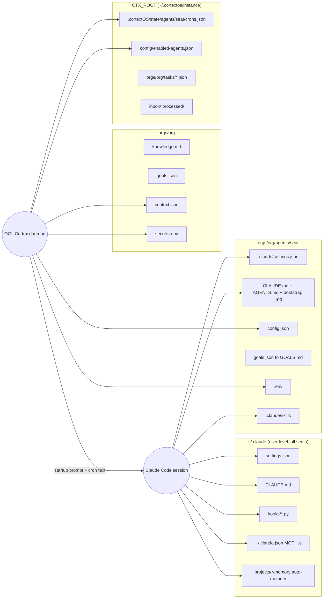
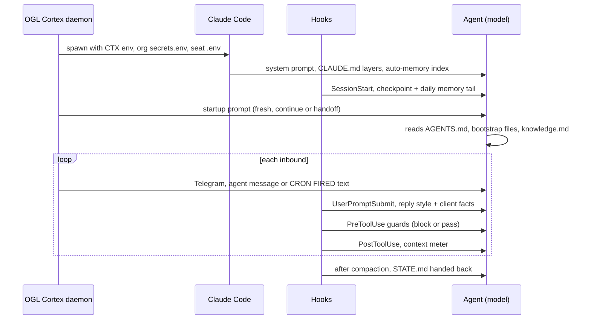

# 03. Configuration Registry

Every file that shapes how OGL Cortex behaves, the real shape of each record type, how a turn's context is assembled, and which file owns each kind of setting.

Placeholders (`$CORTEX_HOME`, `$CTX_ROOT`, `<instance>`, `<org>`, `<seat>`, `<project-slug>`) are defined in 01.

## Why a registry

Three different readers consume configuration:

- **Claude Code** reads settings, CLAUDE.md files, hooks, skills, MCP config and auto-memory.
- **The OGL Cortex daemon** reads seat `config.json`, `.env` files, org `context.json`, `crons.json` and `enabled-agents.json`.
- **The model** reads bootstrap files because a prompt tells it to.

When one fact lives in two files, the copies drift, and a seat acts on whichever copy it reads first. This registry names one owner file for each kind of setting.

Terms:

- **Seat**: one agent's folder, `orgs/<org>/agents/<seat>`.
- **Hook**: a command Claude Code runs at a fixed moment (before a tool call, after compaction). It can block the action or add context.
- **Compaction**: Claude Code summarising the conversation when the context window fills.
- **Gate**: the auditor seat checking an artifact and returning PASS or FAIL.
- **`.gated-<sha>`**: a read-only frozen copy of a file at the exact version the auditor passed.
- **`.bak-<timestamp>-<reason>`**: a manual backup taken before an edit.

---

## 1. The registry

### 1.1 Who reads what



### 1.2 Registry table

Guard names used below:

- **Surface guard**: `shared_surface_guard.py` (source `harness/hooks/shared_surface_guard.py`, installed to `<seat>/.claude/hooks/ogl/`, or `~/.claude/hooks/ogl/` with `--user-level`), a PreToolUse hook that blocks Bash writes to shared roots. Default roots: `~/.claude`, `~/.claude.json`, the shared uv cache, global npm and `brew upgrade`, plus any root in `OGL_SURFACE_EXTRA_ROOTS`; writes under `~/.claude/projects/` are exempt (rules in `surface.py`). Seat folders are not in the default list.
- **Hash watch** (optional, not included): an infrastructure-seat cron that hashes every watched settings, hook, skill, CLAUDE.md and MCP file and pages the orchestrator once per change.
- **Auditor gate**: auditor review before a change goes live, with a `.gated-<sha>` copy kept.

The command-line tool is named `cortextos`.

| # | Path | Owner | Controls | Who edits | Change guard | Version control |
|---|---|---|---|---|---|---|
| 1 | `~/.claude/settings.json` | Owner | User-level hooks (for example the ship gate), enabled plugins, marketplaces, env such as `DISABLE_AUTOUPDATER=1`, TUI options | Owner; seats only with a surface-guard pass token | Surface guard, hash watch | Recommended: a private local git repo for `~/.claude` config and hooks |
| 2 | `~/.claude/CLAUDE.md` | Owner | Global instructions for every Claude session on the host: memory read order, ship gate, coding guidelines, file naming | Owner. Memory tools may rewrite a generated block inside it | Surface guard, hash watch | As above |
| 3 | `~/.claude.json` | Claude Code and owner | MCP servers: `mcpServers` at user scope and `projects.<path>.mcpServers` per project. Claude Code also writes session state here constantly | Claude Code; owner for MCP edits | Surface guard; hash watch on the `mcpServers` subtree only | Not suitable for git (volatile); back up `mcpServers` separately |
| 4 | `~/.claude/hooks/ogl/` (only with `install.sh --user-level`) | OGL layer authors; consumed by all seats | Machine-wide guards: `ship_gate.py`, `shared_surface_guard.py` (imports `surface.py`, `codewrites.py`), `orwell_lint.py` | Orchestrator under auditor gate | Surface guard (pass token only), hash watch, `.gated-<sha>` copies | Git |
| 5 | `<seat>/.claude/settings.json` | Seat owner; orchestrator writes most | Hooks, `statusLine`, permissions, `autoCompactWindow` | Orchestrator, the seat | Hash watch | Seat git repo |
| 6 | `<seat>/config.json` | Framework schema | Runtime, model, profile, timezone, day/night window, approval rules, context thresholds, session length. May hold a legacy `crons` array | Orchestrator, owner, dashboard | Daemon re-reads `ctx_*` thresholds on mtime change (`src/daemon/fast-checker.ts`) | Seat git repo |
| 7 | `<seat>/goals.json` and `GOALS.md` | Orchestrator writes every seat's goals | Daily focus, goals, bottleneck. `GOALS.md` is generated: do not edit | Orchestrator via the goal-management skill; `cortextos goals generate-md` | None | Seat git repo |
| 8 | `orgs/<org>/goals.json` | Owner (north star), orchestrator (daily focus) | North star, daily focus, org goals | Orchestrator per goal-management skill | None | Org repo (the framework repo ignores `orgs/`) |
| 9 | `$CTX_ROOT/.cortextOS/state/agents/<seat>/crons.json` | Daemon | Live cron schedule. Envelope `{updated_at, crons[]}` (`src/bus/crons.ts`) | `cortextos bus add-cron`, `update-cron`, `remove-cron` | Atomic write and per-seat lock (`src/bus/crons.ts`); automatic `crons.json.bak` | Export with `list-crons` into a tracked file if you want history |
| 10 | `<seat>/.env` | Owner | Seat secrets: `BOT_TOKEN`, `CHAT_ID`, `ALLOWED_USER`, plus integration keys | Owner only | Seat `.gitignore` excludes `.env*`; the bus refuses to read `.cortextos-env` (`src/bus/system.ts`) | Never in git |
| 11 | `orgs/<org>/secrets.env` | Owner | Org-wide secrets loaded into every seat before the seat `.env` (`src/pty/agent-pty.ts`) | Owner | None | Never in git |
| 12 | `<seat>/.cortextos-env` | Daemon (generated) | `CTX_*` path variables, rewritten on every start (`src/daemon/agent-process.ts`) | Daemon only | Regenerated | Ignore |
| 13 | `orgs/<org>/context.json` | Owner | Org name, timezone, day window, orchestrator name, default approval categories, comms style, optional `require_deliverables` | Owner, orchestrator | None | Org repo |
| 14 | `orgs/<org>/knowledge.md` | All seats (append) | Shared fact base read at every session start | Any seat | None | Org repo |
| 15 | `$CTX_ROOT/config/enabled-agents.json` | Daemon | Which registered seats start | `cortextos start <seat>`, `cortextos stop <seat>` | Daemon writes | Back up on change |
| 16 | `$CORTEX_HOME/templates/` | Framework upstream | Starting shape for new seats: `agent`, `orchestrator`, `analyst`, `agent-codex`, `agent-opencode`, `hermes`, `m2c1-worker`, `org` | Upstream; the analyst's drift check watches it | Framework git | Framework repo |
| 17 | `<seat>/ENTITIES.md` | Orchestrator | Canonical noun index: people, places, prices | Orchestrator, behind a written write gate | Prose gate | Seat git repo |
| 18 | `<seat>/MEMORY.md`, auto-memory | Seat | Long-term memory (4.1) | Seat, or a nightly consolidation cron prompt you write (no code ships) | Hash watch on bootstrap names | Seat git repo (auto-memory lives under `~/.claude/projects/`) |
| 19 | `<seat>/STATE.md` | Seat | Where the work stands; re-injected after compaction | Seat | None | Seat git repo |
| 20 | `<seat>/.claude/hooks/ogl/` | Seat owner | Hooks installed by `harness/install.sh`: the guards and the compaction kit (`compaction/`: `meter.py`, `after_compact.py`, `save_summary.py`, `common.py`, `compaction.json`) | Orchestrator under auditor gate | Hash watch, `.gated-<sha>` | Seat git repo |
| 21 | `<seat>/.claude/skills/`, `~/.claude/skills/` | Template and seat; owner for user skills | Skill text loaded on demand | Orchestrator | Hash watch | Seat repo; user skills in the `~/.claude` repo |
| 22 | `<seat>/.claude/agents/*.md`, `~/.claude/agents/` | Seat, plugins | Subagent definitions | Orchestrator | Hash watch | Seat repo |

### 1.3 Hook sets by role

| Role | Typical hook commands | Notes |
|---|---|---|
| Orchestrator | template hooks plus all of `harness/settings.example.json` | Ship gate, surface guard, send guard, brief guard, future-time guard and the compaction kit |
| Analyst, auditor, specialist | template hooks plus a subset | Send guard, surface guard (warn mode), ship gate; add the compaction kit for long sessions |
| Infrastructure specialist | a small set | Send guard and surface guard in strict mode (omit `SURFACE_CODE_MODE=warn`); no Telegram permission hooks |
| Template default | 6 to 7 | `hook-planmode-telegram`, `hook-permission-telegram`, `hook-loop-detector`, `hook-ask-telegram`, `crash-alert`, `hook-compact-telegram`, plus `hook-idle-flag` on analyst and agent |

Every template ships `cortextos bus hook-loop-detector` as a PreToolUse hook (`templates/orchestrator/.claude/settings.json`). Keep it unless you replace it with an equivalent.

Keep hook scripts in `<seat>/.claude/hooks/` (the installer uses `<seat>/.claude/hooks/ogl/`) or `<seat>/tools/`. A hook registered from a deliverables or scratch folder disappears silently when someone cleans that folder.

### 1.4 Backups and frozen copies

- Take a `.bak-<UTC timestamp>-<reason>` copy before editing any settings or hook file by hand.
- After the auditor passes a hook or guard, copy it to `<file>.gated-<sha>` and `chmod 400` it. The next change is then a diff against the passed version.
- With a git repo for `~/.claude/hooks` and each seat, prefer commits and tags over loose `.bak` files.

---

## 2. Record shapes

### 2.1 Seat `config.json`

Template default (`templates/orchestrator/config.json`, crons omitted):

```json
{
  "agent_name": "{{agent_name}}",
  "enabled": true,
  "runtime": "claude-code",
  "startup_delay": 0,
  "max_session_seconds": 255600,
  "max_crashes_per_day": 10,
  "working_directory": "",
  "timezone": "",
  "day_mode_start": "",
  "day_mode_end": "",
  "communication_style": "",
  "approval_rules": {"always_ask": [], "never_ask": []},
  "ecosystem": {"local_version_control": {"enabled": true}}
}
```

A configured orchestrator adds model and context settings:

```json
{
  "agent_name": "boss",
  "enabled": true,
  "runtime": "claude-code",
  "startup_delay": 0,
  "max_session_seconds": 255600,
  "max_crashes_per_day": 10,
  "working_directory": "$CORTEX_HOME/orgs/<org>/agents/boss",
  "timezone": "America/New_York",
  "day_mode_start": "09:00",
  "day_mode_end": "21:00",
  "communication_style": "Terse. Lead with the answer.",
  "approval_rules": {"always_ask": ["external-comms", "financial", "deployment", "data-deletion"], "never_ask": []},
  "ecosystem": {"local_version_control": {"enabled": true}},
  "model": "<model id>",
  "profile": "<profile>",
  "ctx_warning_threshold": 80,
  "ctx_handoff_threshold": 88
}
```

`working_directory` must be an absolute path in the real file. `255600` seconds is 71 hours, the default `--continue` rotation. Other keys the daemon reads: `dangerously_skip_permissions` (default on unless `false`), `telegram_polling`, `voice_id`. Analyst templates add `ecosystem.upstream_sync`, `catalog_browse` and `community_publish`. `agent-codex` sets `runtime: "codex-app-server"`; `agent-opencode` sets `runtime: "opencode"`.

### 2.2 `goals.json`

Seat file:

```json
{
  "focus": "One sentence: what this seat works on today.",
  "goals": ["Goal one", "Goal two"],
  "bottleneck": "What blocks progress, or empty.",
  "updated_at": "2026-01-01T09:00:00Z",
  "updated_by": "boss"
}
```

The org file (`orgs/<org>/goals.json`) adds `north_star`, `daily_focus` and `daily_focus_set_at`.

### 2.3 `crons.json` entry

```json
{
  "name": "morning-review",
  "prompt": "Read .claude/skills/morning-review/SKILL.md and execute the morning review workflow, including goal cascade from .claude/skills/goal-management/SKILL.md. Send at most one consolidated Telegram. Then run: cortextos bus update-cron-fire morning-review",
  "schedule": "0 8 * * *",
  "enabled": true,
  "created_at": "2026-01-01T00:00:00.000Z",
  "metadata": {"migrated_from_config": true, "original_type": "recurring"},
  "last_fired_at": "2026-01-02T08:00:05.343Z",
  "fire_count": 1,
  "last_fire_attempted_at": "2026-01-02T08:00:05.343Z"
}
```

Five-field expressions run on the daemon's local clock (02, section 6.2). The legacy template form in `config.json` uses `type` and `cron` keys; migration converts it to this shape.

### 2.4 `settings.json` hook block

```json
{
  "hooks": {
    "PreToolUse": [
      {
        "matcher": "Bash",
        "hooks": [{"type": "command",
                   "command": "python3 \"$CLAUDE_PROJECT_DIR\"/.claude/hooks/ogl/brief_guard.py"}]
      },
      {
        "matcher": "Bash|Write|Edit",
        "hooks": [{"type": "command",
                   "command": "python3 \"$CLAUDE_PROJECT_DIR\"/.claude/hooks/ogl/future_time_guard.py",
                   "timeout": 5}]
      }
    ]
  },
  "statusLine": {"type": "command", "command": "cortextos bus hook-context-status", "refreshInterval": 5},
  "autoCompactWindow": 430000
}
```

Claude Code sets `$CLAUDE_PROJECT_DIR` to the seat directory when it runs a hook command. The full block the installer merges is `harness/settings.example.json`. The `statusLine` command writes `context_status.json`, which the daemon reads for context handoff.

### 2.5 Skill frontmatter

```yaml
---
name: goal-management
description: "Daily goal lifecycle management. Use for: morning briefing goal cascade, setting daily focus, refreshing agent goals, reviewing goal progress."
triggers: ["goals", "daily focus", "priorities", "goal cascade"]
---
```

Only `name` and `description` are parsed (`src/cli/list-skills.ts`). `triggers` is a hint for the model.

### 2.6 Auto-memory file frontmatter

```yaml
---
name: lookup-before-inference-for-owned-systems
description: "For a system whose mechanism is written in code you own, read the source before inferring."
metadata:
  node_type: memory
  type: feedback
  originSessionId: <session uuid>
  modified: 2026-01-01T00:00:00.000Z
---
```

`type` is one of `feedback`, `project`, `reference`, `user`. The index `MEMORY.md` carries one short line per file.

### 2.7 Task record

`$CTX_ROOT/orgs/<org>/tasks/<task_id>.json`:

```json
{
  "id": "task_<epoch ms>_<random>",
  "title": "Scan untracked directories for credentials before auto-commit",
  "description": "TASK: ...\nFILES: ...\nBAR: ...\nRETURN: ...",
  "type": "agent", "needs_approval": false, "status": "in_progress",
  "assigned_to": "<seat>", "created_by": "<orchestrator>", "org": "<org>",
  "priority": "normal", "project": "", "kpi_key": null,
  "created_at": "2026-01-01T05:04:37Z", "updated_at": "2026-01-01T05:04:49Z",
  "completed_at": null, "due_date": null, "archived": false
}
```

The four `TASK/FILES/BAR/RETURN` lines are enforced by `brief_guard.py` on dispatches.

### 2.8 Inbox message

`$CTX_ROOT/inbox/<seat>/<priority>-<epoch ms>-from-<sender>-<rand>.json`, moved to `inflight/` then `processed/`:

```json
{
  "id": "<epoch ms>-<sender>-<rand>",
  "from": "<sender>", "to": "<seat>", "priority": "normal",
  "timestamp": "2026-01-01T05:04:49.000Z",
  "text": "ACK task_<id>. Starting now.",
  "reply_to": "<original msg id>",
  "sig": "<HMAC-SHA256, keyed by $CTX_ROOT/config/bus-signing-key>"
}
```

### 2.9 `truth_correction` event

Written by `harness/tools/emit-truth-correction.sh`. Keep one copy on `PATH` or call it from the repo checkout. Events land in `$CTX_ROOT/orgs/<org>/analytics/events/<seat>/<date>.jsonl`:

```json
{
  "id": "<epoch>-<seat>-<rand>", "agent": "<seat>", "org": "<org>",
  "timestamp": "2026-01-01T21:58:29Z", "category": "action",
  "event": "truth_correction", "severity": "info",
  "metadata": {
    "kind": "self_correction", "caught_agent": "<seat>", "caught_by": "<seat>",
    "catcher_type": "party", "triggering_msg": null,
    "occurred_at": "2026-01-01T21:58:29Z",
    "dedupe_key": "<seat>.<slug>.<UTC stamp>",
    "claim": "Reported 69 duplicate items",
    "correction": "13 real duplicates; 56 were untitled items grouped together; corrected in the next message",
    "evidence": "<path to log or receipt>"
  }
}
```

The script enforces a canonical `kind` enum, a derived `caught_by`, an injective `dedupe_key` and no future `occurred_at`. One file plus symlinks is the recommended pattern for any script shared across seats.

### 2.10 Templates

| Template | Model / runtime | Default crons | Default hooks | Use for |
|---|---|---|---|---|
| `orchestrator` | unset / `claude-code` | heartbeat, check-approvals, morning-review, evening-review, weekly-review | 6: plan-mode, permission, loop-detector, ask, crash-alert, compact | The seat the owner talks to |
| `analyst` | unset / `claude-code` | heartbeat, usage-monitor, nightly-metrics, auto-commit, check-upstream, catalog-browse | 7 (adds idle flag) | Analyst and auditor seats |
| `agent` | unset / `claude-code` | heartbeat | 7 | Specialists |
| `agent-codex` | `gpt-5-codex` / `codex-app-server` | heartbeat | none (Codex) | Codex-backed specialists |
| `agent-opencode` | `openai/gpt-4.1-nano` / `opencode` | heartbeat | none | OpenCode-backed specialists |
| `hermes`, `m2c1-worker` | template-specific | | | Special-purpose workers |
| `org` | n/a | n/a | n/a | New org: `context.json`, `goals.json`, `knowledge.md`, `brand-voice.md` |

Create a seat with `cortextos add-agent <name> --template <template>`. Fill `IDENTITY.md` after creation: `cortextos bus list-agents` builds the role string from it (`src/bus/agents.ts`). Local edits to template skills will conflict with a later template upgrade; keep a list of skills you changed.

---

## 3. Prompt assembly

### 3.1 Layers in order



### 3.2 Environment variables

The daemon sets these in every seat terminal (`src/pty/agent-pty.ts`):

| Variable | Value | Used for |
|---|---|---|
| `CTX_INSTANCE_ID` | `<instance>` | Picks the runtime root. Defaults to `default` when unset (`src/utils/env.ts`) |
| `CTX_ROOT` | `~/.cortextos/<instance>` | Runtime state root |
| `CTX_FRAMEWORK_ROOT` | `$CORTEX_HOME` | Framework repo |
| `CTX_AGENT_NAME` | `<seat>` | Seat identity; hooks key per-seat pass tokens on it |
| `CTX_ORG` | `<org>` | Org |
| `CTX_AGENT_DIR` | seat path | Hooks that need the seat folder |
| `CTX_PROJECT_ROOT` | `$CORTEX_HOME` | Fallback framework root |
| `CRM_AGENT_NAME`, `CRM_TEMPLATE_ROOT` | same as above | Backward compatibility |
| `CTX_TELEGRAM_CHAT_ID` | copy of `CHAT_ID` | Alias |
| `CTX_TIMEZONE`, `TZ` | `config.json` `timezone` | Local time in the session |
| `CTX_ORCHESTRATOR_AGENT` | `context.json` `orchestrator` | Who to escalate to |

The daemon writes these to `<seat>/.cortextos-env` on each start. Secret load order: org `secrets.env` first, then the seat `.env`. A key defined in both takes the seat value without warning, so define each key in one file only.

### 3.3 Startup prompt

`buildStartupPrompt()` (`src/daemon/agent-process.ts`) composes: current UTC time; "Read AGENTS.md and all bootstrap files"; "do NOT call CronCreate"; overdue reminders; the deliverables rule if `context.json` sets `require_deliverables`; a handoff block after a context handoff; and "Send a Telegram message to the user saying you are back online" unless `telegram_polling` is `false`. A `--continue` restart uses `buildContinuePrompt()`.

### 3.4 Cron prompts

The scheduler injects `[CRON FIRED <iso>] <name>: <prompt>` (`src/daemon/agent-manager.ts`). A manual fire from the dashboard injects `[CRON: <name>] <prompt>` (`src/daemon/ipc-server.ts`). Hooks that special-case crons must match both prefixes.

Cron prompts can carry real logic, for example a liveness canary procedure inside the heartbeat prompt. Such logic is outside hook review and outside git unless you export it. Prefer a short prompt that points to a skill or script in the seat repo.

### 3.5 Hook-injected context (orchestrator reference set)

| When | Hook | Injects |
|---|---|---|
| SessionStart (`compact`) | `<seat>/.claude/hooks/ogl/compaction/after_compact.py` | Full STATE.md, "Trust it over the summary" |
| PostToolUse | `<seat>/.claude/hooks/ogl/compaction/meter.py` | Context meter nudge and warning at the token counts in `compaction.json` |
| SessionStart (any) | `<seat>/.claude/hooks/ogl/memory/sessionstart_inject.py` | The newest pre-compaction checkpoint and the tail of today's daily memory |
| UserPromptSubmit | Optional: `memory/client-graph/recall_hook.py`, `memory/session-digest/index/recall_hook.py` | Client graph facts or notes search hits. A reply-style router is not included |

### 3.6 Goals cascade

1. The orchestrator reads `orgs/<org>/goals.json`, asks the owner for the day's focus, and writes `daily_focus`.
2. It writes each active seat's `goals.json`.
3. `cortextos goals generate-md --agent <seat> --org <org>` renders `GOALS.md` from that seat's `goals.json` only (`src/cli/goals.ts`).
4. It messages each seat.

To prove the cascade ran, the morning-review cron should check that `updated_at` is today on every running seat's `goals.json`. Write each `goals.json` with an atomic write (temp file plus rename).

Check scripted phrases in skills against the send guard's banned-phrase list. A skill that tells the seat to open with a stock phrase the guard bans produces a block on every run.

---

## 4. Keeping configuration consistent

### 4.1 One long-term memory store per seat

A seat can end up with three memory stores: the root `<seat>/MEMORY.md`, a `<seat>/memory/MEMORY.md`, and Claude Code's native auto-memory under `~/.claude/projects/<project-slug>/memory/`. In-session memory writes land in the native store. Pick one store as the long-term memory, keep it under the 200-line index limit, and point the boot list at it. If you keep a second file, name it in the boot list or delete it.

Warnings that point at line numbers in another file go stale when that file is rewritten. Point at a named entry instead.

### 4.2 Facts that tend to drift

| Fact | Copies that drift | Owner |
|---|---|---|
| Cron file path | Template prose versus `src/bus/crons-schema.ts` | The code; always use the bus commands |
| Cron list | Legacy `config.json` `crons` array versus `crons.json` | `crons.json` |
| Boot message | `AGENTS.md`, `CLAUDE.md`, daemon startup prompt | `AGENTS.md` plus `telegram_polling` |
| Model | Prose in `CLAUDE.md` versus `config.json` `model` | `config.json` |
| Context limits | `config.json` `ctx_*`, `settings.json` `autoCompactWindow`, `compaction.json` | Pick one policy (02, section 4.5) |
| Org defaults | `context.json` versus each seat `config.json` | `context.json` |
| `BOT_TOKEN`, `CHAT_ID` | Org `secrets.env` versus seat `.env` | One file per key |
| Prices and nouns | `ENTITIES.md` versus MEMORY files | `ENTITIES.md` |
| Fleet roster | A hand-written FLEET.md versus `enabled-agents.json` | `enabled-agents.json` |

### 4.3 Retired seats

`cortextos stop <seat>` stops a seat but leaves its folder, state folder, heartbeat record and `crons.json`. Crons for a seat with no running process do not fire, but they still appear in exports. When you retire a seat for good, archive its folder and remove its state folder and `crons.json`.

### 4.4 Version control

- `$CORTEX_HOME/.gitignore` ignores `orgs/`. Give the org and each seat its own private repo, with `.env*`, `telegram-images/` and deliverables ignored.
- Put `~/.claude/hooks`, `~/.claude/settings.json` and `~/.claude/CLAUDE.md` in a private local repo.
- The hash watch pages on change but does not keep the old version. Git does.
- The analyst's nightly `auto-commit` cron snapshots seat repos locally and never pushes. Scan untracked folders for credentials before each commit.

---

## 5. One owner file per setting

| Setting | Owner file | Other copies |
|---|---|---|
| Schedules | `crons.json`, edited only through `cortextos bus add-cron`, `update-cron`, `remove-cron` | Remove the `crons` array from `config.json` after migration |
| Which seats run | `$CTX_ROOT/config/enabled-agents.json` | Generate any human roster from it |
| Model, runtime, session length, context thresholds | Seat `config.json` | No model names in prose. One context policy |
| Org defaults (timezone, day window, approval categories, comms style) | `orgs/<org>/context.json` | Seat `config.json` only where a seat differs |
| Hooks every seat needs | `~/.claude/settings.json` | Note: user-level hooks also apply to the owner's interactive Claude sessions |
| Seat-specific hooks | `<seat>/.claude/settings.json` | Scripts under `<seat>/.claude/hooks/` or `<seat>/tools/` |
| Hook code | `~/.claude/hooks/`, `<seat>/.claude/hooks/`, both in git | `.gated-<sha>` as tags or commits |
| Secrets | Seat `.env` for seat keys, `orgs/<org>/secrets.env` for shared keys | Never the same key in both |
| Boot procedure | `AGENTS.md` | `CLAUDE.md` points to it |
| Goals | `orgs/<org>/goals.json`, seat `goals.json` | `GOALS.md` generated only |
| Nouns and prices | `ENTITIES.md` | MEMORY files carry pointers |
| Long-term memory | One store per seat, under 200 index lines | Merge or delete the rest |
| Work state across compaction | `STATE.md` | Checkpoint injection points to it |
| Shared scripts | One file plus symlinks | No copies |
| Identity | `IDENTITY.md` per seat | Fill it at creation |

---

## 6. Known limitations

1. **`orgs/` is outside the framework repo.** Seat and org config has no history unless you add repos (4.4).
2. **No config file is validated at write time.** A malformed `config.json` or `settings.json` fails at the next start or the next hook run.
3. **Seat `.env` silently overrides org `secrets.env`.** There is no warning for a key defined twice.
4. **`cortextos goals generate-md` reads only the seat `goals.json`.** It does not merge the org file.
5. **Template skills edited in a seat do not merge on upgrade.** A template update overwrites or conflicts with local edits.
6. **Manual cron fires use a different prefix.** `[CRON: <name>]` from the dashboard versus `[CRON FIRED <ts>]` from the scheduler.
7. **`list-agents` mode is self-reported.** The day or night mode shown per seat comes from the seat, not from the daemon's clock.
8. **Retired seats leave state behind.** Stopped seats keep heartbeat records, state folders and cron files until removed.

---

## Source files

- `src/bus/crons.ts`, `src/bus/crons-schema.ts`, `src/bus/agents.ts`, `src/bus/system.ts`
- `src/types/index.ts`
- `src/daemon/cron-migration.ts`, `src/daemon/cron-scheduler.ts`, `src/daemon/agent-manager.ts`, `src/daemon/ipc-server.ts`, `src/daemon/agent-process.ts`, `src/daemon/fast-checker.ts`
- `src/pty/agent-pty.ts`
- `src/utils/env.ts`
- `src/cli/goals.ts`, `src/cli/list-skills.ts`
- `templates/*/config.json`, `templates/*/.claude/settings.json`, `templates/org/`
- `.gitignore`
