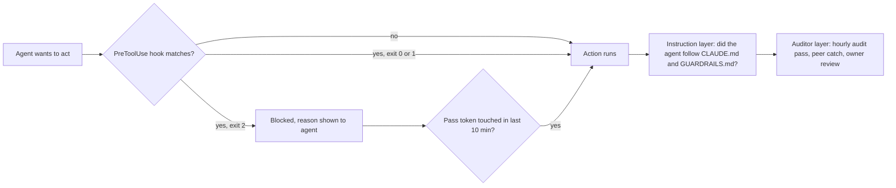
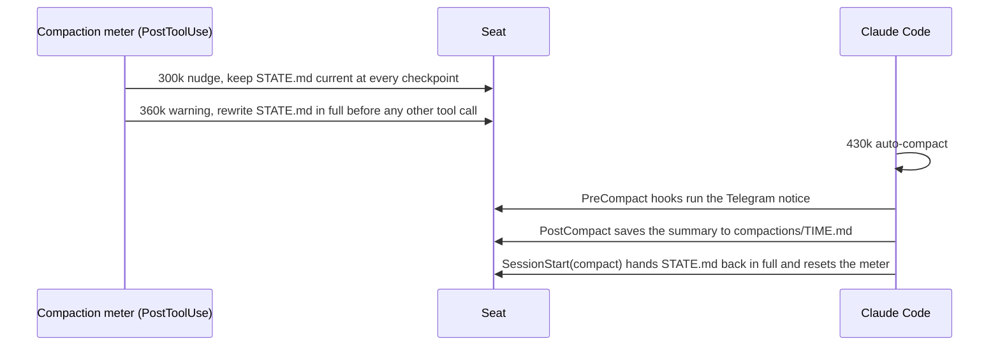
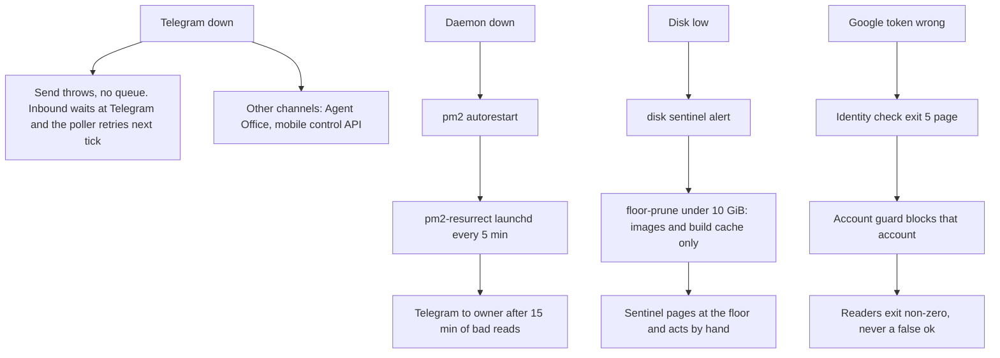

# 04. Fail-Safes and Boundaries

This document describes what stops OGL Cortex agents from doing damage, what happens when a component fails, and how the system recovers. It covers the three enforcement layers, every guard in the OGL layer, the context and compaction lifecycle, the watchdog set, failure handling per component, and the failure classes each guard defends against.

Related documents: `03-configuration-registry.md` covers how hooks are registered. `11-ai-safety-governance.md` lists the rules these guards enforce.

## Terms

- **Hook**: a script Claude Code runs at a fixed moment: before a tool call (PreToolUse), after one (PostToolUse), at compaction (PreCompact, PostCompact), at session start (SessionStart), on each prompt (UserPromptSubmit) or at session end (SessionEnd, Stop).
- **Block**: a PreToolUse hook stops a call only when it exits with code 2. Claude Code treats any other non-zero exit code as a non-blocking error, and the call still runs. Every blocking guard in OGL Cortex exits 2 on purpose. This is the most important fact in this document.
- **Pass token**: a file the agent touches to let one blocked command through. It is consumed on use and expires after 10 minutes.
- **Fail closed / fail open**: when the guard itself crashes, "closed" blocks the command and "open" lets it run.
- **Seat**: one running Claude Code agent with its own folder under `$CORTEX_HOME/orgs/<org>/agents/<seat>/`.
- **Roles**: the orchestrator (the seat the owner talks to), specialists (builder, analyst and other workers), the auditor (checks claims and gates installs) and the sentinel (watches machine health).
- **Compaction**: Claude Code squeezing a long conversation into a summary so it fits the model's context window.

---

## 1. Rule enforcement: three layers

Every rule in OGL Cortex is held by one or more of three layers:

1. **Mechanical**: a hook or wrapper script refuses the action. It works even when the agent forgets the rule.
2. **Instruction**: the rule is written in `CLAUDE.md`, `GUARDRAILS.md`, `MEMORY.md` or a skill. It works only if the agent reads, remembers and obeys it.
3. **Auditor**: another party checks after the fact. The auditor seat runs hourly passes, peers log catches in a truth ledger, and the owner approves risky actions.

The design principle is "prefer guards that work when you are wrong about yourself". A rule that fails under instruction alone is a candidate for a mechanical guard.

### 1.1 Where hooks are registered

Hooks load from two settings scopes. Each scope fences a different set of sessions.

| Settings file | Scope | Default OGL Cortex content |
|---|---|---|
| `~/.claude/settings.json` | Every Claude Code session for that OS user, including desktop sessions the owner opens by hand | Nothing by default. With `harness/install.sh --user-level`: the ship gate, shared-surface guard and Orwell send-lint, in `~/.claude/hooks/ogl/` |
| `$CORTEX_HOME/orgs/<org>/agents/<seat>/.claude/settings.json` | Sessions started in that seat folder | The framework template hooks (Telegram relays, loop detector, idle flag, crash alert, compaction notice) plus the OGL block from `harness/settings.example.json`, merged by `harness/install.sh`. Hook scripts live in `<seat>/.claude/hooks/ogl/` |

Default guard placement:

| Guard | Seats that load it |
|---|---|
| Shared-surface guard | All seats. The builder runs full block mode; other seats start with `SURFACE_CODE_MODE=warn` for the code-analysis rule |
| Orwell send-guard | Every seat that writes to a human |
| Brief guard, future-time guard, compaction kit | The orchestrator, and any seat with long sessions |

Option: a guard registered only in seat settings does not fence a desktop session the owner starts outside the seat folders. To put home-wide cleanups behind the same fences, also register the shared-surface guard in `~/.claude/settings.json` and give the owner a personal pass token.

### 1.2 Mechanical guards

The command-line tool is named `cortextos`.

| # | Guard (file) | Event and matcher | What it blocks | Mode | How to release | Tests |
|---|---|---|---|---|---|---|
| 1 | Shared-surface guard (`<seat>/.claude/hooks/ogl/shared_surface_guard.py`, parser `surface.py`, code reader `codewrites.py`) | PreToolUse, Bash | Commands that change things every seat depends on: writes or deletes under `~/.claude`, `~/.claude.json`, the shared uv cache and any root listed in `OGL_SURFACE_EXTRA_ROOTS` (for example an MCP credential folder); `uv cache prune` and `uv cache clean`; global npm and pnpm installs; `brew upgrade` | Block (exit 2). Code-analysis hits are warn-only on seats in warn mode. A detected write to a guarded root blocks in every mode | `touch ~/.ogl-cortex/state/.surface-pass-once-<seat>`, one use, 10 minutes. If the guard crashes on a guarded path it blocks, and the token does not apply | `--selftest`. Release suites carry block and allow rows, mutation tests, and a replay of a recorded command corpus that must show zero verdict changes |
| 2 | Orwell send-guard (`<seat>/.claude/hooks/ogl/orwell_lint.py`) | PreToolUse on Bash and on MCP send tools (mail send, CRM send-message, social create-post, reply, forward, create-draft) | Outgoing human-facing text that breaks Orwell's six rules or uses em or en dashes. Deterministic, no model involved | Block (exit 2) | `touch ~/.ogl-cortex/state/.orwell-pass-once-<seat>` (the rule 6 exception). A crash on a send fails closed | `--selftest`, `harness/tests/test_orwell_lint.py` |
| 3 | Brief guard (`<seat>/.claude/hooks/ogl/brief_guard.py`) | PreToolUse, Bash | `cortextos bus create-task --assignee <other agent>` whose description lacks the four lines TASK, FILES, BAR, RETURN | Block (exit 2). Crash in scope fails closed; out of scope fails open | None. Rewrite the brief | `harness/tests/test_brief_guard.py` |
| 4 | Future-time guard (`<seat>/.claude/hooks/ogl/future_time_guard.py`) | PreToolUse, Bash, Write, Edit | A UTC clock stamp more than 3 minutes in the future written to `memory/`, `STATE.md`, or a `send-telegram` / `send-message` call | Block. Fails open on any error: it is a tripwire, not a gate | None | `--selftest` |
| 5 | Pentest ship gate (`<seat>/.claude/hooks/ogl/ship_gate.py`) | PreToolUse, Bash (seat or user level) | `git push`, `vercel --prod`, `vercel deploy`, `npm publish`, `wrangler deploy`, `scp` and `rsync` to a remote, unless `security/pentest-gate-report.json` with `"status": "pass"` exists | Block (exit 2). See 1.3 | `OGL_PENTEST_OVERRIDE=accepted-risk` in the session environment plus `security/pentest-risk-acceptance.md` | `harness/tests/test_ship_gate.py`; see 1.3 |

Wrapper gates are scripts the agent calls. They are mechanical only when used:

| Wrapper | What it enforces |
|---|---|
| `harness/tools/ship.sh` | Runs your pentest gate command, deploys, and re-checks production (HTTP 200 plus the gate again with the live URL). With `--promote-cmd` it gates a preview candidate and promotes only on pass. Exit map: 0 shipped, 2 usage error, 3 pre-deploy gate failed, 4 deploy failed, 5 live and wrong, 6 candidate failed, 7 promote failed |
| `harness/tools/emit-truth-correction.sh` | Validates every truth-ledger entry: canonical kind, catcher derived from a real message id, unique dedupe key, real past timestamp, and a dry-run flag that cannot be swallowed |
| `harness/tools/brief_audit.py` | Lists every file a worker wrote in the task window and marks each IN, tmp or OUT of the brief's FILES line, before the orchestrator accepts the return |
| Guarded KB ingest (optional, not included) | A wrapper that refuses a knowledge-base ingest that would not replace by source, so repeated ingests cannot pile up duplicate chunks |

Non-guard hooks shape context and refuse nothing: Telegram relays for permission prompts, plan mode and questions; idle flag and crash alert; compaction meter, state hand-back and summary saver. Optional hooks not included in this repository fit the same slot: a PreCompact checkpoint, session-start injection, a session digest, prompt-time recall and routing, and a post-commit trigger for `harness/tools/adversarial-pass.sh`. Keep UserPromptSubmit hooks fast: their run time is added to every prompt.

The shared-surface guard and the Orwell send-lint write logs under `$OGL_STATE_DIR` (default `~/.ogl-cortex/state/`: `surface-guard.log`, `orwell-lint.log`). Each line carries a verdict (PASS, BLOCK, WARN, NOTE, shadow, pass-once, FAIL-CLOSED, FAIL-OPEN) and the seat. A guard counts as live only after a real call leaves a line in its log.

### 1.3 Ship gate requirements

The ship gate is the guard most likely to look stronger than it is. It meets these requirements:

- **Exit 2 on block.** A hook that prints "BLOCKED" and returns 1 does not stop the command.
- **Match every deploy form.** `vercel --prod`, `npx vercel --prod --yes` and `vercel deploy --prod` are all production deploys. A pattern that requires the word `deploy` misses the first two.
- **Bind the report to the tree.** A pass report in any parent folder with no date check lets any command under that folder through. Require the report to be newer than the last change in the tree being shipped, or route every deploy through `harness/tools/ship.sh` and block raw `vercel`.
- **Prove it with a sink.** Feed the hook a payload that must be refused and check the exit code is 2. A passing selftest does not prove the live hook blocks.
- **Never let a wrapper rewrite a verdict.** Risk acceptance lives in a separate file. The report always carries the true verdict.

### 1.4 Shared-surface parser coverage

The shared-surface guard ships with a release process: the builder writes the change, the auditor gates it with a written report, and the install happens only on the auditor's PASS. The parser treats each of these forms as a delete or write, and each is a test row:

| Class | Forms |
|---|---|
| Flag variants | `uv -q cache prune`, `uv cache clean --force` |
| Brace expansion | `rm -rf ~/{.cache,x}/uv` |
| Alternate delete verbs | `trash`, `osascript` Finder "delete POSIX file" |
| `find` deletes | `find ... -delete`, `find ... -exec rm`, `find | xargs rm`, destructive writes through `find -exec` |
| Root as parent | `rm -rf /` counts as touching every protected root |
| Session memory | Deletes of a seat's `~/.claude/projects/<project>/` folder, its `memory/` folder, `MEMORY.md` or any `.jsonl` transcript. Writes stay allowed |

The code-analysis rule ships warn-only and flips to block per seat after a 48-hour window with zero false positives. Schedule that readout as a one-shot cron.

### 1.5 No inline LLM judge

Every PreToolUse guard is deterministic Python. There is no inline LLM judge and no classifier model in the tool path. Model-based checks run after the fact:

- the adversarial pass (`harness/tools/adversarial-pass.sh`), a fresh read-only Claude session that attacks one claim, never blocking;
- the `auditor` subagent type, a read-only checker the orchestrator uses before saying "done";
- the auditor seat, a full Claude seat doing hourly audits (1.7).

This keeps the tool path fast and its verdicts reproducible.

### 1.6 Rules held by instruction only

These rule classes have no hook behind them by default. They hold only if the agent remembers them. Each is a candidate for a guard.

| Rule class | Where written | Mechanical cover |
|---|---|---|
| No website change without the owner's explicit approval | `GUARDRAILS.md` | None checks for an approval id. The ship gate checks security, not approval |
| Approval for external comms, financial, deployment, data deletion | `config.json` `approval_rules.always_ask` | Limited. Seats run with `--dangerously-skip-permissions`, so PermissionRequest relays rarely see a prompt |
| Never edit your own bootstrap files, skills or core | `GUARDRAILS.md` | Partial. The surface guard covers `~/.claude`, not a seat's own `CLAUDE.md`, `AGENTS.md` or `.claude/skills` |
| Secrets never over chat | `GUARDRAILS.md` | None at send time. The pentest gate's TruffleHog scan covers shipped trees only |
| Owner-facing dates in the owner's time zone, never raw `date -u` | `STATE.md` clock rule | Partial. The future-time guard catches only future UTC stamps |
| Every number carries its source | `STATE.md` | None by default. An optional attribution lint (not included) can block narrow forms |
| List the whole DNS zone before a nameserver switch; add then delete | `GUARDRAILS.md` | None |
| Address UI controls by identity, never by a CSS state selector | `GUARDRAILS.md` | None |
| Ask before any shared `~/.claude` skill install | `GUARDRAILS.md` | Partial. The surface guard blocks once; the agent can self-release |
| "Stop" means stop; no screen input without a go | `STATE.md` | None |
| Status lists come from task rows, not a compaction summary | auto-memory | None |

Pass tokens are a speed bump, not an approval. The agent that was blocked can release itself. The value is a forced second step and a log line the auditor reads.

### 1.7 Rules held by a person or an auditor seat

| Party | What it does |
|---|---|
| Auditor seat | `forensic-audit-pass` every hour: scans the last 60 minutes of bus events and messages for unverified claims, writes coaching into the offending agent's memory, escalates high-severity items to the owner. Gates every guard install with a written GATE-REPORT. Keeps a daily digest and a false-claim catch-rate metric |
| Truth ledger | Every caught false claim is logged as a `truth_correction` event of kind `peer_catch`, `self_correction` or `principal_catch`, through the validator script |
| Analyst seat | Hourly `orphan-guard` sweep (daemon, stray processes, a "running is not emitting" check for control-tier seats), nightly metrics, daily theta-wave improvement cycle |
| Owner | Approves deploys, client sends, spending and access changes. Approvals arrive on Telegram or in the Agent Office from the owner's account |

---

## 2. Tokens and context

### 2.1 Settings

| Setting | Default | Where |
|---|---|---|
| Model and window | `claude-opus-5-5[1m]`, 1,000,000 tokens | `config.json` `model`; daemon state `context_status.json` |
| Claude Code auto-compaction point | 430,000 tokens | `.claude/settings.json` `autoCompactWindow` |
| Compaction meter | nudge at 300,000, warn at 360,000, "limit" label at 400,000 | `.claude/hooks/ogl/compaction/compaction.json` |
| Daemon context thresholds | warn 80%, hand-off 88% of the window | `config.json` `ctx_warning_threshold`, `ctx_handoff_threshold`; logic in `src/daemon/fast-checker.ts` |
| Planned session rotation | 255,600 s = 71 hours | `config.json` `max_session_seconds`; `src/daemon/agent-process.ts` |
| Crash cap | 10 crashes per day | `config.json` `max_crashes_per_day` |
| Status line | `cortextos bus hook-context-status`, refresh 5 s | `.claude/settings.json` `statusLine` |

Interaction: with a 1M window and auto-compaction at 430k, the daemon's 80% and 88% thresholds (800k and 880k) are not reached in normal use. The meter plus auto-compaction do the work. The daemon path that still applies is the hard overflow check, which force-restarts a seat when the terminal shows an overflow error and usage corroborates it. If you lower the window or raise `autoCompactWindow`, recheck which threshold fires first.

### 2.2 What happens as context fills

### 2.3 What is lost and how it comes back

| Lost at compaction | How it comes back |
|---|---|
| Exact tool output, file contents, reasoning | Not recovered. The Compact Instructions in `CLAUDE.md` tell the summary to drop tool output already acted on |
| Current checkpoint, promises to the owner, live changes and rollbacks, dead ends, owner rules | `STATE.md`, handed back in full after every compaction |
| What survived in the summary | `compactions/<time>.md` |
| Last exchanges before compaction | An optional PreCompact checkpoint hook (not included), for example into `memory/checkpoints/latest.md` |
| The current day's work log | The daily memory file, read at session start per the boot checklist |
| Session as a whole | An optional session digest on PreCompact and SessionEnd (not included) |

Implementation note for checkpoint hooks: a shell hook that runs `python3 - << 'EOF'` gives Python the script on stdin, so the hook's JSON payload never arrives and `transcript_path` is empty. Pass the script as a file or with `-c`, read the payload from stdin, write to a dedicated file rather than a shared boot card, and write nothing when zero messages are captured. Test with a real hook payload. Alert when a checkpoint reports zero messages.

### 2.4 Session rotation and restarts

The daemon restarts each seat after `max_session_seconds` with `--continue`, which keeps the conversation. The timer re-reads `config.json` on each fire, so a changed value takes effect without a daemon restart. After a daemon restart every seat comes back with `--continue` and re-reads its bootstrap files.

Daemon commands take `--instance <instance>`. Without it the CLI targets the `default` instance and can report "Daemon is not running" while your instance is up.

---

## 3. Fallback behaviour

### 3.1 Watchdog set

Run watchdogs that must survive a dead or capped agent session under launchd (or systemd), not as agent crons. Agent-session crons stop when the seat stops.

| Watchdog | Runs as | Watches | Action on a trip |
|---|---|---|---|
| Disk and swap watch | launchd, owned by the sentinel seat | Free disk every 60 s; swap file count; swap free | Messages the orchestrator and wakes the sentinel at a configurable floor (for example 7 GB free or 17 swap files) |
| disk sentinel | launchd | Disk states: ok at 20 GiB or more, warn, critical under 10, emergency under 5 | Alerts on a state change; re-pings if stuck over 2 h. Never deletes |
| floor-prune guard | launchd | Disk under 10 GiB | Prunes Docker images and build cache only, never volumes, with a cooldown; tells the orchestrator |
| heartbeat-sentinel | launchd | Wedged seats | Alarms the orchestrator, pokes idle seats, circuit breaker on mass idle |
| session-liveness watch | launchd | A seat whose model session is up but dark (for example on a usage cap) | Alerts; never restarts |
| daemon-storm watch | launchd, 15 s cadence | Two or more daemon stops in 60 s | Alerts with a 180 s re-ping guard |
| daemon-commander watch | launchd | Who runs `pm2 restart` on the daemon | Logs the caller's process chain. Observe only |
| pm2-resurrect check | launchd, every 5 min | Daemon not online in `pm2 jlist` | Resurrects only on a clean read; pages the orchestrator on a bad read; after 15 min of bad reads, sends one Telegram to the owner without the daemon |
| Credential identity check | Builder cron plus a launchd backstop | That each Google credential file holds the account it is named for; hashes of settings and hook files | Exit 5 on mismatch: pages once per episode and feeds the account guard's block list |
| Crash-alert relay | Builder cron, hourly | Crash alerts the framework writes | Relays undelivered alerts; reports relay failure by exit code |
| Claude auth sentinel | pm2, every 20 min, inside the login session | That Claude answers "ok" | Alerts on any other answer. A usage-cap answer is classed `kind=cap`: one page per outage with the reset time |
| Orphan guard | Analyst cron, hourly | Daemon pid, stray model servers, control-tier seats that run but do not emit | Flags HIGH only on control-tier down or unexpected processes |
| Fast-checker idle heartbeat | Inside the daemon, every 50 min per seat | Seat idle | Writes "[watchdog] <agent> alive" (`src/daemon/fast-checker.ts`) |
| Business pollers | Seat crons | Inboxes, booking feeds, traffic | Exit-code maps: 0 is ok and every other code names a distinct failure (nothing read, send failed, credential mismatch, partial read). A crashed poll never looks like a quiet one |
| Site uptime watch | launchd | Each production site answers | Pages on a site down. It cannot see billing state; pair it with a billing check |
| Domain-expiry sentinel | launchd | WHOIS expiry dates | Routes early warnings to the orchestrator |

### 3.2 Failure by failure

**Telegram fails.** The send call throws on error and has no retry queue. A 429 rate limit is logged as a warning (`src/telegram/api.ts`). The poller fetches inbound messages and recovers next tick, so messages wait on Telegram's side. Fallback channels are the Agent Office and the mobile control API. Route every send through `cortextos bus send-telegram`: raw `curl` sends never reach `outbound-messages.jsonl` and leave no record.

**The daemon fails.** pm2 restarts it. If pm2 cannot be read, the launchd resurrect check pages the orchestrator, then the owner. Restart storms page within 15 s.

**An MCP server fails.** There is no built-in MCP watchdog. Add a session-start check that names failed MCP servers in the seat heartbeat, and remove dead entries from `~/.claude.json`. A stdio server whose command is a URL cannot start. The fallback for the knowledge layer is reading the source notes directly. Shared toolchain caches are a single point of failure: one `uv cache prune --force` can break every running `uvx` MCP server at once, which is why the surface guard blocks it.

**The dashboard fails.** The dashboard is a viewer. The bus, crons and Telegram work without it. Run it as a production build (`next build` then `next start`) and add it to the uptime watch if you depend on it.

**Google auth fails.** The identity check detects a credential file that holds the wrong account and pages once. The account guard then blocks that account in the MCP. Readers use the on-disk token, check the token's email and refuse a mismatch, so alerts exit non-zero instead of reporting a false read.

**Hosting billing fails.** An uptime watcher cannot see payment state. Track invoices separately.

**Disk fills.** Alert under 20 GiB, automatic prune of Docker images and build cache under 10 GiB, page at the floor. Nothing deletes agent data on its own. A full disk can corrupt a Docker VM and lose every container and volume, so keep the floor generous.

**Swap fills.** The sentinel pages at a swap-file threshold. Relief is manual: drop caches inside the Docker VM, restart Docker, stop stray crawls. While swap is high, hold heavy jobs (deploy scans, local browsers, local speech models).

**A cron fails.** The daemon owns schedules. A missed heartbeat write produces "Cron gap detected" nudges every 10 minutes. Write cron prompts to verify by receipt, never by silence. An interval cron as long as the heartbeat interval never fires, so long jobs use wall-clock five-field schedules (`src/bus/crons.ts`).

**Backups.** Decide per database whether it needs running backups. If you disarm backup jobs, keep frozen encrypted dumps and a written restore procedure, and record the decision.

---

## 4. Failure classes and the guard for each

Each guard exists to stop a class of failure. This table maps class to defence and says whether the defence is mechanical.

| # | Failure class | Mechanism | Defence | Mechanical? |
|---|---|---|---|---|
| 1 | A home-wide cleanup from an unfenced session deletes agent evidence and restarts the daemon | The session loads only user-level settings | Surface guard covers `find` deletes and `~/.claude/projects`; optional user-level registration | Partly. Seat sessions only unless registered at user level |
| 2 | A large download fills disk and swap mid-task | Downloads are not guarded | Pre-flight size check for any download over 1 GB; notify the sentinel first | Alert only |
| 3 | A delete form the parser does not know reaches a protected root | Parser gap | Parser coverage table (1.4) and replay suites | Yes, for seats |
| 4 | A shared cache prune breaks every running MCP server | `uv cache prune --force` overrides the in-use lock | Shared-surface guard | Yes (block once, then self-release) |
| 5 | A credential file holds the wrong Google account and readers report the wrong inbox as read | An MCP-started OAuth window completes with the wrong signed-in account | Readers check the token email; an optional account guard (not included); identity check | Partly |
| 6 | A seat goes dark on a usage cap and alerts point at the wrong fix | A cap answer looks like a login failure | Sentinel `kind=cap` branch; quota ledger every 10 min | Detection only |
| 7 | A full disk resets the Docker VM | Disk fills during a build | Disk alerts and auto-prune | Partly |
| 8 | Sentinels vanish silently and still read as live | Untracked files inside a git repo are removed by `git clean` | Sentinels live outside any repo | Yes, by placement |
| 9 | A checkpoint hook writes empty checkpoints | Heredoc takes stdin from the hook payload | See 2.3 | Alert on zero |
| 10 | A guard is reported live before the running session has loaded it | Settings edited mid-session are not reloaded | A guard is live only after a real call leaves a log line | Rule |
| 11 | Sends built in `$MSG` variables or heredocs skip command-text guards | Guards read the Bash command text, not the final message | Send-boundary lint inside `cortextos bus send-telegram` | Planned |
| 12 | Production deploy before the gate, ungated previews, a client file on a public URL | Gate depends on vigilance | `harness/tools/ship.sh`, preview then promote | Yes, when used |
| 13 | A site launches without search indexing | No launch step asks | An indexing and noindex check inside your gate command (`ship.sh --gate-cmd`) | Only if your gate checks it |
| 14 | A DNS move drops records | Expected records are copied, not the zone | List the whole zone; add then delete | No |
| 15 | A UI automation loop toggles live switches | Controls addressed by state, not identity | Address controls by identity; read the result after | No |
| 16 | Wrong dates or unsourced numbers reach the owner | `date -u` read as the owner's calendar; numbers stated from memory | Clock rule; future-time guard; optional attribution lint (not included) | Partly |

Smaller patterns: cron cannot reach the login keychain, so a sentinel that needs it runs inside the login session; a lint that reads only line 1 of a multi-line send misses the rest; a watcher that stops on one failed account stops on all of them unless it counts failures per account; a gate run from the wrong folder can scan gigabytes.

---

## 5. Known limitations

1. Command-text guards do not see what interpreted code (Python, Node, AppleScript, JXA) does at run time, or paths assembled at run time.
2. Pass tokens are self-released. They log; they do not authorise.
3. No guard checks for an approval id before a website deploy.
4. Seats run with `--dangerously-skip-permissions`, so the permission relay sees few prompts. Approval gates rely on the bus and on instruction.
5. There is no MCP watchdog and no automatic restart of failed MCP servers.
6. Heartbeat rows for parked or retired seats go stale but can still read "online". Prune retired agents from the fleet view.
7. The daemon's idle watchdog heartbeat lands on a row named after the instance rather than the seat if the heartbeat call lacks the seat identity.
8. One-shot crons do not remove themselves unless the prompt does it. Give them an end date or a checked self-remove step.
9. Claude Code cuts auto-memory indexes over 200 lines at load. Keep the index short.
10. Logs grow without bound unless added to a rotation job.
11. The cron store lives under the instance state folder (`~/.cortextos/<instance>/.cortextOS/state/agents/<agent>/crons.json`). Templates that name `${CTX_ROOT}/state/<agent>/crons.json` describe an older layout.

## 6. Risk table

Likelihood (L) and impact (I) are scored 1 to 5 for a typical single-owner install. Score = L x I. These are judgments.

| Rank | Risk | L | I | Score | Recommended control |
|---|---|---|---|---|---|
| 1 | A deploy reaches production without a gate pass | 4 | 5 | 20 | Ship gate exits 2, matches every deploy form, binds the report to the tree; or block raw `vercel` and require `harness/tools/ship.sh`. Prove with a sink deploy that must be refused |
| 2 | The host runs out of disk or memory mid-task | 4 | 4 | 16 | Permanent launchd disk and swap watch; pre-flight size check on large downloads; log rotation; scheduled host and Docker restarts |
| 3 | A human or desktop session deletes agent data | 3 | 5 | 15 | Register the surface guard at user level with an owner pass token, or keep agent evidence outside paths a cleanup sweeps |
| 4 | A false claim reaches the owner (dates, numbers, "done") | 5 | 3 | 15 | Send-boundary lint; local-date check on the send path; hourly audit |
| 5 | Context lost at compaction | 5 | 2 | 10 | Working PreCompact checkpoint, tested with a real payload; `STATE.md` discipline |
| 6 | A usage cap takes a seat down before a dated event | 2 | 5 | 10 | Quota ledger with a page at a set level (for example 90%) when an event falls before the reset |
| 7 | A shared credential is overwritten or a wrong account is read | 2 | 4 | 8 | An account guard (optional, not included) on every seat that uses the MCP; identity check |
| 8 | A silent knowledge-layer outage leads agents to answer from memory | 4 | 2 | 8 | Session-start MCP health line in the heartbeat; remove dead MCP entries |
| 9 | A shared toolchain breaks for all seats | 2 | 4 | 8 | Surface guard in block mode after the readout window; audit self-release tokens |
| 10 | Database loss with no current backup | 1 | 4 | 4 | Decide per database; arm backups for anything live |
| 11 | A one-shot cron fires again later | 1 | 2 | 2 | End date or a checked self-remove step |

## Design notes

- User-level registration of the surface guard fences every session, including the owner's. Leaving it seat-only keeps owner sessions free and leaves agent evidence open to cleanups.
- A hard ship gate at user level refuses every deploy that lacks a fresh pass. Turn it on knowingly.
- The send-boundary lint closes the variable and heredoc bypass. It changes `cortextos bus send-telegram` and ships with a test that drives it to fail once.

## Source files

- `src/daemon/fast-checker.ts`
- `src/daemon/agent-process.ts`
- `src/daemon/agent-manager.ts`
- `src/telegram/api.ts`
- `src/bus/crons.ts`
- `src/hooks/hook-context-status.ts`
- `src/hooks/hook-permission-telegram.ts`
- `src/hooks/hook-planmode-telegram.ts`
- `src/hooks/hook-extract-facts.ts`
- OGL layer: `harness/hooks/shared_surface_guard.py`, `harness/hooks/surface.py`, `harness/hooks/codewrites.py`, `harness/hooks/orwell_lint.py`, `harness/hooks/brief_guard.py`, `harness/hooks/future_time_guard.py`, `harness/hooks/ship_gate.py`, `harness/hooks/compaction/`; tools in `harness/tools/`
