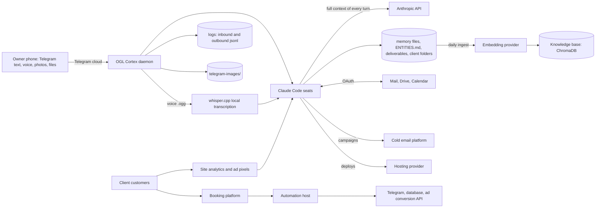

# 12. Data Privacy and Compliance

This document describes what personal and client data flows through OGL Cortex, where it is stored, how long it stays, which outside services receive it, and what an operator needs in place for GDPR, CCPA, Mexican privacy law, US marketing law and SOC 2. Secrets handling is in `11-ai-safety-governance.md` section 7. Vendors are profiled in `13-vendor-risk.md`.

## Scope and terms

An enterprise privacy programme has a Data Protection Officer, a record of processing activities, data processing agreements with every vendor, retention schedules, subject-access workflows and annual audits. OGL Cortex ships none of these. It is built for one owner. It does hold real personal data (the owner's messages, clients, their customers, sales leads), so an operator who uses it for client work should add the controls in section 7.

- **Personal data**: anything that identifies a person: name, email, phone, voice, face, booking.
- **Processor**: a company that handles data on your behalf. Anthropic processes everything a seat reads.
- **Retention**: how long data is kept before deletion.

---

## 1. Shape of the system

OGL Cortex runs on one host under one OS user account. Every seat runs as that user, so every seat can read every file that user can read. Seats share `~/.claude` and `~/.config`. There is no per-seat file isolation.

The arrows to outside companies matter most. The model provider sees everything a seat reads. The embedding provider sees what is ingested into the knowledge base. Telegram carries every message between the owner and the fleet.

## 2. Data inventory

Paths are install-relative. `<instance>` is the daemon instance name; `<org>` and `<seat>` are folder names under `$CORTEX_HOME/orgs/`.

### 2.1 Owner messages and media

| Store | What it holds | Default retention | Source |
|---|---|---|---|
| `~/.cortextos/<instance>/logs/<seat>/inbound-messages.jsonl` | Every Telegram message received by a seat (text; voice and photos noted as placeholders) | Kept from first boot. No rotation | `src/telegram/logging.ts` |
| `~/.cortextos/<instance>/logs/<seat>/outbound-messages.jsonl` | Every Telegram message a seat sent through the bus | Kept from first boot. No rotation | `src/telegram/logging.ts` |
| `~/.cortextos/<instance>/logs/` | stdout, crash and restart logs per seat | No rotation | daemon |
| `<seat>/telegram-images/` | Photos, files and voice `.ogg` files the owner sends | No rule. Kept until deleted | `src/telegram/media.ts` |
| Voice transcripts | Transcribed locally by whisper.cpp (`whisper-cli`). The default model is `~/.cortextos/models/ggml-tiny.en.bin`; override with `CTX_WHISPER_MODEL`, set the language with `CTX_WHISPER_LANG`, disable with `CTX_TELEGRAM_NO_TRANSCRIBE=1`. Audio never goes to a cloud speech service. The transcript text enters the seat's context, so it reaches the model provider | Lives in session transcripts and memory | `src/telegram/transcribe.ts` |
| Claude Code session transcripts | Every turn of every seat, including tool output | Local `.jsonl` files under `~/.claude/projects/` with no rotation; provider-side retention per the provider's terms | Claude Code |

The daily git auto-commit excludes `telegram-images/`, `node_modules/` and similar folders, and refuses files that match common credential patterns (`src/bus/system.ts`). Media are not copied into git.

Retention and evidence pull in opposite directions. Approval receipts often cite a file in `telegram-images/`. If a retention job deletes media, those receipts point at nothing. Pick a retention window longer than your audit window, or copy cited files to a receipts folder before deletion.

### 2.2 Memory and knowledge layers

| Store | What it holds | Leaves the host? |
|---|---|---|
| Seat memory: `MEMORY.md`, `memory/*.md`, `memory/topics/incidents.md` | Working notes, lessons, daily logs | Yes: read into model context; `MEMORY.md` and the daily file are ingested into the knowledge base by the `kb-ingest-daily` cron |
| `ENTITIES.md` | The noun index: one entry per person, company, place, with source and date. In client work it holds names, emails, phone numbers, prices and contract terms | Yes: loaded into the orchestrator at boot and ingested |
| Org knowledge base | Chunks and embeddings of ingested documents, which can include client transcripts | Yes: embeddings and document reads go to the configured embedding provider through `GEMINI_API_KEY` |
| Optional external brain (PGLite, Obsidian vault) | Structured pages, notes | Local unless configured otherwise |
| Claude auto-memory | Claude Code's per-project memory folder | Read into context |
| Memory backups and snapshots | Copies made before consolidation passes | Local |

### 2.3 Email, files and calendars

| Access | How | Who reads it |
|---|---|---|
| Google Workspace MCP | One OAuth credential file per account in the MCP credential folder | Seats through the MCP; scripts through the on-disk token |
| Desk and billing readers | Read-only Gmail and Calendar reads on a schedule | Cron-driven scripts |
| claude.ai connectors | Mail, calendar, drive, design and ad tools attached to the Claude account | Any seat signed in to that account |
| Shared folders | Client upload folders | Seats |

Keep each account's token readable only by the code that needs it. An account guard and an identity check (optional, not included; see `04-failsafe-boundary-log.md`) stop one account's token from being written into another account's file.

### 2.4 Client and lead data

| Store | Data subjects | Typical fields | Typical location | Where it goes next |
|---|---|---|---|---|
| Lead lists | Businesses and their owners | Company names, contacts, public registry fields, scores | `<seat>/deliverables/<project>/` and `~/Clients/<Client> - Projects/` | Cold email platform after approval |
| Client meeting data | Clients and their partners | Transcripts, exports, contact details | `<seat>/deliverables/<project>/` | Model context; sometimes the knowledge base |
| CRM | Leads and clients | CRM records | A local database, optionally exposed through a tunnel | Depends on the CRM |
| Booking system | People who book calls | Names, emails, times; calendar sync | A local database in Docker | Daily `pg_dump` to a backups folder with mode `700/600` |
| Client folders | All clients | Final deliverables and internal documents | `~/Clients/` | Sent by the owner |
| Recordings | Clients and others | Audio, video, transcripts | Local media folders | Transcripts into context |

### 2.5 Client end customers

When the fleet operates a client's booking and marketing stack, it touches the client's customers' data:

| Flow | Personal data | Processor type |
|---|---|---|
| Bookings and payments | Guest name, contact, trip, payment status | Booking platform (the client's account) |
| Booking events to the owner | Notifications | Self-hosted automation host |
| Booking persistence | Bookings and commission | Cloud database |
| Site analytics | Visitor behaviour and sessions | Product analytics, web analytics, session replay, ad pixel |
| Conversions to ad platforms | Conversion events, usually with hashed contact data | Ad platform conversion API |
| Social direct messages | Customer messages | DM automation tool |
| Ops board | Aggregated booking intent and traffic | Local poll cron |

### 2.6 Bus records

- Agent Office bridge state and action log.
- Tasks and approvals under `~/.cortextos/<instance>/orgs/<org>/tasks/` and `approvals/`. Task descriptions often name clients.
- Event log under `~/.cortextos/<instance>/orgs/<org>/analytics/events/`.

## 3. Third parties that receive data

| Service type | What it receives | Why |
|---|---|---|
| Model provider (Anthropic) | Everything a Claude seat reads or writes: messages, memory, client files, transcripts, lead lists opened in a session | Runs the agents |
| Telegram | All owner-to-fleet chat, voice notes, photos, files | Control channel |
| Embedding provider (Google Gemini by default) | Memory files and ingested documents | Knowledge base |
| Workspace provider | Mail, Drive, Calendar of connected accounts | OAuth access |
| Cold email platform | Lead lists and sending inboxes | Outreach |
| Hosting provider | Site code and deployed assets | Hosting |
| Booking, automation and database hosts | Client customer data | Bookings and automation |
| Analytics and ad platforms | Site visitor data | Analytics and ads |
| OpenAI (optional) | Codex sessions when Codex seats are enabled | Builds |
| Tailscale (optional) | Network metadata; Funnel exposes chosen local services to the internet | Remote access |
| MCP server operators | Whatever a seat passes to a remote MCP server | Tools |

Check which plan and terms cover each provider. Consumer and subscription terms differ from commercial terms on training use and retention. Keep a signed data processing agreement on file for any provider that processes client data under a client contract.

## 4. Retention controls

The command-line tool is named `cortextos`.

| Data | Built-in control |
|---|---|
| Completed tasks | `cortextos bus archive-tasks` moves completed tasks older than 7 days to the archive (archive, not delete) |
| Reminders | `cortextos bus prune-reminders [--days N]` |
| Database backups | Keep the newest N snapshots in the backup cron prompt |
| Telegram media | None. Add a scheduled job |
| Telegram message logs | None. Add a rotation job |
| Lead lists, transcripts, client folders | None. Set per client contract |
| Memory and knowledge base | Grows. Memory consolidation passes, if you run them, compact memory but do not delete source data |

Suggested starting values: 30 days for media, 90 days for message logs, and lead lists deleted at the end of the campaign plus the opt-out retention your email law requires.

## 5. Access and exposure

| Control | Default | Option |
|---|---|---|
| Who can command seats | Telegram `ALLOWED_USER` allowlist of numeric user ids. The daemon refuses to start Telegram without it (`src/daemon/agent-manager.ts`) | Add more ids comma-separated |
| Disk encryption | Not managed by OGL Cortex | Turn on the operating system's full-disk encryption before any client data lands on the host |
| Secret files | `~/.config/*` and credential files at mode `600` | Password manager references |
| Dashboard | Next.js app protected by `ADMIN_USERNAME` and `ADMIN_PASSWORD` in the dashboard env file | Bind to `127.0.0.1` or the tailnet only; run a production build |
| Public endpoints | None by default | Tailscale Funnel or Cloudflare tunnels for chosen services. Audit `tailscale serve status --json` and remove any mapping that points at a port with no listener |
| Git | Seat folders auto-commit locally | Keep seat repos without a public remote; memory and deliverables hold client data |

## 6. Compliance considerations

This is not legal advice. It lists which frameworks can apply to an OGL Cortex operator and what the software does and does not provide.

| Framework | When it applies | What OGL Cortex provides | What the operator adds |
|---|---|---|---|
| **GDPR** (EU) | When the fleet processes EU residents' data, for example travel clients with EU guests | Local storage; an allowlist on the control channel; an event log | Lawful-basis record, DPAs, subject-access and deletion process, breach procedure, privacy notice review |
| **CCPA / CPRA** (California) | Businesses over revenue or data-volume thresholds; California clients or leads | Data inventory (this document) | Threshold check; "do not sell or share" process if in scope |
| **CAN-SPAM** (US commercial email) | Any cold or marketing email campaign | Campaign settings: plain text, no tracking, stop on reply | Unsubscribe path and physical address in every message |
| **TCPA** (US calls and texts) | Calls, SMS or ringless voicemail | None | A written consent policy before any campaign |
| **LFPDPPP** (Mexico, private-party data protection) | Mexican businesses that handle personal data | None | An aviso de privacidad on each client site; consent and ARCO request handling |
| **HIPAA** (US health data) | Only if a client shares patient records | None | Do not route patient data through the fleet without a BAA-covered stack |
| **PCI DSS** (card data) | Only if card numbers are stored | The fleet stores no card numbers; payments run in hosted checkouts | Keep it that way |
| **SOC 2** | If a customer asks for a security report | Informal controls: pentest gate before ship, approval log, event log, backups | Written security policy, access reviews, encryption at rest, a SOC 2 audit |

Client sites built by the fleet need their own privacy and terms pages. Add a `/privacy` check to the gate command that `harness/tools/ship.sh` runs.

## 7. Recommended controls

In order of impact for an install that handles client data:

1. **Encrypt the disk.** One host holds client PII, lead lists, OAuth tokens and secrets. Full-disk encryption is the single largest protection against theft or loss.
2. **Document AI processing to clients.** Everything a seat reads goes to the model provider; ingested memory goes to the embedding provider. Add a short standard clause to client agreements.
3. **Set retention.** Rotate message logs and media on a schedule, and preserve cited receipts first.
4. **Keep personal facts out of boot files.** `ENTITIES.md` and `MEMORY.md` load into every orchestrator session and are ingested daily. Store contact details for people in the client folder, not in boot files, and keep only a pointer in `ENTITIES.md`.
5. **Close unused public endpoints.** Every tunnel or Funnel mapping is a public surface. Remove mappings to ports with no listener.

## Known limitations

- All seats run as one OS user. There is no file isolation between seats.
- Telegram logs and media have no built-in retention.
- Knowledge-base ingest sends memory content to the embedding provider; there is no per-file redaction step.
- The dashboard env file and seat `.env` files are plain text on disk.

## Source files

- `src/telegram/transcribe.ts`
- `src/telegram/media.ts`
- `src/telegram/logging.ts`
- `src/bus/system.ts`
- `src/bus/knowledge-base.ts`
- `src/daemon/agent-manager.ts`
- `src/cli/bus.ts` (`archive-tasks`, `prune-reminders`, `kb-ingest`, `kb-query`)
- `knowledge-base/scripts/mmrag.py`
- OGL layer: `harness/hooks/shared_surface_guard.py`
