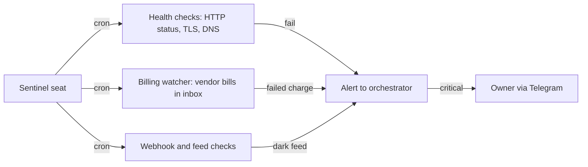

# 13. Vendor and third-party risk

This document lists the outside services OGL Cortex depends on, what each one does, what data reaches it, what fails when it stops, and how to reduce the risk. It also covers the optional integrations an owner usually adds. Which data each vendor receives in detail is in `12-data-privacy-compliance.md`. How the system is built is in `01-core-architecture.md` to `04-failsafe-boundary-log.md`.

## How to use this document

An enterprise vendor programme has questionnaires, SOC 2 reports, contract reviews and annual re-assessment. A one-owner install needs a lighter version of the same thing:

| Enterprise practice | OGL Cortex equivalent |
|---|---|
| Vendor inventory | Your copy of the tables below, kept in the org `knowledge.md` |
| Continuous monitoring | A sentinel seat plus watcher crons (section 6) |
| Billing and renewal tracking | A billing-alert cron that reads vendor bills from your inbox |
| Contract and DPA review | Read each vendor's data terms once, before the first client data reaches it |

Tiers:
- **Tier 1**: if it stops, the fleet stops or the owner loses the control channel.
- **Tier 2**: if it stops, a client site, booking flow or paid campaign stops.
- **Tier 3**: a tool or convenience. Work slows; nothing customer-facing breaks.

---

## 1. Tier 1: required foundations

The command-line tool is named `cortextos`.

| Vendor | Role in OGL Cortex | Data sent | If it stops | Risk controls |
|---|---|---|---|---|
| **Anthropic (Claude, Claude Code)** | Runtime for every `claude-code` seat | Everything a seat reads or writes | Seats stop reasoning. The daemon and crons keep firing into idle sessions | Pin the Claude Code version and trial upgrades on one seat. Watch the weekly usage cap; a cap-out looks like a hung seat. Configure OAuth account rotation (`cortextos bus list-oauth-accounts` shows the pool) |
| **Telegram** | Control channel. One bot per seat | All owner-to-fleet traffic, voice notes, photos, files | The owner cannot direct the fleet by phone | `ALLOWED_USER` fail-closed check. Keep a second channel: the dashboard and a private-network control surface |
| **Host OS and hardware** (macOS or Linux) | Runs the daemon, seats, dashboard and all state | All of it | Everything stops | Disk encryption on. Off-machine backups of `$CORTEX_HOME` and the org folder. Free-disk alerts |
| **Package registries** (npm, PyPI, Homebrew, uv) | Installs Claude Code, the framework, MCP servers launched with `npx` or `uvx`, Python tools | Package requests | New installs and on-start MCP servers fail | Pin MCP server versions instead of fetching latest at start. Block global cache prunes and global installs behind a guard hook (document 04) |
| **GitHub** | Upstream framework repo; CI (`ci.yml`, `leak-guard.yml`); private repos | Code and history | Upstream updates stop. Running seats are unaffected | Scan history for secrets before any repo goes public. Gate `git push` with the ship gate hook |
| **Google Gemini API** | Knowledge base embeddings (`gemini-embedding-2-preview` by default) and multimodal PDF ingest, via `knowledge-base/scripts/mmrag.py` and `GEMINI_API_KEY` | Every document ingested into the KB, and every query | `cortextos bus kb-ingest` and `kb-query` fail | Watch for `kb_ingest_failed` events. A billing hold on the Google Cloud project returns permission errors that look like code bugs; check billing first |

## 2. Tier 2: common hosting and client-facing integrations

None of these is required by the framework. They are the services an owner typically wires in. Replace the names with your own stack.

| Category | Typical vendors | Role | If it stops | Risk controls |
|---|---|---|---|---|
| Static and serverless hosting | Vercel, Netlify, Cloudflare Pages | Client and owner websites; candidate deploys for the ship gate | Every hosted site can go dark at once on an account-level billing hold | Ship through the wrapper only (document 14). Billing watcher. A second card on critical accounts. After an alias change, the edge can serve the old deploy for a few minutes |
| DNS, CDN, storage, tunnels | Cloudflare (DNS, R2, Stream, `cloudflared`) | Domains, media, tunnels to local services | Media disappears; tunnelled services drop | Track renewal and deletion deadlines. Quick tunnels change URL on restart; use named tunnels (`cortextos tunnel start`) for anything persistent |
| Private network | Tailscale (Funnel, Serve) | Exposes local services publicly or to the owner's devices | Remote control surfaces go offline | Review exposed ports on a schedule. Remove any Funnel mapping whose local port has no listener |
| Containers | Docker Desktop | Local services such as a booking system | The service and its data volume | Never treat a container disk image as a cache to reclaim. Back up volumes |
| Workflow automation | n8n (self-hosted or cloud) | Webhooks, booking alerts, conversion events | Alerts stop reaching the owner without error | Health-check each workflow endpoint |
| Booking and payments | Booking platforms, Stripe | Client bookings and checkout | Bookings stop | Keep card data inside the vendor. Allow the vendor's CDN in the site's Content Security Policy, or embedded checkouts fail silently |
| Mail and productivity | Google Workspace, Microsoft 365 | Mail reading, sending, files, calendars, billing detection | Digests, billing alerts and owner email stop | One OAuth credential per account. Guard against an MCP rewriting one account's token with another's (document 04). OAuth apps in testing mode expire tokens on a short cycle |
| Ads and analytics | Google Ads, GA4, Search Console, Meta Ads, PostHog | Campaigns, reporting, indexing checks | Paid acquisition reporting stops | Store the ad account currency with the account. Expect API query rules to change; let watchers fail loudly |
| Messaging automation | ManyChat and similar | Social DM automation | DMs fall back to manual | Platform AI permissions can block automated replies |
| Cold outbound | Smartlead and similar | Sending, warm-up, inbox rotation | Campaigns stop | Read plan limits from the vendor's docs and confirm by API before you rely on a feature. Transactional mail services forbid cold mail in their terms |
| Registrars and site hosts | Namecheap, GoDaddy, WordPress hosts, Wix | Domains and legacy sites | Renewals lapse; mail on the domain stops | Keep a renewal calendar. Record who owns each client account and who can revoke access |

## 3. Retired vendors

A vendor you stop using can still hold data or keys.

| Leftover | Action |
|---|---|
| API keys in scripts or `.env` files | Rotate the key at the vendor, then delete it from code and history |
| Subscriptions | Cancel and confirm no further charges |
| Webhooks and alert mail | Remove them, or alerts fail silently |
| Boot files naming the old vendor | Update `knowledge.md` and seat files; seats act on what boot files say |
| MCP servers for the old vendor | Remove them from `~/.claude.json` |

## 4. Tier 3: MCP servers and tools

Every MCP server in user-level `~/.claude.json` appears in every seat's tool list. Classify each one:

| Launch type | Example | Risk | Control |
|---|---|---|---|
| Remote HTTP endpoint run by a third party | A hosted MCP URL | A third party's code path into every seat | Add only if used daily. Scope to the seats that need it (project-level config) |
| `npx <package>` or `uvx <package>` at start | Browser or workspace MCPs | Unpinned fetch of new code on every start | Pin versions |
| Local binary or script | Playwright, local knowledge tools | Low | Keep updated |
| Account connectors in the Claude client | Mail, Drive, design tools | Each one can read or act on an outside account | Review the connected list on a schedule |

Other common tools: voice AI, image generation APIs, a password manager CLI (Bitwarden `bw`) for secret storage, scraping services for lead or review data, stock asset libraries. Each one needs an owner, a key location and a removal step.

## 5. Cross-cutting risks

| Risk | Effect | Control |
|---|---|---|
| One card behind many vendors | One decline takes down hosting and AI services together | A second card for Tier 1 and hosting; billing watcher |
| Billing holds look like outages or wrong accounts | Seats misdiagnose a 402 or 403 as a code or config bug | Diagnosis rule: "was there a bill?" before "which account?" |
| Hard deadlines with data loss | Media deletion, domain expiry | A dated deadline list read by the morning review |
| Client-owned accounts operated by the fleet | Unclear renewal and revocation duty | Record owner, operator and exit steps per account |
| Stale vendor facts in boot files | Seats act on retired vendors | Update `knowledge.md` the day a vendor changes |
| Vendor terms read by agents | Plan limits and terms of service get misread | Confirm limits against the vendor's docs and a live API call; the owner signs off |

## 6. Monitoring pattern

Add each check with `cortextos bus add-cron <seat> <name> "<5-field expr>" <prompt...>`. Watchers message the owner only on a change of state, not on every run.

## Known limitations

- The framework does not track vendors itself. The inventory is a file the owner keeps.
- Watchers detect failures; they do not renew, pay or restore anything.
- An MCP server added user-wide reaches every seat. Claude Code has no per-seat allow list for user-level servers; use project-level config to scope.
- `npx` and `uvx` launches fetch code at start unless pinned.

## Source files

- `knowledge-base/scripts/mmrag.py`
- `src/bus/knowledge-base.ts`
- `src/daemon/agent-manager.ts`
- `.github/workflows/ci.yml`
- `.github/workflows/leak-guard.yml`
- `package.json`
