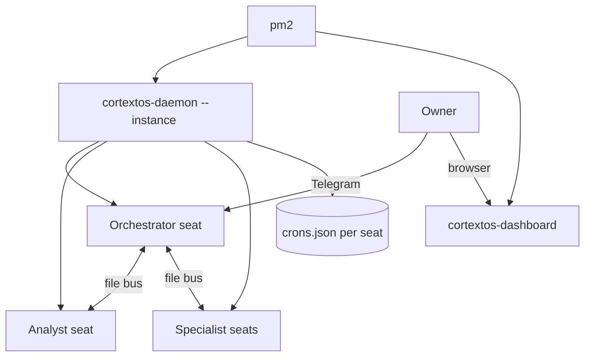
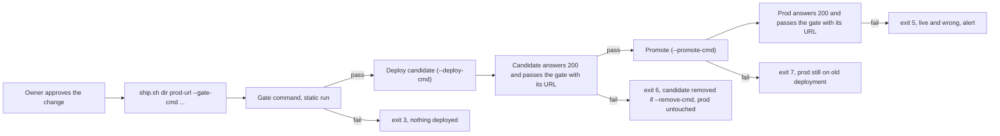

# 14. README and quickstart: install, run, change safely, ship

This document takes a new operator from an empty machine to a running OGL Cortex fleet, then covers daily operation, safe changes and the ship chain. Internals are in `01-core-architecture.md` and `02-execution-engine.md`. Settings are in `03-configuration-registry.md`. Guards are in `04-failsafe-boundary-log.md`.

The command-line tool is named `cortextos`.

Every `cortextos` command below was checked against the CLI's `--help` output. Commands from the OGL layer are marked as such and live in this repo's `harness/` folder (`harness/tools/ship.sh`, `harness/install.sh`). The pentest gate is `harness/security/cortex_pentest_gate.py`.

## Terms

- **Instance**: one runtime state folder, `$CTX_ROOT` = `~/.cortextos/<instance>`. The default instance id is `default`. `$CORTEX_HOME` is the framework checkout (for example `~/cortextos`).
- **Org**: a group of seats that share a knowledge base, tasks and approvals. Lives in the framework checkout at `orgs/<org>/`.
- **Seat**: one agent, in `orgs/<org>/agents/<seat>/`.
- **Daemon**: the Node process (`dist/daemon.js`) that keeps every seat's Claude Code session alive.
- **pm2**: the process manager that keeps the daemon and the dashboard running.

---

## 1. Prerequisites

| Dependency | Install | Notes |
|---|---|---|
| Node.js 20+ | nodejs.org | |
| pm2 | `npm install -g pm2` | |
| Claude Code | `npm install -g @anthropic-ai/claude-code`, then `claude login` | Pin the version you run |
| Telegram bot per seat | @BotFather | One bot token per seat |
| Your numeric Telegram user id | Any user-id bot, or `getUpdates` (step 3.3) | Goes in `ALLOWED_USER` |
| Optional: whisper.cpp model | `scripts/install-whisper-model.sh` in the framework repo | Local voice-note transcription |
| Optional: Gemini API key | `GEMINI_API_KEY` | Knowledge base embeddings |
| Disk encryption | FileVault on macOS, LUKS on Linux | Seats hold tokens and client data on disk |

Supported platforms: macOS and Linux. The framework also runs on Windows 10/11 with Task Scheduler for reboot persistence (`scripts/install-windows-pm2-startup.ps1`).

## 2. Install

### 2.1 Guided

```bash
npm install -g pm2
curl -fsSL https://raw.githubusercontent.com/grandamenium/cortextos/main/install.mjs | node
claude ~/cortextos
# inside Claude Code:
/onboarding
```

Or run the interactive wizard from a shell:

```bash
cortextos setup --instance <instance>
```

`setup` installs state folders, creates an org, configures seats and starts the daemon.

### 2.2 Manual

```bash
cortextos install --instance <instance>
cortextos init <org> --instance <instance>
cortextos add-agent boss --template orchestrator --org <org> --instance <instance>
cortextos add-agent analyst --template analyst --org <org> --instance <instance>
```

Put credentials in each seat's `.env` (`orgs/<org>/agents/<seat>/.env`):

```bash
BOT_TOKEN=<bot-token>
CHAT_ID=<chat-id>
ALLOWED_USER=<numeric-user-id>[,<numeric-user-id>]
```

Then generate the pm2 config and start:

```bash
cortextos ecosystem --instance <instance> --org <org>
pm2 start ecosystem.config.js && pm2 save && pm2 startup
```

### 2.3 Add the OGL layer

The OGL layer is seat files and hooks, not a framework fork. For each seat, `harness/install.sh <seat-dir> --apply` installs from this repo's `harness/` folder:

| Piece | Destination |
|---|---|
| Seat templates (`harness/templates/CLAUDE.md`, `harness/templates/STATE.md`); the other bootstrap files come from the framework template | `orgs/<org>/agents/<seat>/` |
| Hooks (`harness/hooks/`) and the `settings.example.json` block | `orgs/<org>/agents/<seat>/.claude/hooks/ogl/`, merged into `.claude/settings.json` |
| Optional user-level guards (ship gate, surface guard, send lint), with `--user-level` | `~/.claude/hooks/ogl/`, registered in `~/.claude/settings.json` |
| Skills (`harness/skills/`) | `orgs/<org>/agents/<seat>/.claude/skills/<skill>/SKILL.md` |
| Crons | Added with `cortextos bus add-cron` (section 6) |

The installer is a dry run unless you pass `--apply`. See [`harness/README.md`](../harness/README.md) for what it writes and how to remove it.

## 3. First boot

### 3.1 The architecture you just started



### 3.2 Check it is alive

```bash
cortextos status --instance <instance>
cortextos list-agents --instance <instance>
cortextos bus list-agents --format text
cortextos bus read-all-heartbeats --format text
cortextos doctor --instance <instance>
```

### 3.3 Onboard each seat

1. Send `/start` to the seat's bot, then any message.
2. If you still need the chat id, read it from the Bot API: `curl -s "https://api.telegram.org/bot<TOKEN>/getUpdates?timeout=30" | jq '.result[-1].message.chat.id'`.
3. Send `/onboarding`. The seat sets its identity, goals and crons, then writes a `.onboarded` flag in its state folder.

## 4. The instance flag

Every lifecycle command defaults to `--instance default`: `install`, `setup`, `init`, `add-agent`, `start`, `stop`, `restart`, `enable`, `disable`, `doctor`, `dashboard`, `ecosystem`. `status` and `list-agents` take `--instance` with no default.

If your fleet runs under another instance id and you leave the flag off, the CLI reads `~/.cortextos/default` and reports "Daemon is not running" while the daemon is healthy. Do not run `cortextos start` in response; it can create orphan processes.

Rule: pass `--instance <instance>` on every lifecycle command, or use the instance id `default` for single-fleet installs.

## 5. Start, stop, restart

| Goal | Command | Notes |
|---|---|---|
| Seat health | `cortextos status --instance <instance>` | Read-only |
| Every seat and role | `cortextos bus list-agents --format text` | `--status running` filters |
| Heartbeats | `cortextos bus read-all-heartbeats --format text` | Read-only |
| Diagnose | `cortextos doctor --instance <instance>` | Checks prerequisites |
| Restart one seat | `cortextos restart <seat> --instance <instance>` | Stop and start. Re-reads `config.json` and `.env`, respawns the PTY. Does not restart the daemon |
| Stop one seat | `cortextos stop <seat> --instance <instance>` | Does not stop the daemon |
| Stop every seat | `cortextos stop --all --instance <instance>` | `--all` is required when no seat is named |
| Start one seat | `cortextos start <seat> --instance <instance>` | Omitting the seat starts every seat. `--foreground` runs the daemon without pm2 for debugging |
| Seat restarts itself, keeps history | `cortextos bus self-restart --reason "<why>"` | Run from inside the seat |
| Seat restarts fresh | `cortextos bus hard-restart --reason "<why>" [--handoff-doc <path>]` | The handoff doc is injected into the next boot prompt |
| Restart the daemon | `pm2 restart cortextos-daemon` | Read section 5.1 first |
| Stop the daemon | `pm2 stop cortextos-daemon` | |
| Dashboard by hand | `cortextos dashboard --port <port> --instance <instance> [--build] [--install]` | Default port 3000. Use `--build` for anything reachable off the machine |
| Regenerate pm2 config | `cortextos ecosystem --instance <instance> --org <org> [--output <path>]` | Writes `ecosystem.config.js` |
| Enable or disable a seat | `cortextos enable <seat> --instance <instance> --org <org>` / `cortextos disable <seat> --instance <instance>` | `--worker` on `enable` registers a headless seat with no Telegram |
| Upstream updates | `cortextos update --check` | Reports only. Without `--check` it asks before applying |

### 5.1 Rules before any restart

| Rule | Why |
|---|---|
| Ask the owner "fresh restart or continue with history?" before restarting on request | The two restarts lose different things |
| Before a daemon restart, list every side service (tunnels, chatbots, guards, previews, local APIs), check each has its own supervisor (pm2 or a launchd/systemd unit with run-at-load and keep-alive), and get the owner's go | Side services started by a seat die with the daemon |
| Before restarting any production service, read its entrypoint for side effects | An entrypoint can start a job that sends or posts |
| Read `$CTX_ROOT/logs/<seat>/restarts.log` before deciding why a seat restarted | |
| Prefer asking a seat to self-restart at a clean point | A commanded restart mid-task can lose work |
| After a crash storm, pm2 stops retrying | Run `pm2 restart cortextos-daemon` by hand |

Seats also restart on their own: on crash, and on context rotation after `max_session_seconds` (default about 71 hours).

## 6. Talking to the fleet

| Channel | How | Notes |
|---|---|---|
| Telegram | Message the seat's bot. Voice notes are transcribed locally. Photos and files are saved under the seat folder | Only ids in `ALLOWED_USER` are accepted. Formatting is Telegram's regular Markdown |
| Dashboard | Browser, login from the dashboard env file (`ADMIN_USERNAME`, `ADMIN_PASSWORD`) | Bind to localhost or a private network; use a production build |
| Persistent remote dashboard | `cortextos tunnel start` | Named Cloudflare tunnel run as a launchd service |
| Seat to seat | `cortextos bus send-message <seat> <urgent|high|normal|low> '<text>' [reply-to]` | A message is not a dispatch. Dispatch with a task (below) |
| Seat to owner | `cortextos bus send-telegram <chat-id> '<msg>' [--image <path>] [--file <path>] [--plain-text]` | Use single quotes or a heredoc for any text with `$`; inside double quotes the shell expands it |

Dispatching work:

```bash
cortextos bus create-task "<title>" --assignee <seat> --priority normal \
  --desc $'TASK: <what>\nFILES: <paths, including the working folder>\nBAR: <how done is verified>\nRETURN: <what to report>'
cortextos bus update-task <task_id> in_progress
cortextos bus complete-task <task_id> --result "<summary>"
cortextos bus log-event task task_completed info --meta '{"task_id":"<task_id>"}'
```

Approvals:

```bash
cortextos bus create-approval "<what>" <external-comms|financial|deployment|data-deletion|other> "<context>"
cortextos bus list-approvals
cortextos bus update-approval <approval-id> <approved|denied> "<note>"
```

## 7. Adding a seat

1. Create a bot with @BotFather. Move the token through a secure path (password manager or a file you create on the machine), never through chat.
2. Send `/start` to the bot, then any message, and read the chat id (section 3.3).
3. Create the seat:
   ```bash
   cortextos add-agent <seat> --template <orchestrator|analyst|agent|agent-codex> \
     --org <org> --instance <instance> \
     [--runtime claude-code|hermes|codex-app-server|opencode] [--disabled]
   ```
   The `templates/` folder also holds `agent-opencode`, `hermes` and `m2c1-worker`. `--template agent --runtime opencode` maps to `agent-opencode`.
4. Write `BOT_TOKEN`, `CHAT_ID` and `ALLOWED_USER` in `orgs/<org>/agents/<seat>/.env`. Without `ALLOWED_USER`, Telegram stays off.
5. Enable: `cortextos enable <seat> --instance <instance> --org <org>`. For a headless seat, add `--worker`.
6. Write the seat's `goals.json`, then `cortextos goals generate-md --agent <seat> --org <org>`.
7. Send `/onboarding` to the new bot.

Short-lived helpers do not need a seat:

```bash
cortextos spawn-worker <name> --dir <path> --prompt "<task>" [--parent <seat>] [--model <model>]
cortextos list-workers
cortextos inject-worker <name> "<text>"
cortextos terminate-worker <name>
```

## 8. Crons

| Task | Command |
|---|---|
| List | `cortextos bus list-crons <seat> [--json]` |
| Add | `cortextos bus add-cron <seat> <name> <interval-or-5-field-expr> <prompt...> [--desc "<text>"]` |
| Update | `cortextos bus update-cron <seat> <name> [--interval <i>] [--cron-expr <e>] [--prompt <p>] [--enabled true|false] [--desc <d>]` |
| Remove | `cortextos bus remove-cron <seat> <name>` |

Storage: `$CTX_ROOT/.cortextOS/state/agents/<seat>/crons.json`, envelope `{ "updated_at": "<ISO>", "crons": [ ... ] }`, written atomically (`src/bus/crons.ts`, `src/bus/crons-schema.ts`). The daemon owns dispatch and reloads the file across restarts.

Guidance:
- Prefer 5-field wall-clock expressions (`"0 8 * * *"`). An interval at or above the heartbeat length can starve on the scheduler.
- A 5-field expression for a one-time job recurs. Remove the cron when the job finishes.
- Do not use Claude Code's in-session `CronCreate` or `/loop` for anything that must survive a restart.
- Confirm a new cron by the artifact its first run produces, not by its presence in the list.

## 9. Logs and state

| What | Path |
|---|---|
| Per-seat logs | `$CTX_ROOT/logs/<seat>/` (`stdout.log`, `crashes.log`, `restarts.log`, `inbound-messages.jsonl`, `outbound-messages.jsonl`) |
| pm2 logs | `~/.pm2/logs/` (`cortextos-daemon-out.log`, `cortextos-daemon-error.log`, dashboard logs) |
| Tasks, approvals, events | `$CTX_ROOT/orgs/<org>/{tasks,approvals,analytics}` |
| Crons | `$CTX_ROOT/.cortextOS/state/agents/<seat>/crons.json` |
| Seat runtime state and scripts | `$CTX_ROOT/state/<seat>/` |
| Knowledge base | `$CTX_ROOT/orgs/<org>/knowledge-base/` (`config.json`, `chromadb/`) |
| Seat memory | `orgs/<org>/agents/<seat>/memory/` and `MEMORY.md` |

## 10. Changing the harness safely

### 10.1 What needs approval

| Change | Rule |
|---|---|
| Seat memory, daily memory, deliverables | Free |
| A seat's bootstrap files (`AGENTS.md`, `CLAUDE.md`, `GUARDRAILS.md`, `IDENTITY.md`, `SOUL.md`, `SYSTEM.md`, `TOOLS.md`, `USER.md`, `HEARTBEAT.md`) and `.claude/skills/**` | Tracked task, exact file list, diff preview, rollback path, owner approval |
| Framework `src/**`, `templates/**`, `ecosystem.config.js` | Same |
| Shared surfaces other seats depend on (package caches, global npm, `brew upgrade`, `~/.claude*` outside projects, MCP credential folders) | Blocked once by the shared-surface guard hook; released by a one-time pass after naming consumers, a backup and a post-check |
| Any website | Owner's explicit go |

### 10.2 Habits that keep changes reversible

| Habit | Form |
|---|---|
| Timestamped backup before editing | `<file>.bak-<UTC stamp>-<reason>`, for example `settings.json.bak-20260101T120000Z-prehook` |
| Freeze a gated artifact before a later edit | Copy the reviewed file to `<name>.gated-<sha>` read-only, then edit, so the next change diffs against what passed |
| Independent review | An auditor seat checks a claim or artifact before it reaches the owner |
| A return is a claim | Open the files a worker names and run its BAR yourself |
| One fenced adversarial pass | On every guard, hook, fix or plan: one claim, a fresh read-only session, evidence as `file:line` plus a reproduction, one round |
| Fixes land with a failing-first test | A fix is proven by a test, not by re-running the reviewer |
| Worktrees for code | Each code-editing worker gets its own worktree or branch. Merge one at a time. Only `main` ships |
| Framework build and test | `npm run build` (tsup) and `npm test` (vitest) pass; new code gets unit tests in `tests/` |
| Upstream changes | Scoped cherry-picks after reading the diff as data. No blind merges |
| Claude Code upgrades | One-seat trial before the fleet |

## 11. CI and the ship chain

### 11.1 Continuous integration

The framework ships two GitHub Actions workflows in `.github/workflows/`:
- `ci.yml`: typecheck and build on push and pull request.
- `leak-guard.yml`: scans for operational leaks (secrets, private paths) on pull requests and pushes to `main`.

CI runs only on code pushed to GitHub. A local-only checkout gets the same checks from `npm run build && npm test` by hand.

### 11.2 Shipping a website



| Step | Detail |
|---|---|
| Approval | Website changes need the owner's go before the ship starts |
| Wrapper (OGL layer) | `harness/tools/ship.sh <dir> <prod-url> --gate-cmd "<cmd>" [--deploy-cmd "<cmd>"] [--promote-cmd "<cmd>"] [--remove-cmd "<cmd>"]`. Each option can also come from `OGL_SHIP_GATE_CMD`, `OGL_SHIP_DEPLOY_CMD`, `OGL_SHIP_PROMOTE_CMD`, `OGL_SHIP_REMOVE_CMD` |
| Deploy modes | Default deploy command: `vercel deploy --prod --yes` (direct mode). For preview-then-promote on Vercel pass `--deploy-cmd 'vercel deploy --prod --skip-domain --yes --format json' --promote-cmd 'vercel promote --yes' --remove-cmd 'vercel remove --yes'`. The promote runs only after the candidate passes, so the artifact that passed is the artifact that goes live |
| Abort conditions | Gate report missing, not written during that step, or status not `pass`; deploy command fails or prints no candidate URL; candidate or prod not HTTP 200 |
| Index checks | Not built in. Put `sitemap.xml`, `robots.txt` and `noindex` checks in your gate command if you need them |
| Exit codes | 0 shipped; 2 usage error; 3 pre-deploy gate failed, nothing deployed; 4 deploy failed or no candidate URL, prod untouched; 5 live and wrong (prod not 200 or live gate failed); 6 candidate failed, prod untouched; 7 promote failed, prod on the old deployment |
| Pentest gate (`harness/security/cortex_pentest_gate.py`, or your own) | Any command that scans `<dir>` (and the URL in `$1` when given) and writes `security/pentest-gate-report.json` with `"status": "pass"`. `ship.sh` runs it as `bash -c "<cmd>" _ "<url>"` |
| Risk acceptance | Owner only, written in `security/pentest-risk-acceptance.md` |
| Hook backstop (OGL layer) | The PreToolUse hook `harness/hooks/ship_gate.py` (installed to `<seat>/.claude/hooks/ogl/`, or `~/.claude/hooks/ogl/` with `--user-level`) blocks `git push`, `gh release`, `gh pr merge`, `npm publish`, `vercel deploy`, `netlify deploy`, `firebase deploy`, `wrangler deploy`, `railway up`, `scp`, `sftp`, `rsync` over ssh and similar unless a passing gate report exists in the working folder or a parent |

Rollback: on candidate failure, production is untouched. After exit 5 (live and wrong), promote the previous deployment again with `vercel promote` or re-point the alias.

### 11.3 Deploy rules

| Rule | Why |
|---|---|
| `cd /abs/dir && vercel ...` in one command | Shell working folders reset between tool calls; a deploy from the seat root uploads the seat, including `.env` and memory |
| Always pass `--url` to the gate for a web surface | Without it the gate skips ZAP and the header check and can still report pass. Read the ZAP return code and report time |
| Never end a gate command by removing the scanner image | The next run has no scanner and can read a stale report |
| After trimming `.vercelignore`, fetch every referenced asset on the live URL | A trim can drop assets. `dir/` plus `!dir/file` does not re-include the file; use `dir/*` plus `!dir/keep.png` |
| After an alias change, check `x-vercel-cache` and `age` before checking content | The edge can serve the old deploy for a few minutes |
| Reconcile git with live before a git-based deploy | Assets deployed by hand are reverted by a git deploy |
| Pull production env outside the build folder | Env values can land in build caches |
| A ship that changes something a watcher checks updates the watcher in the same change | Otherwise the next watcher run pages a false drift |
| "Shipped" means the wrapper's SHIPPED line | Nothing else counts |
| Re-run the gate after any later change | A pass covers only the artifact it scanned |

## 12. Troubleshooting quick table

| Symptom | First check |
|---|---|
| "Daemon is not running" but seats answer | Missing `--instance` (section 4) |
| Seat ignores Telegram | `ALLOWED_USER` in `.env`; daemon log line starting `SECURITY:` |
| Seat silent, no errors | Usage cap; `cortextos bus list-oauth-accounts`; `restarts.log` |
| Cron never fires | Interval at or above heartbeat length; switch to a 5-field expression |
| KB queries return nothing | `GEMINI_API_KEY`; billing on the Google Cloud project; `cortextos bus kb-collections` |
| Voice notes not transcribed | Model file present (`scripts/install-whisper-model.sh`); `ffmpeg` on PATH; language vs English-only model |

## Known limitations

- Lifecycle commands default to the `default` instance. Multi-instance installs must pass `--instance` every time.
- `cortextos dashboard` without `--build` runs a development server. Bind it to localhost or a private network.
- CI does not run on changes that stay in a local checkout.
- The ship wrapper's default deploy command targets Vercel. Other hosts need `--deploy-cmd` and their own promote step.
- The ship gate hook matches command patterns. A deploy run through a script with an unrelated name is not matched; route deploys through the wrapper.

## Source files

- `README.md`
- `CLAUDE.md`
- `package.json`
- `ecosystem.config.js`
- `install.mjs`
- `src/cli/`
- `src/bus/crons.ts`
- `src/bus/crons-schema.ts`
- `src/daemon/agent-manager.ts`
- `src/telegram/transcribe.ts`
- `scripts/install-whisper-model.sh`
- `scripts/install-windows-pm2-startup.ps1`
- `.github/workflows/ci.yml`
- `.github/workflows/leak-guard.yml`
- `templates/`
