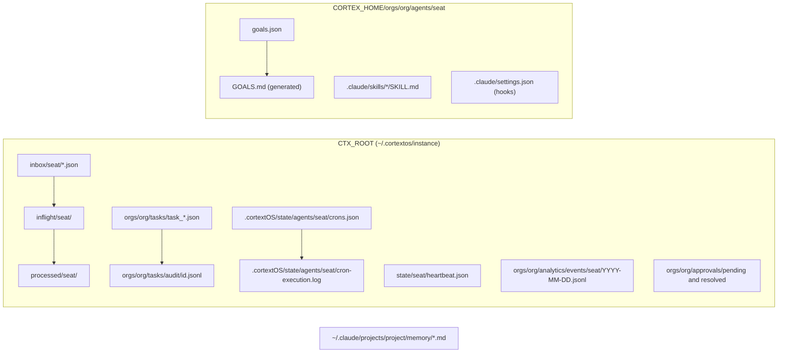
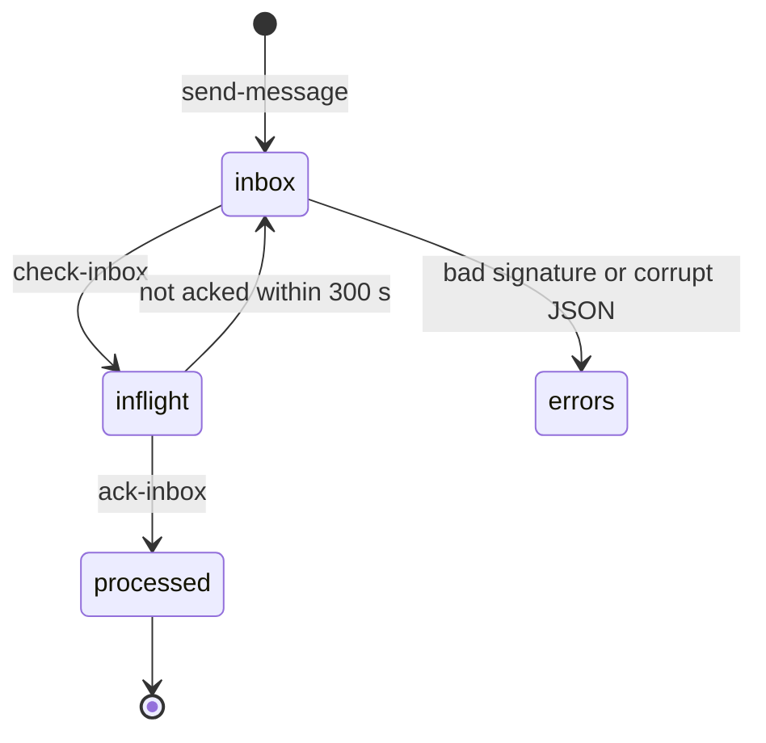

# 21. Data Models and Schema Registry

This document describes every data shape that moves through OGL Cortex: where it lives on disk, who writes it, its fields, an example, and how strictly it is validated. Use it when you write a tool that reads fleet state, build a dashboard, or debug a record that looks wrong.

Path conventions:
- `$CORTEX_HOME` is your framework checkout (for example `~/cortextos`).
- `$CTX_ROOT` is the runtime state root for one daemon instance (`~/.cortextos/<instance>`).
- `<org>` is your org folder name. `<seat>` is one agent folder under `$CORTEX_HOME/orgs/<org>/agents/`.

Related documents: architecture in `01-core-architecture.md`, how the daemon fires crons and injects prompts in `02-execution-engine.md`, `config.json` and `settings.json` in `03-configuration-registry.md`, prompt text carried inside these shapes in `22-prompt-registry.md`, and the tests that check them in `23-evals-and-benchmarks.md`.

## How schemas work in OGL Cortex

A schema is a written rule for which fields a record must have and which values are allowed. OGL Cortex has no central schema registry (no JSON Schema, Avro or Protobuf files). It uses four mechanisms instead:

1. **TypeScript interfaces** in `src/types/index.ts`. They describe what the framework code writes. TypeScript checks them at build time. Nothing checks files on disk against them at read time. They match the original bash version's JSON formats for backward compatibility.
2. **Runtime validators** for enum fields: agent names, priorities, event categories, severities, approval categories and task ids (`src/utils/validate.ts`). They run when the CLI writes, not when anything reads.
3. **Writer scripts and hooks** in the OGL layer that enforce stricter shapes than the bus. Example: the `truth_correction` event is validated by `harness/tools/emit-truth-correction.sh`, not by the bus.
4. **Convention only** for some shapes: event names and metadata, auto-memory frontmatter, skill frontmatter, and `goals.json`.

`src/harness/schema.ts` defines an SQL store for the Cortex harness. It is a compatibility shadow store, marked not production-authoritative in its own schema, and is covered in `01-core-architecture.md`.

## Where the data lives

`resolvePaths()` in `src/utils/paths.ts` builds every runtime path from the agent name, the instance id and the org.



| Shape | Location | Scope |
|---|---|---|
| Task | `$CTX_ROOT/orgs/<org>/tasks/task_*.json` | Org |
| Task audit line | `$CTX_ROOT/orgs/<org>/tasks/audit/<task_id>.jsonl` | Org |
| Inbox message | `$CTX_ROOT/{inbox,inflight,processed}/<seat>/*.json` | Seat |
| Event | `$CTX_ROOT/orgs/<org>/analytics/events/<seat>/<YYYY-MM-DD>.jsonl` | Org, per seat |
| Heartbeat | `$CTX_ROOT/state/<seat>/heartbeat.json` | Seat |
| Cron definitions | `$CTX_ROOT/.cortextOS/state/agents/<seat>/crons.json` | Seat |
| Cron execution log | `$CTX_ROOT/.cortextOS/state/agents/<seat>/cron-execution.log` | Seat |
| Approval | `$CTX_ROOT/orgs/<org>/approvals/{pending,resolved}/*.json` | Org |
| Goals | `$CORTEX_HOME/orgs/<org>/agents/<seat>/goals.json` and `$CORTEX_HOME/orgs/<org>/goals.json` | Seat and org |
| Auto-memory note | `~/.claude/projects/<project>/memory/*.md` | Claude Code project |
| Skill | `<seat>/.claude/skills/*/SKILL.md`, `~/.claude/skills/*/SKILL.md` | Seat and user |
| Hook registrations | `<seat>/.claude/settings.json`, `~/.claude/settings.json` | Seat and user |

## 1. Task

**Type:** `interface Task` in `src/types/index.ts`. Created by `createTask()` in `src/bus/task.ts`.

**Location:** one JSON file per task, `$CTX_ROOT/orgs/<org>/tasks/task_<epochMs>_<8 digits>.json`. Tasks are org-scoped: every seat in an org shares one task folder.

| Field | Type | Required | Notes |
|---|---|---|---|
| id | string | yes | `task_<Date.now()>_<8 random digits>`. Eight digits avoid same-millisecond collisions. |
| title | string | yes | Free text. |
| description | string | yes | Free text. The OGL brief guard requires four lines here for cross-seat dispatch (see below). |
| type | `agent` or `human` | yes | `human` is a task for the owner. |
| needs_approval | boolean | yes | |
| status | `pending`, `in_progress`, `completed`, `blocked`, `cancelled` | yes | |
| assigned_to | string | yes | Seat name or human. |
| created_by | string | yes | |
| org | string | yes | |
| priority | `urgent`, `high`, `normal`, `low` | yes | Validated on write. |
| project | string | yes | Often empty. |
| kpi_key | string or null | yes | |
| created_at, updated_at | ISO 8601 string | yes | Second precision, no milliseconds. |
| completed_at, due_date | string or null | yes | |
| archived | boolean | yes | |
| result | string | no | Set on completion. |
| outputs | array of `{type: "file", value, label?}` | no | |
| blocked_by, blocks | array of task ids | no | Dependency graph. Cycles are rejected before write. |

**Example:**

```json
{
  "id": "task_1790000000000_12345678",
  "title": "Build pricing page for the demo site",
  "description": "TASK: Build /pricing from the approved plan.\nFILES: sites/demo/src/pages/pricing.tsx\nBAR: npm run build passes; page renders at 390px with no horizontal overflow\nRETURN: preview URL and the build log path",
  "type": "agent",
  "needs_approval": false,
  "status": "pending",
  "assigned_to": "builder",
  "created_by": "boss",
  "org": "<org>",
  "priority": "normal",
  "project": "",
  "kpi_key": null,
  "created_at": "2026-01-15T09:00:00Z",
  "updated_at": "2026-01-15T09:00:00Z",
  "completed_at": null,
  "due_date": null,
  "archived": false,
  "result": ""
}
```

**Task audit log.** Every transition appends one line to `tasks/audit/<task_id>.jsonl`. Shape `TaskAuditEntry` in `src/bus/task.ts`: `ts`, `event` (`create`, `claim`, `update`, `complete`), `agent`, and optional `from`, `to`, `note`. The audit log is an observability aid, not the source of truth. A failed audit write never blocks the task write.

```json
{"ts":"2026-01-15T09:00:00Z","event":"create","agent":"boss","to":"pending","note":"First-boot onboarding"}
```

The command-line tool is named `cortextos`.

**OGL convention: the four-line brief.** `brief_guard.py` (`harness/hooks/brief_guard.py`, installed to `.claude/hooks/ogl/`) blocks a Bash call of the form `cortextos bus create-task ... --assignee <other seat>` unless `--desc` contains lines starting `TASK:`, `FILES:`, `BAR:` and `RETURN:`. The rule applies to the description string at the moment the seat's Bash tool runs the command. The bus itself does not enforce it, so tasks created by scripts, other seats without the hook, or the dashboard are not checked.

**Validation:** TypeScript interface plus write-time enum checks. Task files are not validated when read.

## 2. Inbox message (agent-to-agent bus)

**Type:** `interface InboxMessage` in `src/types/index.ts`. Written by `sendMessage()` in `src/bus/message.ts`.

**Lifecycle:**



A message file lands in `inbox/<to>/`. `check-inbox` moves it to `inflight/<to>/`. `ack-inbox` moves it to `processed/<to>/`. An inflight file older than 300 seconds returns to the inbox, so an un-acked message redelivers after five minutes.

**Filename:** `<priorityNumber>-<epochMs>-from-<sender>-<rand5>.json`. Priority numbers: urgent 0, high 1, normal 2, low 3. Sorting filenames sorts by priority, then time.

| Field | Type | Required | Notes |
|---|---|---|---|
| id | string | yes | `<epochMs>-<from>-<rand5>`. This is the `msg_id` a seat passes as `reply_to`. |
| from, to | string | yes | Validated agent names. |
| priority | `urgent`, `high`, `normal`, `low` | yes | |
| timestamp | ISO 8601 | yes | Milliseconds forced to `.000Z`. The id carries the full precision. |
| text | string | yes | Free text. Wrapper headers live inside the text, not as fields. |
| reply_to | string or null | yes | |
| sig | hex string | no | HMAC-SHA256 over `id:from:to:text`, keyed by `$CTX_ROOT/config/bus-signing-key`. |

**Signature handling.** A message with a bad signature moves to `inbox/<seat>/.errors/`. A message with no signature is accepted with a warning as legacy. The signature covers `id`, `from`, `to` and `text`. Treat `priority`, `timestamp` and `reply_to` as unauthenticated.

**Example:**

```json
{
  "id": "1790000000000-builder-ab12c",
  "from": "builder",
  "to": "boss",
  "priority": "normal",
  "timestamp": "2026-01-15T09:05:00.000Z",
  "text": "Pricing page built. Preview and build log paths in the task result.",
  "reply_to": null,
  "sig": "<64 hex chars>"
}
```

**Validation:** TypeScript interface. Corrupt JSON is quarantined to `.errors/`, which is the only read-time check.

## 3. Event

**Type:** `interface Event` in `src/types/index.ts`. Written by `logEvent()` in `src/bus/event.ts`, called by:

```bash
cortextos bus log-event <category> <event> <severity> --meta '<json>'
```

**Location:** append-only JSONL, one file per seat per UTC day: `$CTX_ROOT/orgs/<org>/analytics/events/<seat>/<YYYY-MM-DD>.jsonl`.

| Field | Type | Required | Notes |
|---|---|---|---|
| id | string | yes | `<epochSeconds>-<agent>-<rand5>`. Seconds, not milliseconds. |
| agent | string | yes | From `CTX_AGENT_NAME`. Empty if that variable is unset. |
| org | string | yes | |
| timestamp | ISO 8601 | yes | Second precision. |
| category | `action`, `error`, `metric`, `milestone`, `heartbeat`, `message`, `task`, `approval`, `agent_activity` | yes | Validated on write. |
| event | string | yes | Free-text name. Not validated. |
| severity | `info`, `warning`, `error`, `critical` | yes | Validated on write. |
| metadata | object | yes | Free-form. If `--meta` is not valid JSON, it is replaced by `{}` without an error. |

**Side effect:** every event also updates `last_heartbeat` in the seat's `heartbeat.json`. A fresh heartbeat means "logged anything recently", not "ran the heartbeat routine".

**Common event names** written by the framework and templates: `heartbeat`, `agent_message_sent`, `inbox_ack`, `telegram_sent`, `telegram_received`, `session_start`, `task_completed`, `task_dispatched`, `briefing_sent`. There is no allow-list. Any reader that counts events must agree with every writer on names and metadata keys.

**Example:**

```json
{"id":"1790000300-boss-9pv7s","agent":"boss","org":"<org>","timestamp":"2026-01-15T09:05:00Z","category":"message","event":"inbox_ack","severity":"info","metadata":{"msg_id":"1790000000000-builder-ab12c"}}
```

**Validation:** envelope only (8 fields, 2 enums). Event names and metadata have no schema.

## 4. truth_correction event (the false-claim ledger)

An OGL convention on top of the event shape: `category: action`, `event: truth_correction`, and a strict metadata shape. It records each time a seat said something false and someone (the seat itself, a peer, a guard, or the owner) caught it. The auditor role owns the collector and the schema.

**Writer:** `harness/tools/emit-truth-correction.sh`. It validates inputs, builds the metadata, and calls:

```bash
cortextos bus log-event action truth_correction info --meta "$META"
```

The bus does not know this shape. A direct `log-event` call skips every check, so seats must use the script.

**Allowed `kind` values:** `self_correction`, `peer_catch`, `enforcer_catch`, `principal_catch`, `verify_cleared`, `artifact_catch`, `known_unrecordable_catch`.

| Metadata field | Type | When | Set by |
|---|---|---|---|
| kind | enum above | always | caller, validated |
| caught_agent | slug | always | caller (default `CTX_AGENT_NAME`) |
| caught_by | slug | always | derived: from the catcher's message id for peer and enforcer catches, from the artifact's owning seat for `artifact_catch`, pinned to the owner for `principal_catch` |
| catcher_type | `party` or `instrument` | always | default `party` |
| triggering_msg | msg_id or null | always | caller, shape-checked |
| occurred_at | ISO 8601 `...SSZ` | always | caller or now; future times rejected |
| dedupe_key | `<caught_agent>.<slug>.<occ_compact>` | always | built by the script; `.` cannot appear inside a part |
| claim, correction | string | always | caller |
| evidence | string or null | always | caller |
| artifact_provenance | `{path, catch_time, evidence_anchor}` | `artifact_catch` only | script |
| principal_evidence | `telegram:<chat>:<message>` handle | `principal_catch` only | caller, existence checked |
| near_miss | `true` | optional | caller |
| candidate_set, resolve_mode | object, `propose-only` | `known_unrecordable_catch` only | script |

**Dedupe rule** (a convention for readers of the ledger): for a plain duplicate `dedupe_key`, the first row in scan order wins (sorted by seat folder, then line order), not the earliest or latest by time. To supersede a row, write a separate amendment event. An amendment emitter is optional and not included in this repository.

**Example:**

```json
{"id":"1790000400-builder-k3m9q","agent":"builder","org":"<org>","timestamp":"2026-01-15T09:06:40Z","category":"action","event":"truth_correction","severity":"info",
 "metadata":{"kind":"self_correction","caught_agent":"builder","caught_by":"builder","catcher_type":"party","triggering_msg":null,"occurred_at":"2026-01-15T09:06:00Z","dedupe_key":"builder.backup-schedule-tz.20260115T090600Z","claim":"Daily backup runs at 09:00 UTC","correction":"launchd schedules use local time; the backup runs at 09:00 local","evidence":"launchctl print output"}}
```

**Validation:** a validating writer script and a contract in its comments. No reader-side validation in the bus.

## 5. Heartbeat

**Type:** `interface Heartbeat` in `src/types/index.ts`. Written by `updateHeartbeat()` in `src/bus/heartbeat.ts`. One file per seat, `$CTX_ROOT/state/<seat>/heartbeat.json`, rewritten atomically.

| Field | Type | Required | Notes |
|---|---|---|---|
| agent | string | yes | |
| org | string | yes | Empty string if not passed. |
| display_name | string | no | Read from the seat's `IDENTITY.md`. |
| status | string | yes | Free text, usually one status sentence. |
| current_task | string | yes | Often empty. |
| mode | `day` or `night` | yes | Day is 08:00 to 22:00 in the configured timezone. |
| last_heartbeat | ISO 8601 | yes | Also bumped by every `log-event`. |
| loop_interval | string | yes | May be empty. |
| timestamp | string | no | Legacy. |

**display_name resolution.** The CLI looks for a name line in `IDENTITY.md`. If it finds none, it falls back to the first `# ` heading. An `IDENTITY.md` left at the template text yields `"display_name": "Agent Identity"`. Fill in the Name section during onboarding.

**Example:**

```json
{
  "agent": "boss",
  "org": "<org>",
  "display_name": "Boss",
  "status": "online: pricing page in review; waiting on owner approval",
  "current_task": "",
  "mode": "day",
  "last_heartbeat": "2026-01-15T09:06:40Z",
  "loop_interval": ""
}
```

**Validation:** TypeScript interface.

## 6. Cron records

OGL Cortex has one live cron shape and two older records that can still exist on disk. Only `crons.json` drives the scheduler.

### 6a. CronDefinition (live)

**Type:** `interface CronDefinition` in `src/types/index.ts`. Read and written by `src/bus/crons.ts`. The path is built in `src/bus/crons-schema.ts`.

**Location:** `$CTX_ROOT/.cortextOS/state/agents/<seat>/crons.json`. Use `cortextos bus list-crons <seat>` rather than reading the file.

**File envelope:**

```json
{ "updated_at": "<ISO 8601>", "crons": [ /* CronDefinition, ... */ ] }
```

Each write keeps the previous file as `crons.json.bak`. A parse failure falls back to the backup.

| Field | Type | Required | Notes |
|---|---|---|---|
| name | string | yes | Unique per seat. |
| prompt | string | yes | Text typed into the seat's terminal. |
| schedule | string | yes | Interval shorthand (`20m`, `4h`, `168h`) or 5-field cron (`0 8 * * *`). |
| enabled | boolean | yes | |
| created_at | ISO 8601 | yes | |
| last_fired_at | ISO 8601 | no | |
| last_fire_attempted_at | ISO 8601 | no | Set before dispatch so a daemon crash cannot double-fire. |
| fire_count | number | no | |
| fire_at | ISO 8601 | no | One-shot fire time. |
| description | string | no | |
| metadata | object | no | Free-form. Crons migrated from `config.json` carry `{"migrated_from_config": true, "original_type": "recurring"}`. |
| manualFireDisabled | boolean | no | The only camelCase field. |

**Example:**

```json
{
  "name": "heartbeat",
  "prompt": "Read HEARTBEAT.md and follow its instructions. Update your heartbeat, check inbox, (...)",
  "schedule": "4h",
  "enabled": true,
  "created_at": "2026-01-01T16:35:19.821Z",
  "last_fired_at": "2026-01-15T08:16:49.511Z",
  "fire_count": 84,
  "last_fire_attempted_at": "2026-01-15T08:16:49.511Z"
}
```

**One-shot jobs use `fire_at`.** A dated 5-field expression such as `0 20 12 10 *` fires every year on that date, not once.

### 6b. CronEntry (legacy, in config.json)

**Type:** `interface CronEntry` in `src/types/index.ts`, used by `AgentConfig.crons`. Fields: `name`, one of `interval`, `cron` or `fire_at`, `prompt`, and `type` (`recurring`, `once`, `disabled`).

The daemon schedules from `crons.json`. A `crons` array left in a seat's `config.json` after migration is dead config: editing it changes nothing. Remove it after migration. See `03-configuration-registry.md`.

### 6c. cron-state.json (legacy)

`$CTX_ROOT/state/<seat>/cron-state.json` holds `{updated_at, crons: [{name, last_fire, interval?}]}`. It can list crons that no longer exist in `crons.json`. Do not use it as a source for what is scheduled.

### 6d. Cron execution log

**Type:** `interface CronExecutionLogEntry` in `src/types/index.ts`. JSONL at `$CTX_ROOT/.cortextOS/state/agents/<seat>/cron-execution.log`, written by `src/daemon/cron-execution-log.ts`.

| Field | Type | Notes |
|---|---|---|
| ts | ISO 8601 | |
| cron | string | Cron name. |
| status | `fired`, `retried`, `failed` | |
| attempt | number | |
| duration_ms | number | Time to type the prompt into the terminal, not the agent's work. |
| error | string or null | |

Rotation keeps the last 1,000 lines once the file passes 200 KB.

```json
{"ts":"2026-01-15T08:16:49.511Z","cron":"heartbeat","status":"fired","attempt":1,"duration_ms":0,"error":null}
```

"Fired" means the prompt reached the terminal. It does not mean the job succeeded. Confirm a job by its artifact.

### 6e. How a fired cron appears in the prompt

| Source | Format | Code |
|---|---|---|
| Scheduled fire | `[CRON FIRED <firedAt>] <name>: <prompt>` | `src/daemon/agent-manager.ts` |
| Manual or test fire over the daemon's local IPC socket | `[CRON: <name>] <prompt>` | `src/daemon/ipc-server.ts` |

A hook that wants to skip cron prompts must match both prefixes.

## 7. goals.json

**Location:** one file per seat (`$CORTEX_HOME/orgs/<org>/agents/<seat>/goals.json`) plus one org file (`$CORTEX_HOME/orgs/<org>/goals.json`). The seat file feeds `GOALS.md`, which `cortextos goals generate-md --agent <seat> --org <org>` regenerates (`src/cli/goals.ts`). The generated file carries the line "Auto-generated from goals.json. Do not edit this file directly."

**Seat shape:**

| Field | Type | Notes |
|---|---|---|
| focus | string | Rendered as the day's focus. |
| goals | array of string, or array of `{title}` | Both forms accepted. |
| bottleneck | string | |
| updated_at | ISO 8601 | |
| updated_by | string | Usually the orchestrator, which may write other seats' goals. |

**Org shape:** `north_star`, `daily_focus`, `daily_focus_set_at`, `goals`, `bottleneck`, `updated_at`, `updated_by`. The org file uses `daily_focus` where the seat file uses `focus`.

**Example:**

```json
{
  "focus": "Ship the demo site pricing page",
  "goals": ["Pricing page through ship.sh by end of day", "Clear the inbox backlog"],
  "bottleneck": "Waiting on owner approval of the plan",
  "updated_at": "2026-01-15T08:00:00Z",
  "updated_by": "boss"
}
```

**Validation:** none. `goals.ts` reads three keys with `typeof` checks and ignores the rest. A misspelled key renders as "(not set, check with your orchestrator)" in `GOALS.md` instead of an error.

## 8. Approval

Approvals gate every external action. **Type:** `interface Approval` in `src/types/index.ts`. Files in `$CTX_ROOT/orgs/<org>/approvals/pending/` and `resolved/`.

| Field | Type |
|---|---|
| id | `approval_<epochSeconds>_<rand5>` |
| title, description | string |
| requesting_agent, org | string |
| category | `external-comms`, `financial`, `deployment`, `data-deletion`, `other` |
| status | `pending`, `approved`, `rejected` |
| created_at, updated_at | ISO 8601 |
| resolved_at, resolved_by | string or null |

`resolved_by` is free text. OGL seats record the channel and the owner's words there, which makes the approval citable later.

```json
{
  "id": "approval_1790000500_fdtl4",
  "title": "Pin MCP server versions in ~/.claude.json",
  "requesting_agent": "boss",
  "org": "<org>",
  "category": "other",
  "status": "approved",
  "description": "Pin the four uvx MCP servers to their current resolved versions.",
  "created_at": "2026-01-15T09:10:00Z",
  "updated_at": "2026-01-15T10:00:00Z",
  "resolved_at": "2026-01-15T10:00:00Z",
  "resolved_by": "owner via dashboard: approved, re-check for useful updates monthly"
}
```

## 9. Auto-memory note (Claude Code memory)

**Location:** `~/.claude/projects/<project>/memory/`. `<project>` is Claude Code's encoding of the seat's working directory (slashes become dashes). The folder holds `MEMORY.md` (the index) and one markdown file per note. Claude Code loads the first 200 lines of `MEMORY.md` at session start and truncates the rest.

**Frontmatter:**

| Key | Notes |
|---|---|
| name | Slug that matches the file name. |
| description | One-line summary. |
| metadata.type | `feedback`, `project`, `reference` or `user`. |
| metadata.node_type | `memory`. |
| metadata.originSessionId | UUID of the session that wrote the note. |
| metadata.modified | ISO 8601 with milliseconds. |

Notes written by hand or by older writers may lack `node_type`, `originSessionId` or `modified`.

```yaml
---
name: confirm-or-flag-for-claims
description: "Customer-facing claims need a positive source or a flag; a disprove-check passes invented claims"
metadata:
  node_type: memory
  type: feedback
  originSessionId: <uuid>
  modified: 2026-01-15T09:00:00.000Z
---
A truth audit that asks "can any source disprove this claim?" passes invented claims automatically. (...)
```

**Index line shape:** a bullet with a markdown link to the note, a separator, and a short hook. Use a plain separator such as ` : ` or ` - `; the house style forbids the long dash.

**Validation:** none in OGL Cortex. The format is Claude Code's. Nothing checks that each note appears in the index or that each index line points at a real file.

## 10. Skill frontmatter

A skill is a folder with a `SKILL.md` that starts with YAML frontmatter. Two readers parse it.

| Reader | Scans | Parser | Keys used |
|---|---|---|---|
| Claude Code | `~/.claude/skills/` and the seat's `.claude/skills/` | Full YAML | `name`, `description`, and Claude Code's own optional keys |
| `cortextos bus list-skills` (`src/cli/bus.ts`, `src/cli/list-skills.ts`) | Framework `.claude/skills/`, the template's skills, and the seat's skills (seat wins on a name clash). Not `~/.claude/skills/` | Line-by-line regex | `name`, `description` only |

**Keys seen in OGL Cortex skills:** `name`, `description`, `triggers`, `allowed-tools`, `license`, `metadata`, `argument-hint`, `user-invocable`, `compatibility`, `disable-model-invocation`, `tags`, `effort`, `version`.

Rules for skill authors:
- Always include frontmatter. `list-skills` silently drops a skill with none.
- Write `description` on one line. `list-skills` reads a folded YAML description (`description: >`) as the literal `>`.
- Use one spelling per key across your skills (for example `user-invocable`, not a mix with `user-invokable`; `triggers`, not a mix with `trigger`).

```yaml
---
name: tasks
description: "Use before any meaningful piece of work. Without a task, the work is invisible to the dashboard and the owner."
triggers: ["create task", "start task", "new task", "track work", "task lifecycle"]
---
```

**Validation:** none in OGL Cortex. Skill prompt content is catalogued in `22-prompt-registry.md`.

## 11. Hook input and output JSON

Claude Code runs a hook command at a fixed event and sends it a JSON object on stdin. The hook answers with an exit code, stderr text, and optional JSON on stdout. The shapes are Claude Code's, documented by Anthropic. This section lists the parts OGL Cortex hooks use.

### 11a. Hook events used by OGL Cortex

| Event | Typical hooks on an orchestrator seat |
|---|---|
| PermissionRequest | `cortextos bus hook-planmode-telegram`, `cortextos bus hook-permission-telegram` |
| PreToolUse | `cortextos bus hook-ask-telegram`; `orwell_lint.py` (Bash sends and MCP sends); `shared_surface_guard.py`; `brief_guard.py`; `future_time_guard.py`; `ship_gate.py` |
| PostToolUse | compaction meter (`compaction/meter.py`) |
| UserPromptSubmit | none shipped; optional recall or prompt-router hooks (not included) |
| SessionStart | compaction hand-back (`compaction/after_compact.py`, matcher `compact`) |
| PreCompact | `cortextos bus hook-compact-telegram` |
| PostCompact | compaction summary saver (`compaction/save_summary.py`) |
| Stop | `cortextos bus hook-idle-flag` |
| SessionEnd | `cortextos crash-alert` |

Commands that start with `cortextos` come from the framework. The rest are OGL layer scripts from `harness/hooks/`, installed to `<seat>/.claude/hooks/ogl/`.

### 11b. Input fields OGL hooks read

| Field | Read by | Meaning |
|---|---|---|
| tool_name | all PreToolUse guards | Tool about to run (`Bash`, `Write`, `Edit`, `mcp__...`). |
| tool_input.command | Bash guards, ship-gate hook | Shell command text. |
| tool_input.file_path, .content, .new_string | future-time guard | Write and Edit payloads. |
| cwd | send guard, surface guard, ship gate, compaction kit | Working directory. |
| transcript_path | compaction meter | Session JSONL, read to estimate context size. |
| session_id | compaction kit | Keys the meter's "already warned" marks. |
| compact_summary | summary saver | Summary text after compaction. |

PreToolUse input (trimmed to fields OGL hooks read):

```json
{
  "session_id": "<uuid>",
  "transcript_path": "~/.claude/projects/<project>/<uuid>.jsonl",
  "cwd": "$CORTEX_HOME/orgs/<org>/agents/<seat>",
  "hook_event_name": "PreToolUse",
  "tool_name": "Bash",
  "tool_input": {"command": "cortextos bus create-task \"X\" --assignee builder --desc \"...\""}
}
```

UserPromptSubmit input:

```json
{"session_id": "<uuid>", "cwd": "...", "hook_event_name": "UserPromptSubmit", "prompt": "=== TELEGRAM from <name> (chat_id:<chat_id>) === (...)"}
```

### 11c. Output contracts

| Pattern | Used by | Effect |
|---|---|---|
| **Block:** exit code 2, reason on stderr | send guard, surface guard, ship gate, brief guard, future-time guard | Claude Code cancels the tool call and shows the stderr text to the model. |
| **Allow:** exit 0, no stdout | every guard on its pass path | Nothing happens. |
| **Inject context:** exit 0, stdout `{"hookSpecificOutput":{"hookEventName":"<Event>","additionalContext":"<text>"}}` | compaction kit (`meter.py`, `after_compact.py`) | Text is added to the model's context. |
| **Permission decision:** stdout `{"hookSpecificOutput":{"hookEventName":"PermissionRequest","decision":{"behavior":"allow"}}}` (or `"deny"` with an optional `"message"`) | framework hooks via `outputDecision()` in `src/hooks/index.ts` | Answers a permission prompt after the owner taps a Telegram button. |

The framework's loop detector (`src/hooks/hook-loop-detector.ts`) writes a fifth shape, `{"decision":"block","reason":"..."}` on stdout. It is optional and not registered by default.

Output of an optional prompt-router hook (not included):

```json
{"hookSpecificOutput": {"hookEventName": "UserPromptSubmit", "additionalContext": "[reply style: <skin>] <style text>"}}
```

**Fail-closed and fail-open.** The brief guard, send guard and surface guard fail closed when they crash on input inside their scope, and open otherwise. The future-time guard fails open on any exception. Context-injecting hooks fail silent by design: a timeout or error injects nothing.

**Pass-once tokens.** The send guard and the surface guard accept a one-shot override file younger than 600 seconds: `~/.ogl-cortex/state/.orwell-pass-once-<seat>` and `~/.ogl-cortex/state/.surface-pass-once-<seat>` (the folder is `$OGL_STATE_DIR` when set). A token never overrides a crash.

**PermissionRequest under bypassPermissions.** `AgentConfig.dangerously_skip_permissions` defaults to true when absent. With permissions skipped, Claude Code raises few permission prompts, so the PermissionRequest hooks rarely fire.

## Known limitations

1. **No central schema registry.** Shapes live in TypeScript interfaces, writer scripts and conventions. Files on disk are not validated when read.
2. **The truth_correction schema lives in a script, not the bus.** A direct `log-event` call writes a non-conforming row. Collectors must tolerate or reject such rows explicitly.
3. **Event names are unbounded.** No allow-list exists, and invalid `--meta` JSON becomes `{}` without an error. Agree on names and metadata keys for any metric you build.
4. **Timestamp precision varies.** Tasks, events and heartbeats use seconds. Messages force milliseconds to `.000`. Crons and the cron log keep real milliseconds. Event ids use epoch seconds; message and task ids use epoch milliseconds. Events within the same second cannot be ordered from the record alone.
5. **The agent field can be empty.** A `log-event` call without `CTX_AGENT_NAME` writes `"agent": ""` and lands in the events root, not a seat folder.
6. **Retired seats persist.** Heartbeat files and event folders are never removed, so `read-all-heartbeats` lists retired and test seats until you archive them.
7. **Legacy cron records.** `config.json` `crons` and `cron-state.json` can outlive migration and mislead a reader. Only `crons.json` is live.
8. **Unsigned message fields.** The bus signature does not cover `priority`, `timestamp` or `reply_to`.
9. **Hook field drift.** OGL hooks read input fields with `.get()` and default to empty. If Claude Code renames a field, a guard passes silently instead of crashing. Pin your Claude Code version and re-run the guard tests after an upgrade.

## Source files

- `src/types/index.ts`
- `src/utils/paths.ts`
- `src/utils/validate.ts`
- `src/bus/task.ts`
- `src/bus/message.ts`
- `src/bus/event.ts`
- `src/bus/heartbeat.ts`
- `src/bus/crons.ts`
- `src/bus/crons-schema.ts`
- `src/daemon/cron-execution-log.ts`
- `src/daemon/agent-manager.ts`
- `src/daemon/ipc-server.ts`
- `src/cli/bus.ts`
- `src/cli/list-skills.ts`
- `src/cli/goals.ts`
- `src/hooks/index.ts`
- `src/hooks/hook-loop-detector.ts`
- `src/harness/schema.ts`
- OGL layer: `harness/tools/emit-truth-correction.sh`, `harness/hooks/brief_guard.py`, `harness/hooks/future_time_guard.py`, `harness/hooks/compaction/`, `harness/hooks/orwell_lint.py`, `harness/hooks/shared_surface_guard.py`, `harness/hooks/ship_gate.py`
