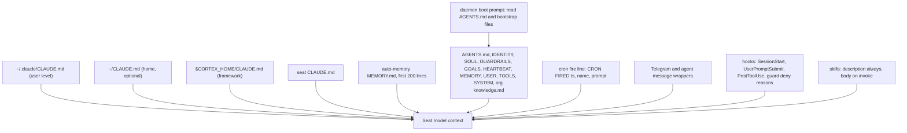

# 22. Prompt registry

This document lists every place in OGL Cortex where text reaches a seat's model as instructions. It explains who writes each surface, when it loads, how big it tends to get, and how to version it. It ends with a versioning design you can adopt on day one.

Related documents: architecture in `01-core-architecture.md`, the cron and settings registry in `03-configuration-registry.md`, data shapes (cron entry, hook input and output JSON) in `21-data-models-schema-registry.md`, the tests that check some of these prompts in `23-evals-and-benchmarks.md`, and which model reads them in `24-model-lifecycle.md`.

Path conventions used below:
- `$CORTEX_HOME` is your framework checkout (for example `~/cortextos`).
- `$CTX_ROOT` is the runtime state root for one daemon instance (for example `~/.cortextos/<instance>`).
- `<org>` is your org folder name under `$CORTEX_HOME/orgs/`.
- `<seat>` is one agent folder under `$CORTEX_HOME/orgs/<org>/agents/`.

## What "prompt surface" means

A prompt surface is any text that reaches a seat's model as instructions without someone typing it into chat that turn. Put simply: everything the model is told before or alongside the owner's message. OGL Cortex has seven kinds:

1. **CLAUDE.md layers.** Claude Code loads these at session start. It reads the user-level file in `~/.claude/` and every `CLAUDE.md` in the working directory and its parent directories.
2. **Auto-memory index.** `~/.claude/projects/<project>/memory/MEMORY.md`. Claude Code loads its first 200 lines into every session for that project.
3. **Seat bootstrap files.** IDENTITY.md, SOUL.md, GUARDRAILS.md and the rest. Claude Code does not auto-load them. The daemon's boot prompt tells the model to read them.
4. **Daemon-typed prompts.** The boot prompt, the continue prompt, the cron-fire line and the Telegram and agent-message wrappers. The OGL Cortex daemon types these into each seat's terminal.
5. **Cron prompts.** The `prompt` field of each entry in a seat's `crons.json`. The daemon types it in on schedule.
6. **Skill prompts.** `SKILL.md` files. Name and description sit in context; the body loads when invoked.
7. **Hook-injected text.** Small programs that Claude Code runs on events (session start, each prompt, after each tool call, compaction). Some print text that joins the model's context. Guard hooks that block an action also send their reason text to the model.



## 1. Seats in scope

The command-line tool is named `cortextos`.

A seat is one long-running Claude Code session the daemon manages. `cortextos bus list-agents` lists every seat with `enabled` and `running` flags. A fleet can keep any number of seats on disk and enable only some. This document uses neutral role names:

| Role | Template | Job |
|---|---|---|
| orchestrator | `orchestrator` | the seat the owner talks to; decomposes and dispatches work |
| analyst | `analyst` | metrics, upstream checks, system improvement cycles |
| specialist | `agent` | domain work (code, content, research) |
| auditor | `agent` with an auditor identity | reviews returns and gates changes |
| sentinel | `agent` | infrastructure watch and alert relay |

Seat folder names are yours to choose (for example `boss` for an orchestrator). Each seat's `config.json` sets `runtime` (for example `claude-code`) and `model`. Model detail is in `24-model-lifecycle.md`.

A disabled seat boots with whatever its files said when it was provisioned. Refresh its prompt files before you enable it.

## 2. CLAUDE.md layers

| Layer | Path | Owner | Loaded by |
|---|---|---|---|
| Global (user) | `~/.claude/CLAUDE.md` | the owner | every Claude Code session on the machine |
| Home | `~/CLAUDE.md` (optional) | the owner | any session under `~` |
| Framework | `$CORTEX_HOME/CLAUDE.md` | Framework upstream | every seat, because every seat lives under `$CORTEX_HOME` |
| Org | `$CORTEX_HOME/orgs/<org>/CLAUDE.md` (optional, not created by default) | the owner | every seat in the org |
| Seat | `$CORTEX_HOME/orgs/<org>/agents/<seat>/CLAUDE.md` | the seat, under owner rulings | that seat |

Design guidance for these layers:

- **Keep the global file a plain file under your control.** If you make `~/.claude/CLAUDE.md` a symlink into a notes vault or synced folder, any process that writes that folder can change what every Claude session on the machine is told. That includes sync jobs and enrichment scripts that append "related notes" blocks. If you want the vault to show the file, let the vault mirror it, not own it.
- **Never let an automated writer edit the global prompt silently.** If a tool must append to it, have the tool write between fixed markers and commit the result, so a diff shows every machine edit.
- **Know what the framework file says.** Upstream `$CORTEX_HOME/CLAUDE.md` is a contributor guide ("run `npm run build` and `npm test`"). Every seat inherits it through the parent-directory walk. That is harmless, but it is not seat guidance. Put seat rules in the seat file or an org file.
- **Do not describe mechanisms that do not run.** A CLAUDE.md line that says "hooks automatically do X" teaches the model to trust X. If the hook is not wired in `settings.json`, delete the line or wire the hook.
- **Give every seat a seat CLAUDE.md.** A seat without one gets its rules only from bootstrap files it is told to read at boot. A seat CLAUDE.md is re-loaded on every session start without relying on the model to follow a "read these files" instruction.

## 3. Auto-memory index

| Seat | Path | Owner |
|---|---|---|
| any Claude Code seat | `~/.claude/projects/<project-slug>/memory/MEMORY.md` | the seat |

The project slug is the seat's absolute working directory with `/` replaced by `-`.

Claude Code loads the first 200 lines of this index into every session. Line 201 and beyond are cut silently. The harness may count lines slightly differently from `wc -l`, so treat about 190 lines as the practical ceiling. Keep the index to one line per lesson, with the detail in topic files beside it. When you reach the cap, merge or retire entries rather than appending.

## 4. Seat bootstrap files

The fresh-boot prompt says "Read AGENTS.md and all bootstrap files listed there" (`src/daemon/agent-process.ts`). The orchestrator template's AGENTS.md lists: IDENTITY, SOUL, GUARDRAILS, GOALS, HEARTBEAT, MEMORY, USER, TOOLS, SYSTEM. The orchestrator CLAUDE.md also tells it to read the org `knowledge.md`.

| File | Purpose | Usual writer |
|---|---|---|
| AGENTS.md | session-start checklist and operating manual | template, then the seat |
| IDENTITY.md | name, role, emoji, vibe | onboarding |
| SOUL.md | behavioural philosophy | template, then the seat |
| GUARDRAILS.md | red-flag rules and responses | seat, plus auditor coaching |
| GOALS.md | current goals | generated from `goals.json` by `cortextos goals generate-md`; do not hand-edit |
| HEARTBEAT.md | what to do on each heartbeat cron | seat |
| MEMORY.md | long-term lessons | seat |
| USER.md | facts about the owner relevant to the role | seat |
| TOOLS.md | tool catalogue | seat |
| SYSTEM.md | org and system context | seat |
| STATE.md (optional) | where the work stands; re-injected after compaction (section 7) | seat |
| ENTITIES.md (optional) | noun index of people, places, systems with source and date | seat |
| ONBOARDING.md | first-boot protocol | template; read only on first boot |
| `orgs/<org>/knowledge.md` | shared facts for every seat | KB ingest and seats |

### 4.1 Size budget

Bootstrap files grow with use, and MEMORY.md and the org knowledge file grow fastest. At roughly 4 characters per token, 500 KB of boot-read text is on the order of 125,000 tokens if read in full.

The framework already has two boot modes:
- The **fresh boot prompt** asks for all bootstrap files.
- The **lean handoff boot prompt** (used after a context handoff) reads GUARDRAILS, IDENTITY and SOUL in full, treats MEMORY.md "as an index", and says "do NOT read the full MEMORY.md body".

Guidance: keep MEMORY.md as an index in every mode. Move narrative into dated topic files. Set a soft cap (for example 60 KB) and have the weekly review prune toward it.

### 4.2 Prose rules are not enforcement

A sentence in a bootstrap file such as "ENTITIES.md is write-gated" is a request, not a gate. If a rule matters, back it with a hook (see `04-failsafe-boundary-log.md`). If no hook exists, say so in the file, so the reader does not assume one.

### 4.3 Template drift between seats

Seats provisioned from one template start with byte-identical files. Three kinds of drift follow:
- A file never gets specialised (two seats keep the same TOOLS.md).
- A seat boots from a template written for a different runtime (for example a Claude Code seat carrying the `agent-codex` AGENTS.md).
- Same-name files drift apart with no shared source.

A cheap check: hash every bootstrap file across seats (`shasum -a 256`) and look for unexpected matches and unexpected differences. Section 9 shows how to make this routine.

### 4.4 Org level

| File | Purpose |
|---|---|
| `orgs/<org>/knowledge.md` | shared facts; orchestrator reads it at boot |
| `orgs/<org>/GUARDRAILS.md` | org-wide guardrails |
| `orgs/<org>/brand-voice.md` | voice rules |
| `orgs/<org>/goals.json` | org goals that feed the daily goal cascade |

## 5. Daemon-typed prompts (framework code)

These live in compiled framework code, so their version is the framework commit. The running daemon executes `dist/`, so rebuild after you pull.

| Surface | Source | What it says |
|---|---|---|
| Fresh boot prompt | `src/daemon/agent-process.ts` | current UTC time; "Read AGENTS.md and all bootstrap files listed there"; "do NOT call CronCreate or CronList for cron restoration"; plus reminder, deliverables and handoff blocks and an online-message line |
| Lean handoff boot prompt | `src/daemon/agent-process.ts` | reads GUARDRAILS, IDENTITY, SOUL; MEMORY.md as index only; approval rules; resume from the handoff doc's Next Actions |
| Onboarding append | `src/daemon/agent-process.ts` | "This is your FIRST BOOT ... read ONBOARDING.md and complete the onboarding protocol" |
| Continue prompt | `src/daemon/agent-process.ts` | "SESSION CONTINUATION ... Re-read AGENTS.md and ALL bootstrap files listed there" |
| Cron fire line | `src/daemon/agent-manager.ts` | `[CRON FIRED <iso>] <name>: <prompt>` |
| Agent message wrapper | `src/daemon/fast-checker.ts` | `=== AGENT MESSAGE from <from> [msg_id: <id>] ===` |
| Telegram wrapper | `src/daemon/fast-checker.ts` | `=== TELEGRAM from [USER: <name>] (chat_id:<id>) ===`, fenced body, recent-sent context, then "Reply using: cortextos bus send-telegram ..." |
| Telegram media wrappers | `src/daemon/fast-checker.ts` | `TELEGRAM PHOTO`, `DOCUMENT`, `VOICE`, `VIDEO` variants with a `local_file:` path |

Two details worth knowing:

- **The cron fire line carries a timestamp on purpose.** Without it, the PTY dedup would drop a repeat fire of the same prompt. Older type comments in `src/types/index.ts` describe a `[CRON: name]` prefix; trust `agent-manager.ts`. Any hook that detects cron turns should match `startswith("[CRON FIRED")`.
- **The cron file path.** Per-agent crons live at `$CTX_ROOT/.cortextOS/state/agents/<seat>/crons.json` (`src/bus/crons-schema.ts`, constants `CRONS_DIRECTORY` and `CRONS_FILENAME`). Some templates and older notes write `${CTX_ROOT}/state/<seat>/crons.json`. That path is wrong. Use `cortextos bus list-crons <seat>` rather than reading the file by hand.

## 6. Cron prompts

Source: `$CTX_ROOT/.cortextOS/state/agents/<seat>/crons.json`. Manage them only through the bus:

```bash
cortextos bus list-crons <seat>
cortextos bus add-cron <seat> <name> <interval-or-cron-expr> <prompt...>
cortextos bus update-cron <seat> <name> --prompt "<prompt>"
cortextos bus remove-cron <seat> <name>
```

### 6.1 Typical cron set

| Seat | Name | Schedule | Prompt starts with |
|---|---|---|---|
| orchestrator | heartbeat | 4h | Read HEARTBEAT.md and follow its instructions |
| orchestrator | morning-review | `0 8 * * *` | Read .claude/skills/morning-review/SKILL.md |
| orchestrator | evening-review | `0 18 * * *` | Read .claude/skills/evening-review/SKILL.md |
| orchestrator | weekly-review | `0 8 * * 0` | Read .claude/skills/weekly-review/SKILL.md |
| orchestrator | upstream-drift-check | 12h | Silent read-only upstream drift check |
| any | kb-ingest-daily | `45 16 * * *` | Daily KB ingest |
| analyst | nightly-metrics | `17 22 * * *` | collect daily metrics |
| analyst | auto-commit | `3 22 * * *` | commit seat files with a PII scan |
| analyst | check-upstream | `5 22 * * *` | compare with the upstream framework |
| analyst | theta-wave | `11 23 * * *` | system improvement cycle |
| auditor | audit-pass | 1h | review recent returns |
| auditor | false-claim-catch-rate | `10 22 * * *` | score the truth-correction ledger |
| sentinel | heartbeat | 2h | |
| sentinel | crash-alert-relay | 1h | relay crash alerts |

These are examples, not a default set. Add business crons (snapshots, healthchecks, polls) as needed. Each is a prompt surface and belongs in this registry.

### 6.2 Cron prompt design rules

- **Point to a file, do not inline a program.** "Read .claude/skills/morning-review/SKILL.md" keeps the logic versioned with the skill. A cron prompt of several thousand characters that runs every hour is a program written in English, with no version history (section 9). Move it into a skill or script.
- **One source for same-name prompts.** If five seats run `kb-ingest-daily`, generate their prompts from one template. Otherwise each copy drifts after its first local edit.
- **Check the schedule says what the prompt says.** `0 20 12 10 *` is a five-field cron that fires once a year (12 October, 20:00). A prompt that says "weekly" on that schedule fires once. For one-shot jobs, say "one-shot" in the prompt and include the removal step.
- **Prefer wall-clock expressions for long intervals.** See `03-configuration-registry.md` for how interval crons interact with the scheduler.
- **Daemon crons run in local time.** Name the zone in any prompt that quotes a time.

## 7. Hook-injected text

### 7.1 Which events inject context

Claude Code adds hook stdout to context on `SessionStart`, `UserPromptSubmit`, `PostToolUse` and `PostCompact`. `PreToolUse` guards that exit 2 send their stderr to the model as the block reason. Other events (`Stop`, `SessionEnd`, `PreCompact`, `PermissionRequest`) usually only act or notify.

A common layout: the orchestrator carries the context-injecting hooks, and other seats carry only guards and notifiers. Decide per seat whether it needs the compaction kit (7.2).

### 7.2 Context-injecting hooks in the OGL layer

| Hook | Event | Text injected |
|---|---|---|
| Checkpoint re-inject (optional, not included) | SessionStart (all) | a header, the last 4,000 chars of `memory/checkpoints/latest.md` if under 72 hours old, the last 3,000 chars of the current or previous day's daily memory, and short reminders |
| STATE.md hand-back (`compaction/after_compact.py`) | SessionStart, matcher `compact` | "The conversation was just compacted. This is STATE.md, your own record of where the work stands. Trust it over the summary where they differ" plus the full STATE.md |
| Context meter (`compaction/meter.py`) | PostToolUse (all) | at a first threshold: "Context meter: Nk of your limit. Keep working..."; at a second: "Compaction is close. Your next action is to rewrite STATE.md in full". Thresholds live in a small `compaction.json` |
| Reply style router (optional, not included) | UserPromptSubmit | `[reply style: <skin>] <text>`, chosen by a cheap model call from a fixed list of skins. Only for the owner's own words; any failure injects nothing |
| Client memory recall (optional, not included) | UserPromptSubmit | a short header plus up to about 6,000 chars of recalled facts when a prompt names a known entity; skips cron turns |
| Adversarial-pass notice (optional, not included) | PostToolUse on Bash | a one-line notice that a fix commit started a background run of `harness/tools/adversarial-pass.sh` |

Non-injecting hooks that support these:
- `compaction/save_summary.py` stores each compaction summary in `compactions/`.
- Optional, not included: a PreCompact hook that writes the checkpoint a SessionStart hook later reads, and a Stop hook that starts background memory consolidation.

Design guidance:
- **Wire hooks from a stable path.** A hook wired from a build or deliverables folder disappears when someone cleans that folder, and a hook that exits 0 on any error disappears without a trace. Keep hooks under `.claude/hooks/` or `tools/`.
- **Fail quiet for injectors, fail closed for guards.** An injector that crashes should inject nothing. A guard that crashes should block (exit 2) with a clear message.
- **Log what you inject.** Only a router that writes a decision log (one JSON line per choice) lets you measure it later.

### 7.3 Guard hooks: block reasons are prompts too

When a PreToolUse hook exits with code 2, Claude Code shows its stderr to the model. That text steers the next action, so write it as an instruction.

| Guard | Scope | Model-facing text (shape) |
|---|---|---|
| Orwell send-lint (`orwell_lint.py`) | seat or user level, outgoing human-facing text | "ORWELL SEND-LINT BLOCKED this message. Rewrite and resend. Reasons: ..." with a one-time pass instruction for the "break any rule" case |
| Brief guard (`brief_guard.py`) | orchestrator, task dispatch | "BRIEF GUARD BLOCKED this dispatch..." when a task lacks TASK, FILES, BAR, RETURN lines; fail-closed |
| Future-time guard (`future_time_guard.py`) | orchestrator | blocks claims about times that have not happened yet |
| Shared-surface guard (`shared_surface_guard.py`) | seat or user level, Bash | blocks destructive or config-writing commands on shared paths; supports a warn mode |
| Ship gate (`ship_gate.py`) | seat or user level, Bash | blocks deploy and publish commands without a passing security report |

Guard logic is in `04-failsafe-boundary-log.md`.

## 8. Skills

| Location | Scope |
|---|---|
| `<seat>/.claude/skills/` | that seat only |
| `~/.claude/skills/` | every Claude Code session on the machine |
| `~/.claude/plugins/` | plugin-provided skills; may contain duplicates between cache and marketplace folders |
| `$CORTEX_HOME/templates/<template>/.claude/skills/` | source copies for new seats |
| `$CORTEX_HOME/community/` | community catalog |

`cortextos bus list-skills --format text` shows what a seat can see.

Count with `find <dir> -name SKILL.md` (add `-L` to follow symlinks). Expect a user-level skills folder to hold many more nested SKILL.md files than invocable skills, because bundles ship sub-skills and examples.

**Template drift.** Compare seat skills with the template:

```bash
for d in <seat>/.claude/skills/*/; do
  n=$(basename "$d")
  t="$CORTEX_HOME/templates/orchestrator/.claude/skills/$n/SKILL.md"
  if [ ! -f "$t" ]; then echo "local-only $n"
  elif cmp -s "$d/SKILL.md" "$t"; then echo "same $n"
  else echo "differs $n"; fi
done
```

Every "differs" skill has local edits that a template refresh would not carry and could overwrite. Keep that list in the seat's notes.

**Subagent definitions are prompts too.** Files in `<seat>/.claude/agents/` and `~/.claude/agents/` set a subagent's instructions, tools and model. Register them here.

## 9. Versioning

The target is "cryptographic versioning": every prompt change gets an immutable, content-addressed version, a record of who changed it and why, and the running system can prove which version it loaded.

### 9.1 Surface by surface

| Surface | Default state | Recommended mechanism |
|---|---|---|
| `~/.claude/CLAUDE.md` | not versioned | put `~/.claude/CLAUDE.md`, `~/.claude/settings.json` and `~/.claude/hooks/` in a private git repo |
| `$CORTEX_HOME/CLAUDE.md` | framework git | none needed |
| Seat files | not versioned: `$CORTEX_HOME/.gitignore` ignores `orgs/` | `git init` in each seat folder; nightly commit cron with a PII scan (the analyst template's `auto-commit` pattern) |
| Org files | not versioned (same ignore) | include in the same private repo or an org repo |
| Cron prompts | `crons.json` plus one `crons.json.bak` written before each save (`src/bus/crons.ts`) | export prompts nightly with fire counters stripped (9.2) |
| User hooks | not versioned | private git repo plus the `.gated-<sha8>` freeze (9.3) |
| Skills | seat git if you set it up; templates in framework git | seat git |
| Daemon prompts | framework git commit | rebuild `dist/` after every pull and record the commit in the daily memory |
| Hook-injected text | inside hook source | hook source in git; injectors write a decision log |

### 9.2 Why cron prompts lose history

Each fire updates `last_fired_at`, `fire_count`, `last_fire_attempted_at` and the envelope `updated_at`. So the single `.bak` holds the state from one write ago, and an edited prompt survives only until the next fire. To keep real history, export a stripped copy:

```bash
python3 - <<'PY'
import json, os, glob
root = os.path.expandvars("$CTX_ROOT/.cortextOS/state/agents")
out = {}
for f in sorted(glob.glob(f"{root}/*/crons.json")):
    seat = f.split("/")[-2]
    data = json.load(open(f))
    crons = data.get("crons", data) if isinstance(data, dict) else data
    out[seat] = [{k: c.get(k) for k in ("name", "schedule", "interval", "enabled", "prompt")} for c in crons]
print(json.dumps(out, indent=2, sort_keys=True))
PY
```

Write the output to a file in your prompt repo and commit it nightly. The file then changes only when a prompt or schedule changes. Check the envelope shape against `21-data-models-schema-registry.md` before relying on the key names.

### 9.3 The `.gated-<sha8>` convention

When a hook passes its gate, freeze a read-only copy named with the first 8 hex digits of its own sha256:

```bash
f=<seat>/.claude/hooks/ogl/shared_surface_guard.py
s=$(shasum -a 256 "$f" | cut -c1-8)
cp "$f" "$f.gated-$s" && chmod 400 "$f.gated-$s"
```

To check whether the live file is still the gated version:

```bash
live=$(shasum -a 256 "$f" | cut -c1-8)
ls "$f.gated-$live" 2>/dev/null && echo "live matches a gated copy" || echo "live is ungated"
```

Run that check before you trust a guard. A guard edited after its last freeze runs code nobody gated. Freeze before any post-gate edit, so the next change is a diff, not a re-test.

Name ad hoc backups `<file>.bak-<UTC stamp>-<reason>` so the reason survives.

### 9.4 Distance from the ideal

| Ideal property | Default | With the setup above |
|---|---|---|
| Every prompt under version control | framework only | all surfaces |
| Content-addressed IDs | none | git object ids, plus `.gated-<sha8>` for guards |
| Immutable history | none | git; add an off-machine remote in case the disk fails |
| Who and why per change | none | commit messages; `.bak` reason suffixes |
| Runtime attestation | none | a SessionStart hook per seat that logs the sha256 of each loaded prompt file |

A minimal attestation hook:

```bash
#!/bin/bash
# SessionStart: record which prompt files this session saw
log="$CTX_ROOT/logs/$CTX_AGENT_NAME/prompt-attest.jsonl"
for f in CLAUDE.md AGENTS.md GUARDRAILS.md MEMORY.md; do
  [ -f "$f" ] && printf '{"ts":"%s","file":"%s","sha":"%s"}\n' \
    "$(date -u +%FT%TZ)" "$f" "$(shasum -a 256 "$f" | cut -c1-12)" >> "$log"
done
exit 0
```

It prints nothing, so it adds no context. It exits 0 on every path, so it cannot block a boot. This is a design sketch; test it in your own seat before you wire it.

## 10. Registry checklist

Run this when you add a seat, and monthly after that:

| Item | How to count |
|---|---|
| Live seats | `cortextos bus list-agents` |
| CLAUDE.md files a seat loads | `ls` up the directory tree from the seat |
| Auto-memory index length | `wc -l ~/.claude/projects/<slug>/memory/MEMORY.md` (stay under about 190) |
| Bootstrap bytes per seat | `wc -c` over CLAUDE.md and the AGENTS.md boot list |
| Cron prompts per seat | `cortextos bus list-crons <seat>` |
| Hook commands per seat | count entries under `hooks` in `<seat>/.claude/settings.json` |
| Skills per seat | `find <seat>/.claude/skills -name SKILL.md` |
| Gated guard copies vs live | the 9.3 check |

## Known limitations

1. The framework ignores `orgs/` in git, so seat and org prompt files have no version history unless you add it.
2. `crons.json` changes on every fire, so its single `.bak` does not preserve prompt history.
3. Claude Code truncates the auto-memory index at 200 lines without an error.
4. Prose rules in bootstrap files are not enforced. Only hooks enforce.
5. No built-in record shows which prompt version a session loaded. Section 9.4 sketches one.

## Design notes

1. Version seat and org prompt files from the first day.
2. Give cron prompts real history by exporting a stripped copy, or move counters into a separate state file.
3. Keep the global CLAUDE.md a plain file you own. Mirror it to notes tools; do not let them write it.
4. Give every live seat its own CLAUDE.md, and refresh template-derived files when you change a seat's runtime.
5. Decide per seat which context-injecting hooks it needs. The compaction kit pays off on any seat with long sessions.

## Source files

- `src/daemon/agent-process.ts` (boot, lean handoff, onboarding and continue prompts)
- `src/daemon/agent-manager.ts` (cron fire line)
- `src/daemon/fast-checker.ts` (Telegram and agent message wrappers)
- `src/bus/crons.ts`, `src/bus/crons-schema.ts` (cron file path, `.bak` on write)
- `src/types/index.ts` (cron and agent config types)
- `templates/orchestrator/` (CLAUDE.md, AGENTS.md, bootstrap files, skills)
- `.gitignore` (the `orgs/` ignore)
