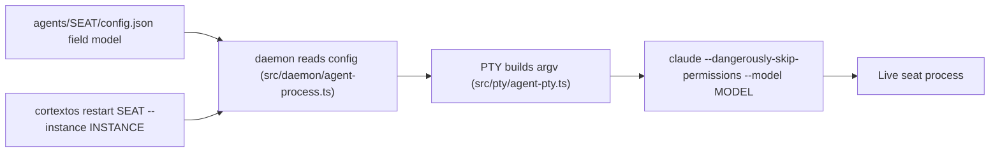
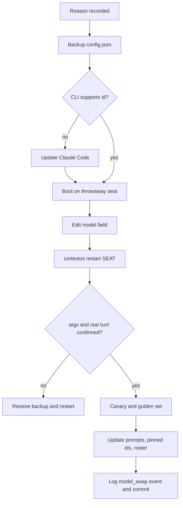

# 24. Model lifecycle

This document covers the language models behind an OGL Cortex fleet. It answers four questions. Where is each seat's model set? What else in the system calls a model? How does a model swap work? What should a swap checklist look like for a one-owner fleet?

Related documents: `01-core-architecture.md` (how the daemon spawns seats), `02-execution-engine.md` (PTY and cron engine), `03-configuration-registry.md` (config file catalogue), `04-failsafe-boundary-log.md` (fail-safes), `13-vendor-risk.md`, `22-prompt-registry.md`, `23-evals-and-benchmarks.md`.

Terms:
- **Seat**: one long-running agent session managed by the cortextOS daemon.
- **Runtime**: which CLI the daemon launches for a seat. `claude-code` is Anthropic's Claude Code CLI. `codex-app-server` is OpenAI's Codex CLI. `opencode` is the OpenCode CLI.
- **Model id**: the string passed to the CLI with `--model`, for example `claude-opus-4-8[1m]`. A `[1m]` suffix selects the 1 million token context variant where the model offers one.
- **Alias**: a short model name the CLI resolves itself, such as `sonnet`, `opus` or `haiku`.
- **Weekly cap**: the 7-day usage limit on a Claude subscription. When a seat hits it, the process stays alive but every turn returns a limit message.

Path conventions: `$CORTEX_HOME` is your cortextOS checkout, `<org>` and `<seat>` are your folder names, `<instance>` is the daemon instance id.

## 1. Where models are set

### 1.1 Seats

Each seat's model lives in one field of `$CORTEX_HOME/orgs/<org>/agents/<seat>/config.json`:

```json
{
  "runtime": "claude-code",
  "model": "claude-opus-4-8[1m]",
  "enabled": true
}
```

Other keys in the file (crons, session limits, timezone) are covered in `03-configuration-registry.md`.

To read every seat's model and runtime:

```bash
cd $CORTEX_HOME/orgs/<org>/agents
for f in */config.json; do
  python3 -c "import json,sys; c=json.load(open('$f')); print('$f'.split('/')[0], c.get('runtime'), c.get('model'), c.get('enabled'))"
done
```

To confirm what a running seat uses, trust the process, not the file:

```bash
cortextos status --instance <instance>
ps -axo pid,command | grep -- '--model'
lsof -a -p <pid> -d cwd -Fn     # maps a PID to its seat folder
```

### 1.2 Other model callers

Seats are not the only callers. A fleet usually grows small tools that call a model directly. Register each one:

| Caller type | Typical model choice | Where the id lives |
|---|---|---|
| Classifier inside a tool (reply routing, labelling) | a small fast model | the tool's `config.json`, called through `claude -p ... --model <id>` |
| Health probe (auth sentinel) | an alias such as `sonnet` | the sentinel script |
| Subagent definitions | `model:` front matter, often `sonnet` | `<seat>/.claude/agents/*.md`, `~/.claude/agents/*.md` |
| Hook-spawned headless runs (memory digests, consolidation) | an explicit `--model`, or none | the hook script |
| Prompt router hooks | a small fast model | the router script |

Rules:
- **Probes use aliases.** A probe pinned to a dated id goes silent when that id retires: the error it gets matches none of its alert strings. Probe with an alias and alert on anything except the expected answer.
- **Classifiers may pin dated ids,** because pinning keeps eval results valid. Then the id is a dependency: record it in this registry and re-run the eval (`23-evals-and-benchmarks.md`) when you move it.
- **Always pass `--model` to headless spawns.** Without it, the spawn inherits Claude Code's default, which can change under you.

### 1.3 Quota pool

All seats and all headless `claude -p` calls authenticated with one Claude subscription draw from the same pool. A memory-digest spawn or a subagent fork spends the same weekly quota that keeps the orchestrator alive. Watch it with a sentinel that reads the usage API and writes a ledger, one JSON line per read:

```json
{"ts":"<iso>","seven_day":{"utilization":72,"resets_at":"<iso>"},"five_hour":{"utilization":11}}
```

The exact fields depend on the usage endpoint you read. Treat this as a shape to adapt, not a fixed schema.

## 2. How a swap happens

### 2.1 The mechanism in code



- `model` is a per-seat field (type in `src/types/index.ts`).
- The daemon passes it into the PTY config (`src/daemon/agent-process.ts`).
- The Claude Code PTY appends `--model <value>` only if the field is set (`src/pty/agent-pty.ts`). If the field is missing, Claude Code picks its own default model, and `cortextos status` shows `-` for the model.
- The Codex PTY falls back to `gpt-5-codex` when no model is set (`src/pty/codex-app-server-pty.ts`). The OpenCode PTY passes `--model provider/model` (`src/pty/opencode-pty.ts`).
- A config edit does nothing until the seat restarts:

```bash
cortextos restart <seat> --instance <instance>
```

`--instance` defaults to `default`. If your daemon runs under another instance id and you leave the flag off, the CLI talks to the wrong instance and reports "Daemon is not running". `cortextos restart` restarts one seat. `pm2 restart cortextos-daemon` restarts the daemon and every seat with it.

- `src/utils/validate.ts` exports a `validateModel` helper, but the launch path does not call it, and its pattern does not accept the `[1m]` suffix. Nothing validates a model id before launch. A typo shows up when the seat fails to boot.
- No effort flag is passed by the PTY. Seats run the CLI's default effort unless you set one in Claude Code settings.

### 2.2 The roster

`src/cli/roster.ts` holds an `EXPECTED_SEATS` table for a delivery roster, with a model and effort per seat. Seats are marked `existing-only` or `create-disabled`. The roster creates missing seats disabled. It never rewrites an existing `config.json`. So the roster states intent. The `config.json` files are what runs. When you change one, change the other or record why they differ.

### 2.3 What else moves in a swap

A swap is more than one config line:

1. **CLI version.** A new model id can need a newer Claude Code. Check `claude --version` against the model's release notes before you swap.
2. **Prompts that name the model.** Seat CLAUDE.md files, the global `~/.claude/CLAUDE.md`, MEMORY.md policy lines and auto-memory notes often say which model a seat runs. Find them with `grep -rn -i '<old model name>' <seat> ~/.claude`.
3. **Pinned ids in tools** (section 1.2).
4. **Quota meaning.** Some models carry their own caps or credit gates. The account-wide meter keeps working, but what "80%" means can change with the model.
5. **Disabled seats.** They keep the model id they were provisioned with. Check it before you enable one.

### 2.4 Who decides

Model choice is an owner decision. The default policy in the OGL layer:
- The owner orders fleet-wide swaps. The orchestrator or a sentinel seat executes.
- In an outage (weekly cap, credit gate, boot failure), the orchestrator may fail a seat over to a known-good model and must tell the owner in the same turn.
- No seat changes its own model silently.

Nothing in the framework enforces this. It is a guardrail in GUARDRAILS.md and the approval skill.

## 3. Failure modes

These are properties of the stack. Plan for each.

| Failure mode | What you see | Reliable signal | Response |
|---|---|---|---|
| Weekly cap reached | process alive, crons log `fired`, heartbeats may look green, every turn returns limit text | the text of the seat's last turn; transcript growth stops | fail over to another model or wait for reset; tell the owner |
| Credit or plan gate on one model | same as above, for seats on that model only | turn text | fail over that seat |
| New model id freezes on boot | heartbeat never advances; session never starts | heartbeat age; no transcript | revert the field and restart; test new ids on a throwaway seat first |
| CLI too old for the model id | boot error or immediate exit | seat stderr log | update Claude Code, then restart |
| Org or auth disable | turns return an access error, not a usage error | grep turn text for the exact error string | fix auth; a model swap does not help |
| Dated id retired under a probe | probe gets an unknown-model error that matches no alert string, so it stays quiet | alert on "anything except ok" | switch probes to aliases |
| Empty `model` field | seat runs the CLI default; status shows `-` | `cortextos status` | always set the field |
| Daemon restart used for a swap | every seat restarts; memory and disk spike; the swap leaves no bus record | `pm2` logs only | restart one seat with `cortextos restart` |

Two rules follow from this table:
- **A dead model looks alive.** Liveness checks must read content (turn text, transcript growth), not process state or cron fire records.
- **A down seat's own notes are weak evidence.** Diagnose an outage from logs and turn text written by something other than the affected seat.

## 4. Quota-aware scheduling

Some owners want to use spare weekly quota before reset. A pattern:

```bash
cortextos bus add-cron <orchestrator-seat> prereset-burn "0 20 * * 1" \
  "One window of queued internal builds before the weekly reset. Internal work only; every ship or send still needs owner approval. Read the 7-day meter every hour; stop at 97 percent or at reset."
```

Notes:
- Daemon crons run in the seat's local time. Convert the reset time from UTC before you write the expression.
- A five-field expression with a fixed day of month and month (`0 20 12 10 *`) fires once a year, not weekly. Use a day-of-week field for a weekly job.
- A stop threshold the seat reads from a meter is a request, not a guard. For a hard stop, have the sentinel that writes the ledger remove the cron when the threshold is crossed.

## 5. Runtimes other than Claude Code

- `codex-app-server` seats need an active Codex login. When the login lapses, the seat stays up and stops working, like a weekly cap.
- Codex sandbox modes (for example `danger-full-access`) can trigger a security gate that a usage reset does not lift.
- If you do not pay for a runtime, mark it off in the roster and in GUARDRAILS.md, and write the condition that re-opens it.

## 6. Enterprise practices, scaled down

| Enterprise practice | One-owner equivalent |
|---|---|
| Model registry with versions and owners | the seat `config.json` files plus `roster.ts` plus the section 1.2 caller list |
| Staged rollout | boot the new id on a throwaway seat, then one real seat for 72 hours, then the fleet |
| Deprecation tracking | a list of every pinned dated id with its retirement date, checked by the analyst's upstream or news digest |
| Regression eval before promotion | the golden set in `23-evals-and-benchmarks.md`, before and after |
| Rollback plan | `config.json.bak-<UTC>-pre-<model>` plus a single-seat restart |
| Cost per model | token totals by model from transcripts; dollars only if you meter them |
| Change approval | owner orders, orchestrator executes, logged in the daily memory |

## 7. Swap checklist

Use this for any change to a seat's `model` or `runtime`, including emergency failovers. Steps marked (E) can wait in an emergency but must be done within 24 hours.

**Before**
1. Write the reason in one line: limit, outage, cost, or quality. For an outage, confirm the cause from the seat's own turn text. An auth disable looks like a cap and a swap will not fix it.
2. Record the current value and back it up:
   ```bash
   grep -n '"model"' $CORTEX_HOME/orgs/<org>/agents/<seat>/config.json
   cp config.json "config.json.bak-$(date -u +%Y%m%dT%H%M%SZ)-pre-<model>"
   ```
3. Check the CLI supports the new id (`claude --version` against the release notes).
4. (E) Boot the new id on a throwaway seat first. A model that freezes on boot takes the seat dark.
5. Read the last line of the quota ledger. Do not swap onto a pool above 90% unless that is the point.

**Change**
6. Edit only `model` (and `runtime` if needed). Never leave `model` empty.
7. Restart only that seat: `cortextos restart <seat> --instance <instance>`.

**Verify (do not trust the seat's own report)**
8. Confirm the live argv with `ps` and `lsof -d cwd`, and with `cortextos status --instance <instance>`.
9. Confirm a real model turn: transcript growth or a heartbeat with content, not a cron `fired` record.
10. (E) Run the seat's liveness canary and one known task, and compare with a recent result.
11. (E) Run the golden set (`23-evals-and-benchmarks.md`) and compare with the last run on the old model.

**After**
12. (E) Update every prompt that names the model (section 2.3).
13. (E) Update pinned ids in tools, or switch them to aliases.
14. (E) Update `roster.ts`, or record why the seat differs.
15. Log one line with old value, new value, reason, who decided, and whether the owner was told:
    ```bash
    cortextos bus log-event action model_swap info --meta '{"seat":"<seat>","from":"<old>","to":"<new>","reason":"<reason>","decided_by":"owner"}'
    ```
16. Commit the seat's `config.json` if the seat folder is under git (`22-prompt-registry.md`, section 9).



## Known limitations

1. Model ids are not validated before launch.
2. A swap done by restarting the daemon leaves no record in the bus restart log.
3. The roster does not rewrite existing seat configs, so roster and disk can disagree.
4. The PTY passes no effort flag.
5. A weekly cap or lapsed login leaves the seat process running, so process-level health checks report healthy.
6. Quota stop thresholds enforced by a seat reading a meter are advisory unless a sentinel enforces them.

## Source files

- `src/types/index.ts` (agent config type, `model` field)
- `src/daemon/agent-process.ts` (config to PTY)
- `src/pty/agent-pty.ts` (`--model` argv for Claude Code)
- `src/pty/codex-app-server-pty.ts` (Codex default model)
- `src/pty/opencode-pty.ts` (OpenCode `--model`)
- `src/utils/validate.ts` (`validateModel`)
- `src/cli/roster.ts` (`EXPECTED_SEATS`)
- `src/cli/restart.ts` (`--instance` flag)
