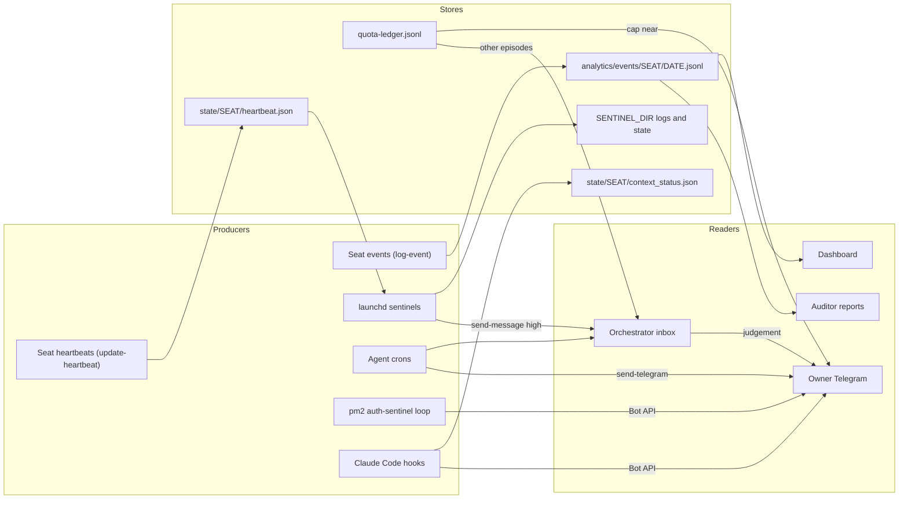

# 31. Observability and alerting

What OGL Cortex measures, where each record lands, what writes it, the default thresholds, and who hears about it.

Related documents: `30-sre-runbooks.md` (what to do when an alert fires), `32-security-red-team-log.md` (guards as defences), `40-finops-capacity.md` (quota and capacity limits), `42-chaos-telemetry-determinism.md` (raw log formats). Path names (`$CTX_ROOT`, `$SENTINEL_DIR`, `<seat>`) and role names follow the conventions in `30-sre-runbooks.md`.

## 1. Three kinds of signal

1. **Self-reports.** Seats write heartbeats, events and message logs about themselves through the cortextOS bus.
2. **Sentinels.** Shell or Python scripts run by launchd (or pm2) outside any model. They check the machine, the quota, credentials and websites. They keep working when every seat is down or capped.
3. **Agent crons.** The daemon injects a prompt into a seat on a schedule. The seat runs a check and decides whether to speak. These need a live seat with quota.

A **page** means a `cortextos bus send-message <seat> high '<text>'` call. It lands in that seat's inbox. Most pages go to the orchestrator, which decides whether the owner hears about it. A short list of producers reaches the owner's Telegram directly (section 5), so that a capped or busy orchestrator cannot swallow them.

## 2. Signal flow

## 3. Where records are written

| Store | Path | Written by | Read by |
|---|---|---|---|
| Heartbeat | `$CTX_ROOT/state/<seat>/heartbeat.json` | `cortextos bus update-heartbeat <status>`, usually from each seat's `heartbeat` cron | `cortextos bus read-all-heartbeats`, heartbeat sentinel, dashboard |
| Event log | `$CTX_ROOT/orgs/<org>/analytics/events/<seat>/YYYY-MM-DD.jsonl` (UTC date) | `cortextos bus log-event <category> <event> <severity> --meta '<json>'` | Dashboard activity feed, metrics, auditor |
| Outbound Telegram | `$CTX_ROOT/logs/<seat>/outbound-messages.jsonl` | `cortextos bus send-telegram` (successful sends only) | Send receipts, auditor |
| Inbound Telegram | `$CTX_ROOT/logs/<seat>/inbound-messages.jsonl` | Daemon Telegram poller | Reply-latency checks |
| Crash and restart logs | `$CTX_ROOT/logs/<seat>/crashes.log`, `restarts.log` | SessionEnd hook `cortextos crash-alert`; restart commands | Crash relay, storm watch |
| Session output | `$CTX_ROOT/logs/<seat>/stdout.log` | Daemon PTY capture | Humans (raw terminal, contains ANSI codes) |
| Context meter | `$CTX_ROOT/state/<seat>/context_status.json` | statusLine command `cortextos bus hook-context-status` | Daemon fast-checker |
| Cron state | `$CTX_ROOT/.cortextOS/state/agents/<seat>/crons.json` and the cron execution log | Daemon scheduler | `cortextos bus list-crons`, `cortextos bus get-cron-log` |
| Metrics report | `$CTX_ROOT/orgs/<org>/analytics/reports/latest.json` | `cortextos bus collect-metrics` | Analyst seat, dashboard |
| Sentinel logs and state | `$SENTINEL_DIR/logs/*.log`, `$SENTINEL_DIR/state/*` | launchd sentinels | Humans and seats on demand; `.alive` files read by other sentinels |
| Quota ledger | `$SENTINEL_DIR/state/quota-ledger.jsonl` | Quota ledger sentinel every 10 minutes | Analyst meter, pre-reset burn governor |
| Guard logs | `~/.claude/hooks/<guard>.log` | PreToolUse guard hooks | Liveness canary, guard tallies |

## 4. Signal inventory with default thresholds

The thresholds below are the defaults in the reference sentinel scripts and framework hooks. Tune them per host.

### 4.1 Seat and daemon health

| Signal | Producer | Threshold | Who hears | How |
|---|---|---|---|---|
| Seat heartbeat | Each seat's `heartbeat` cron (template default `4h`) | None by itself. `read-all-heartbeats` labels old entries `[STALE]` | Nobody directly | Read by the heartbeat sentinel and the orchestrator's heartbeat review |
| Wedged seat | Heartbeat sentinel, launchd every 10 min | Heartbeat age at least 2x the seat's cadence **and** work pending | Orchestrator | Page, re-ping every 6 h. The sentinel excludes the ops seat that owns it; another seat must watch ops |
| Mass idle | Heartbeat sentinel | At least K seats idle at once, K = max(3, ceil(n/4)) | Orchestrator | Page |
| Auto-poke of idle seat | Heartbeat sentinel | Cron fired but not drained after 30 min | The idle seat | Ships in dry-run mode (`POKE_DRY_RUN=1`). Review the WOULD-POKE lines before you enable it |
| Daemon restart storm | Storm watch, checks every 15 s | At least 2 stops in 60 s = onset; at least 5 = rapid; recovered after 5 quiet minutes | Orchestrator | Page |
| Who restarted the daemon | Commander watch (launchd KeepAlive) | Any `pm2 restart cortextos-daemon` | Orchestrator | Page naming the parent process chain |
| Session dark but up | Session liveness watch, every 10 min | Process up but no model output for the TTL (default 10 h) | Orchestrator | Page. Run one copy per seat you care about |
| Real crash | SessionEnd hook `cortextos crash-alert` | Any crash. Routine session ends are suppressed during quiet hours (22:00 to 07:00, fixed time zone in the hook source) with a 10-minute dedupe | **Owner** | Telegram via Bot API |
| Crash alert relay | Ops cron, hourly | New alert files in the default crash inboxes | Orchestrator | One page per new alert |
| Compaction notice | PreCompact hook `cortextos bus hook-compact-telegram` | Every compaction | **Owner** | Telegram |
| Context meter | statusLine `hook-context-status`, about every 5 s | `ctx_warning_threshold` (default 30%), `ctx_handoff_threshold` (default 60%) | The seat | Fast-checker injects a warning, then a handoff and restart |
| Event feed | Every seat via `log-event` | None | Nobody | Dashboard Activity page and live stream |
| Dashboard | pm2 app `cortextos-dashboard` | None | Nobody | Pull only |

### 4.2 Machine capacity

| Signal | Producer | Threshold | Who hears | How |
|---|---|---|---|---|
| Disk free | Disk sentinel, launchd every 10 min | States: ok at 20 GiB or more, warn under 20, critical under 10, emergency under 5. Pages under 6 GiB, on a drop of at least 900 MiB inside about 1,000 s, on a new top-level directory growing past 5 GB, or on a df parse failure. Re-ping every 2 h | Orchestrator | Page plus a `disk_sentinel_alert` event |
| Disk floor | Floor guard, launchd every 5 min | Under 10 GiB: page once per 30 min, no automatic prune. Under 6 GiB: emergency page at most every 20 min plus a `disk_emergency_escalation` critical event | Orchestrator | Page and event |
| Disk and swap watch | Infra-watch seat script, every 60 s | Disk at or below 7 GiB; swap file count at or above 17 | Orchestrator and infra watch | Page. Exits after it trips, so re-arm it after each page |

### 4.3 Quota, login and credentials

| Signal | Producer | Threshold | Who hears | How |
|---|---|---|---|---|
| Claude plan quota | Quota ledger, launchd every 10 min | `PACE` (projects 100% before reset), `WARN80` (7d at least 80), `DEGRADED90` (at least 90), `STALE` (reading older than 15 min), `DAYBURN` (7d up more than 10 points in one UTC day), plus `SCHEMA`, `ANOMALY`, `READER` | Orchestrator; **owner** at 7d 90% and on a proven cap | Page; direct Telegram for the owner paths. Exit code 3 means an episode is open |
| Usage meter | Analyst seat, hourly line | None; it is a reading (`7d=` and `5h=` fields) | Nobody | Read by the pre-reset burn governor |
| Claude login works | Auth sentinel, pm2 loop every 20 min | The probe must answer exactly `ok` | **Owner** | Plain `curl` to the Bot API, so it works when no model works. Alert kinds: `cap`, `auth`, `probe` |
| Google credential identity | Credential identity check, hourly | `MISMATCH` (a credential file holds another account, exit 5); `UNKNOWN` after 3 failed checks | Orchestrator | Page once per episode |
| Settings change watch | Same script | Any hash change across watched files: every `settings.json` and `settings.local.json`, hook scripts, `~/.claude/CLAUDE.md`, skills, agents, commands, and the `mcpServers` block of `~/.claude.json` | Orchestrator | Page once per change |

### 4.4 Guards

| Signal | Producer | Threshold | Who hears | How |
|---|---|---|---|---|
| Guard verdicts | PreToolUse guards: shared-surface guard, send guard, attribution lint, Google account guard, brief guard, future-time guard | Per guard (see `32-security-red-team-log.md`) | The acting seat | Exit 2 blocks the call; the reason goes to the model |
| Guard liveness canary | Each seat's heartbeat cron attempts one write the shared-surface guard must block | A `BLOCK` line each window per seat. A landed file means the guard is dead | Orchestrator and auditor | Seat-run check |

### 4.5 Business and housekeeping

| Signal | Producer | Threshold | Who hears |
|---|---|---|---|
| Domain expiry | Domain expiry sentinel, daily | 60, 30, 14, 7 days; 7 is urgent. "Measured nothing" if every lookup failed | Orchestrator |
| Knowledge base freshness | KB freshness sentinel, daily | Newest `ingested_at` too old (exit 10) | Orchestrator |
| Fleet lint | Nightly lint job | Any non-clean verdict | Orchestrator |
| Database backup liveness | Backup liveness watch, daily | Last run older than 25 h, or not every database backed up | Orchestrator |
| Billing alerts | Orchestrator cron running a billing-mail reader | New or escalated bill, moved deadline, paid. Exit map: 0 ok; 3 void (no account read); 4 a send failed; 5 credential mismatch; 6 partial | **Owner** |
| Site and booking watches | Infra-watch scripts | Non-200, vendor payment page, or a changed checkout link count, confirmed by a re-probe | Orchestrator |
| Nightly metrics | Analyst cron running `cortextos bus collect-metrics` | Per seat: tasks, errors, heartbeat staleness | Orchestrator on anomaly |
| Upstream drift | Cron running `cortextos bus check-upstream` | Framework diverges from upstream | Orchestrator |
| Claim audit | Auditor cron | Unverified claim, guardrail break; high severity if a wrong fact reached the owner or the same root cause repeats 3 times in 7 days | Offending seat; owner on high severity |

## 5. Paths that reach the owner without the orchestrator

| Path | Trigger | Code |
|---|---|---|
| Auth sentinel | Login or model probe not `ok` | Sentinel script, direct Bot API call |
| Quota ledger | 7d at least 90%, or a proven cap | Ledger script via `send-telegram` |
| Billing alerts | New or escalated bill; credential mismatch | Billing script via `send-telegram` |
| Crash hook | Any real crash; routine ends outside quiet hours | `src/hooks/hook-crash-alert.ts` |
| Compaction hook | Every compaction | `src/hooks/hook-compact-telegram.ts` |

Model-run crons can also message the owner on a condition. Those need a live seat with quota.

## 6. Signals that look live but are not

Check for these when you audit an install:

- **Dead meters that read zero.** A usage file that stopped updating still reads `0`. Anyone who trusts it sees an idle plan. Rename retired meters to `RETIRED-<name>` so they cannot pass as healthy.
- **Duplicate jobs that never run.** A crontab copy of a sentinel that cannot reach the login keychain logs `SKIP` every run. It looks like cover and gives none. Keep one working copy.
- **Disabled watchers.** `launchctl print-disabled gui/$(id -u)` lists jobs that exist but never fire.
- **Optional hooks not registered.** `cortextos bus hook-loop-detector` blocks repeated tool loops, but only on seats whose `settings.json` registers it.
- **Dated one-shot crons.** A 5-field expression with a fixed day and month fires again a year later unless the prompt removes it.

## 7. Known limitations

- **Most pages go to one inbox.** If the orchestrator is capped, compacting or deep in a long job, pages queue. The direct owner paths in section 5 exist for that reason.
- **No reply-latency alert ships by default.** Inbound and outbound logs both carry timestamps; see the design notes.
- **No per-seat token burn.** The quota ledger shows the account total only.
- **No cost-per-day figure.** Bills arrive by mail; usage APIs are per vendor.
- **Disk is measured by more than one sentinel**, each with its own floor. Know which one is speaking.
- **The heartbeat sentinel cannot watch the seat that runs it.** Assign another seat to watch ops.
- **Temporary watch scripts started with `nohup` die on reboot.** Promote anything you want to keep to a launchd job.

## 8. Design notes: cheap additions

| Missing signal | Cheapest way to add |
|---|---|
| Reply latency to the owner | A short launchd script every 5 minutes: for each inbound owner message older than N minutes with no outbound since, page the orchestrator; past 15 minutes, send the owner one line saying the seat is busy. Add median and p90 to nightly metrics |
| Token burn per seat | Every Claude Code transcript line under `~/.claude/projects/<project>/*.jsonl` carries a `usage` object (input, cache creation, cache read, output). A nightly script can sum it per seat per UTC day. No API calls needed |
| Cost per day | Add a run-rate line to the billing reader built from the bills it already parses |
| Dashboard and local servers up | Add `curl` lines to an existing 10-minute sentinel |
| Telegram delivery | Daily canary to a sink chat; check its `message_id` lands in the outbound log; page through a second channel if not |
| One status page | List every `.alive` mtime against its expected cadence plus every open episode (quota, credentials, disk) into one JSON the dashboard can show |

## Source files

- `src/bus/event.ts` (event log writer)
- `src/bus/metrics.ts` (`collect-metrics`)
- `src/telegram/logging.ts` (outbound log)
- `src/hooks/hook-crash-alert.ts`, `src/hooks/hook-compact-telegram.ts`, `src/hooks/hook-loop-detector.ts`
- `src/daemon/fast-checker.ts` (context thresholds)
- `dashboard/src/lib/watcher.ts` (event feed)
