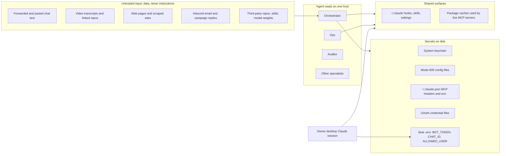

# 32. Security model and red-team practice

How OGL Cortex thinks about attack surfaces, which defences ship with it, how to run adversarial passes against your own guards, and a hardening checklist for a new install.

OGL Cortex targets a single owner running a small agent fleet on one host. It is not an enterprise security programme. Section 5 maps the enterprise items to their closest equivalent.

Related documents: `30-sre-runbooks.md` (RB-06 key rotation), `31-observability-alerting.md` (credential and settings watchers), `42-chaos-telemetry-determinism.md` (how guards are tested), `34-changelog.md` (when each guard arrived).

## Terms

- **Prompt injection**: outside text (a web page, an email, a transcript) written to look like an instruction, so an agent reading it might obey it.
- **Hook**: a script Claude Code runs before or after a tool call. A PreToolUse hook blocks the call by exiting with code 2. Any other non-zero exit does not block.
- **Pass token**: a file a seat touches to let one blocked command through. It is self-issued, so it is a speed bump with an explanation, not an authority gate.
- **Hunter**: a fresh, read-only Claude session told to break exactly one claim about a guard or fix.
- **Gate**: the auditor seat re-runs a guard packet's tests and adds its own probes before ops may install it. `HOLD` means fix first. `PASS` means install.
- **Mutant**: a deliberately broken copy of the code. A good test suite fails on it ("killed").
- **Oracle**: an independent source of truth used to grade a guard, for example the real shell's behaviour.

---

## 1. Trust model



The core risk is the arrow from untrusted input into a seat that can both run commands and read secrets. Every defence in section 3 cuts, narrows or watches one of these arrows.

---

## 2. Attack surfaces

### 2.1 Telegram

- **Who can drive a seat.** The daemon refuses to enable Telegram for a seat whose `.env` has `BOT_TOKEN` but no valid numeric `ALLOWED_USER` list. Inbound messages from anyone else are dropped. This is the strongest control in the system. Keep it.
- **What still gets in.** The allowed user forwards untrusted material: links, screenshots, voice notes, pasted third-party text. The allow-list proves who sent a message, not that its content is safe.
- **Voice notes** arrive as speech-to-text. Treat proper nouns and numbers in transcripts as unverified.

### 2.2 Video links and transcripts

Short-form videos are pulled, transcribed and summarised. The transcript is untrusted text. Videos often point at a GitHub repo, which raises the stakes: see 2.5.

### 2.3 Web pages

Seats browse with Playwright, other browser MCPs, and sometimes the owner's own browser. Page text enters the model's context directly. First-party code that fetches pages (scrapers, graders) also carries web content in. Trusted code does not make its input trusted.

### 2.4 Email

- **Auto-reply engines.** Any engine that feeds inbound email into a classifier prompt is a live injection surface. The safe design: the model only picks from a fixed set of approved replies; every merge field that reaches the outgoing message is checked against a source the attacker cannot write (for example, a number is sent only if it appears in your own config); a deterministic STOP and out-of-office filter runs before the model; each reply is marked handled before sending.
- **Mail read through MCP** is untrusted text with the same risk.
- **Alerts that quote inbound mail** carry third-party personal data into your chat. Keep excerpts short.

### 2.5 Third-party code, skills and models

Installing a skill into `~/.claude/skills` makes it visible to every seat. Running a cloned repo runs its code with the seat's permissions. Model loaders with `trust_remote_code` run code from the model repo. A good pre-install scan lists: network hosts the code contacts, environment variables it reads, files it writes outside its own folder, and any `eval` or dynamic code paths.

### 2.6 Secrets on disk

Typical locations in an install:

| Location | Holds | Expected mode |
|---|---|---|
| System keychain | Generated passwords, API keys | Keychain ACL |
| Mode-600 config files (for example `~/.config/<tool>/`) | Tokens, service account JSON | `-rw-------` |
| `~/.claude.json` | MCP server config, including static `Authorization` headers and env keys | `-rw-------` |
| `~/.google_workspace_mcp/credentials/` | Per-account OAuth tokens | `-rw-------` |
| `$CTX_ROOT/secrets/` | Framework-level secrets | `-rw-------` |
| Seat `.env` | `BOT_TOKEN`, `CHAT_ID`, `ALLOWED_USER` | `-rw-------` |

Secrets also leak into places that are not "secret files": build caches (`.next/`), git history, dangling git objects, logs, and chat transcripts.

### 2.7 Shared bot tokens

If a human's desktop Claude session sends Telegram with a seat's bot token by direct `curl`, those sends bypass the outbound log and the send guard. It also creates a second, unlogged holder of the key. Give each sender its own bot or route all sends through `cortextos bus send-telegram`.

### 2.8 MCP servers

Servers authenticate in three ways: OAuth grants stored on disk, static bearer headers in `~/.claude.json`, and env keys. Remote MCP servers run by third parties return tool output that is untrusted text inside every seat that loads them. `OAUTHLIB_INSECURE_TRANSPORT` is normal for a localhost callback and matters only if the callback is reachable from another host.

### 2.9 Network listeners

The dashboard, local preview servers, bot servers and container ports can bind to all interfaces. A mobile control API that can approve, stop and start the fleet is the most sensitive listener. Bind it to loopback or a private tailnet address, and require a bearer token. Tunnels (for example `cloudflared` LaunchAgents) expose local services to the internet; inventory what each one forwards.

---

## 3. Defences that ship with OGL Cortex

### 3.1 Telegram allow-list (framework, mechanical)

`ALLOWED_USER` must hold one or more numeric Telegram user ids. Without it, Telegram stays off for that seat. Source: `src/daemon/agent-manager.ts`.

### 3.2 Memory-injection discipline (rule)

Untrusted content is never written verbatim into memory files, daily logs or `MEMORY.md`, because memory is injected into the next session as trusted context. Paraphrase external findings with a source pointer, and turn imperative text into descriptive text. No hook enforces this; it relies on seat instructions.

### 3.3 Untrusted-code rule (rule)

Never hand untrusted code to an agent that can both run commands and read secrets. Scan first, then run in a sandbox or a seat started with an empty environment and no keychain access.

### 3.4 Secrets never over chat (rule)

Secrets go to the keychain or a password manager. If one lands in chat, rotate it (RB-06).

### 3.5 Pentest gate, ship wrapper and ship hook (mechanical)

- **Pentest gate** (`cortex_pentest_gate.py <root> --output security [--url <url>] [--requires-authz --authz-evidence <file>] [--skip-zap]`): secret scan (TruffleHog), dependency audit, OWASP ZAP web scan when `--url` is given, header checks, and API authorisation evidence when `--requires-authz` is set. The verdict is `fail` only on a blocker. Raw secret-scan output is never written to disk; hits are stored redacted as short hashes, and an unverified hit with no recorded disposition is a blocker.
- **Ship wrapper** (`ship.sh`): preview, gate the candidate URL, then promote the same build. Exit codes in RB-11.
- **Ship gate hook** (`ship_gate_hook.py`, user-level PreToolUse): blocks recognised ship commands unless a passing `security/pentest-gate-report.json` exists in the current directory or an ancestor.
- **Risk acceptance** lives in a separate acceptance note under `security/`, written in the owner's words. The gate report always keeps its true verdict. A wrapper that rewrites the report to `pass` is a forged pass.

### 3.6 Shared-surface guard (mechanical)

`~/.claude/hooks/shared-surface-guard.py` with its parser `surface.py` and `codewrites.py`. It blocks, with exit 2, any command that changes a surface other seats depend on:
- package cache prunes (`uv cache prune`, `uv cache clean`), global `npm`/`pnpm` installs, `brew upgrade`;
- writes and deletes under `~/.claude*` (outside `projects/`), OAuth credential folders, and shared secret config folders;
- deletes under `~/.claude/projects/` (seat transcripts and auto-memory);
- every delete spelling it can parse: `rm` with brace expansion, `trash`, Finder delete through `osascript`, `find -delete`, `find -exec` running any write verb on a protected root.

The block message names live consumers and asks for a backup and a post-check. A per-seat pass token releases one command: `touch ~/.claude/hooks/.surface-pass-once-$CTX_AGENT_NAME` (valid 10 minutes, consumed once, logged). With `SURFACE_CODE_MODE=warn`, the code-analysis rule only warns; redirects, `cp`, `rm` and direct writes still block. The guard fails closed when the raw command names a guarded root and the guard itself errors.

### 3.7 Google Workspace account guard (mechanical)

`~/.claude/hooks/gws-account-guard.py` blocks Google Workspace MCP calls for accounts you list, any account in an open credential-mismatch episode, and any `start_google_auth` call. No pass token. See RB-09.

### 3.8 Send guard (writing guard, security-adjacent)

`orwell-lint.py` lints outgoing Telegram and MCP sends against a fixed rule set with word lists and regex, no model. It fails closed in scope. It matters for security because sends that bypass the bus also bypass it. Escape for one send: `touch ~/.claude/hooks/.orwell-pass-once-$CTX_AGENT_NAME`.

### 3.9 Credential identity and settings watch (detector)

An hourly check pages once per episode when a credential file holds a token for the wrong account, and once per change when any watched settings, hook, skill or `mcpServers` entry changes hash. See `31-observability-alerting.md` section 4.3.

### 3.10 Dispatch and time guards (process integrity)

`brief_guard.py` refuses cross-seat task dispatch without `TASK:`, `FILES:`, `BAR:` and `RETURN:` lines. `future_time_guard.py` refuses writes and sends that stamp a UTC time more than 3 minutes in the future. Neither is a security control in the narrow sense; both stop a seat from creating records that look verified when they are not.

---

## 4. Running adversarial passes

Guards are code that decides what a model may do. Test them like code, then attack them.

### 4.1 The guard packet

Every guard change ships as a packet in its own folder:

```
<guard>-<version>-<date>/
  README.md           # claim, scope, install and rollback lines
  candidate/          # the new guard files
  tests/              # must-flag and must-allow rows
  mutants.py          # each mutant removes one rule; every one must turn a test red
  oracle.json         # optional: real-shell results for each probe
  replay_diff.py      # run old and new guard over real command history; list every verdict change
  install.sh          # refuses without an auditor PASS; backs up the live file; verifies hashes
```

The bar before install:
1. Tests fail on the live guard and pass on the candidate for the named commands.
2. Allowed cases stay allowed.
3. Every mutant is killed.
4. The replay over real history shows only the intended verdict changes.
5. The auditor seat returns `PASS` after its own probes.
6. The installer writes a backup `<file>.bak-<UTC stamp>-<reason>` and a frozen `<file>.gated-<sha>` copy.

### 4.2 The real-shell oracle

The strongest test grades the guard against what the shell does, not what the author believes. For each probe shape, run the command for real in each shell (`bash`, `zsh`, `sh`) inside `sandbox-exec` with a must-find control first. If the control misses, the run is void. Compare the guard's verdict to the sandbox's observed write or delete. Report `MISS` (dangerous, allowed) and `over-flag` (safe, blocked) separately.

### 4.3 Hunter passes

Run one fenced pass on every guard, hook or fix before you call it done:

```bash
hunter.sh --claim "<one rule the guard must hold>" --cd <dir> <files...>
```

The fence:
- one claim, fresh eyes (never the author), read-only tools;
- evidence as `file:line` plus a reproduction;
- one round and a time budget.

Judge each finding with one question: can a real user or operator action reach it? Drop invented inputs, even true ones. Every fix lands with a test that fails without it. Prove fixes with tests, never by re-running the hunter. Stop when findings turn into edge cases nobody can reach.

A void run (for example, the engine failed to authenticate) can read like a clean report. Check the run header before you trust an empty findings list.

### 4.4 Positive controls in production

A guard that never fires looks the same as a guard that works. Give each guard a scheduled positive control: a known-bad call that must be blocked and logged. A landed file or a missing `BLOCK` line is an outage.

---

## 5. Enterprise items and their equivalents

| Enterprise item | Fit for a one-owner fleet | Closest equivalent |
|---|---|---|
| External pentest firm | Rarely | Pentest gate on every ship; auditor gates; hunter passes |
| Bug bounty | No | None. Keep public surfaces small and gated with `--url` |
| SOC or SIEM | No | Sentinels plus the event log |
| Threat model sign-off | Light | Section 2 of this document plus hunter claims |
| Secrets manager with rotation policy | Partly | Keychain or password manager plus mode-600 files; rotation is manual and owner-gated |
| Separate prod and dev accounts | Partly | One browser profile per business account |
| Least-privilege service account per agent | No | All seats run as one OS user. Per-seat pass tokens and per-seat hook registration are the only separation |

---

## 6. Hardening checklist for a new install

Work through this list after setup and again after any major change.

**Host**
- [ ] Turn on full-disk encryption.
- [ ] Turn on the OS firewall and stealth mode.
- [ ] Configure an off-machine backup (Time Machine to an encrypted disk, or encrypted cloud backup) that covers `$CORTEX_HOME`, `$CTX_ROOT`, `~/.claude` and seat repos.
- [ ] Bind dashboards, preview servers and control APIs to `127.0.0.1` or a private tailnet address. Inventory what every tunnel forwards.

**Secrets**
- [ ] Every secret file is mode 600. Check with `stat -f '%Sp %N' <file>`.
- [ ] No secret in any git history. Before you add a remote, scan full history (`trufflehog git file://<repo>`; syntax from the TruffleHog docs, not run during writing) and rewrite it if needed.
- [ ] Garbage-collect dangling git objects that may hold secrets (`git fsck --unreachable`, then `git gc --prune=now`) once you are sure nothing needs them.
- [ ] Any secret that ever crossed chat is rotated (RB-06).
- [ ] Production env is pulled to a directory outside the build tree.
- [ ] Each human session that sends Telegram uses its own bot, or sends through the bus.

**Gates**
- [ ] The ship gate hook's pattern list matches every deploy form your team uses (for example `vercel --prod`, `npx vercel --prod`, `vercel deploy --prod`, deploy API calls, `git push` to a deploy branch). Test each form against the hook.
- [ ] The ship gate hook rejects reports that are older than the newest file in the deploy tree, or that sit above the project root.
- [ ] No stale `security/pentest-gate-report.json` sits at a high-level directory where every child project inherits it.
- [ ] Web surfaces are always gated with `--url`. After each gate run, print the ZAP return code and the report mtime in the same command.
- [ ] A failed ZAP run never reads an old report as current. Remove or rename old reports before each run.

**Guards**
- [ ] The shared-surface guard, send guard and account guard are registered on every seat that needs them, and in any desktop Claude session that touches shared surfaces.
- [ ] The settings watch covers hook script contents, not only settings files.
- [ ] Each guard has a scheduled positive control (section 4.4).
- [ ] Code-analysis rules move from warn to block only after a measured quiet period with organic hits, not zero hits.
- [ ] A backstop exists for auto-memory files that live outside git (for example a nightly copy).

**Third-party code**
- [ ] Untrusted repos and model code run in a sandbox or a no-secrets seat, after a written scan.
- [ ] Installs into shared `~/.claude` need the owner's go, cited in the install record.
- [ ] Remote MCP servers are listed with their owner and what token they hold.

**Access**
- [ ] `ALLOWED_USER` names only the owner (and named helpers).
- [ ] The mobile control API token is rotated on a schedule and after any device loss.

---

## 7. Known limitations

- Pass tokens are self-issued. A seat that wants to bypass a guard once can.
- The shared-surface parser cannot see every form: code inside script files, runtime-assembled paths, JavaScript for Automation, HFS paths, and `do shell script` bodies remain open.
- Memory-injection discipline is enforced by instructions, not by a hook.
- All seats share one OS user. There is no kernel-level isolation between seats.
- A Telegram bot token is a full credential. Anyone holding it can send as the bot and read its updates.

## Source files

- `src/daemon/agent-manager.ts` (Telegram allow-list)
- `src/cli/roster.ts` (seat `.env` keys)
- `src/hooks/` (framework hooks)
- `templates/agent/GUARDRAILS.md`, `templates/orchestrator/GUARDRAILS.md` (untrusted content and memory writes)
