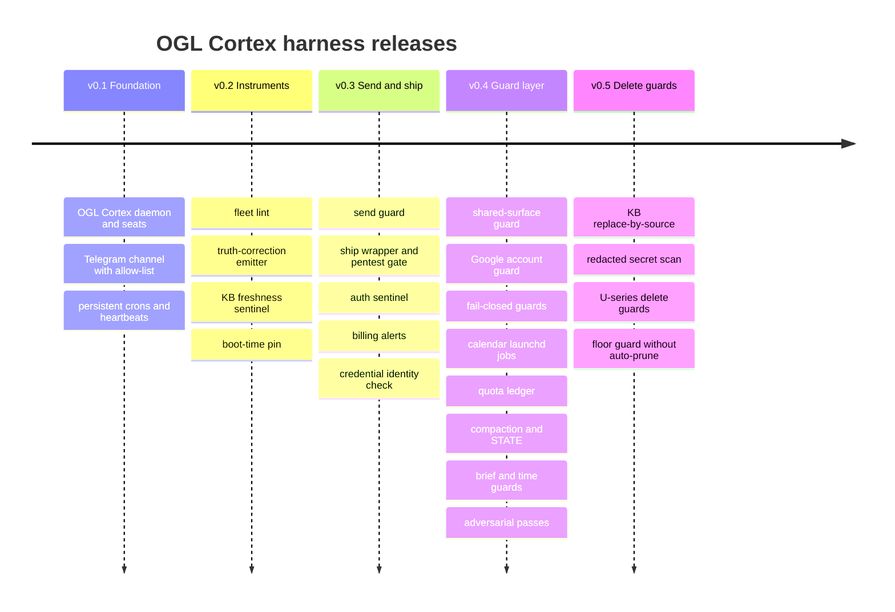

# 34. Changelog

The version labels v0.1 to v0.5 group features in the order they were added. They are not tagged releases.

Release notes for the OGL Cortex harness layer: the hooks, guards, tools, memory protocol and deploy path that sit on top of the framework. Framework changes are tracked in the upstream framework repository.

Each entry says what the feature does and why it exists, as a property of the software.

Related documents: `32-security-red-team-log.md` (how each guard works), `31-observability-alerting.md` (each sentinel's thresholds), `30-sre-runbooks.md` (what to do when one fires).

## Release map

## Hook inventory at v0.5

An orchestrator seat set up with `harness/install.sh` registers these hooks. Specialist seats register a subset. Hook files install to `<seat>/.claude/hooks/ogl/`. Entries marked "not included" describe optional components that this repository does not ship.

The command-line tool is named `cortextos`.

| Event | Hook | Since |
|---|---|---|
| PreToolUse (Bash, send MCPs) | `orwell_lint.py` send guard | v0.3 |
| PreToolUse (Google Workspace MCP) | account guard (optional, not included) | v0.4 |
| PreToolUse (Bash) | `shared_surface_guard.py` with `surface.py` and `codewrites.py` | v0.4 |
| PreToolUse (Bash) | `brief_guard.py` | v0.4 |
| PreToolUse (Bash, Write, Edit) | `future_time_guard.py` | v0.4 |
| PreToolUse (Bash) | attribution lint (optional, not included) | v0.4 |
| PreToolUse (Bash), seat or user level | `ship_gate.py` | v0.3 |
| PreToolUse (AskUserQuestion), PermissionRequest | `cortextos bus hook-permission-telegram`, `hook-planmode-telegram`, and the AskUserQuestion relay | framework |
| Stop | `cortextos bus hook-idle-flag` | framework |
| SessionEnd | `cortextos crash-alert`; memory digest (optional, not included) | framework; v0.4 |
| PreCompact | `cortextos bus hook-compact-telegram`; checkpoint script and memory digest (optional, not included) | framework; v0.4 |
| SessionStart | on `compact`, `compaction/after_compact.py`; session inject script (optional, not included) | v0.4 |
| PostToolUse | compaction meter `compaction/meter.py`; fix-commit trigger (optional, not included) | v0.4 |
| PostCompact | `compaction/save_summary.py` | v0.4 |
| UserPromptSubmit | client recall hook and prompt router (optional, not included) | v0.4 |
| statusLine | `cortextos bus hook-context-status` | framework |

---

## v0.5: Delete guards and memory hygiene

### Guards
- **U1, package cache deletes.** Every spelling of deleting a shared package cache now blocks, including brace expansion such as `rm -rf ~/.{claude,x}`. Braces are expanded before every root rule, and expansion caps fail toward blocking.
- **U2, trash and Finder deletes.** `trash <path>` and `osascript` Finder `delete` on a protected root count as deletes.
- **U3, `find` as a delete.** `find <root> -delete` and `find -exec` running any write verb on `{}` (`rm`, `truncate`, `chmod`, `sed -i`, `sh -c ': > "$1"'`, `dd of=`) now block.
- **U4, transcript and auto-memory protection.** Deletes under `~/.claude/projects/` block. Writes stay allowed. A single named topic file may still be removed.
- Each U-series packet changes only `surface.py`; `shared_surface_guard.py` and `codewrites.py` stay unchanged.

### Security
- **Redacted secret scan** (optional, not included in this repository). The pentest gate no longer writes raw secret-scan output to disk. Hits are stored as short hashes. An unverified hit with no recorded disposition is a blocker, not a warning.
- **Shared test-fixture list.** Known fake keys used in tests can be marked as fixtures. The list never applies to a verified hit.

### Memory and knowledge base
- **KB replace-by-source** (optional, not included in this repository). A guarded `kb-ingest` wrapper replaces all chunks from a source file on re-ingest instead of appending. Oversized memory files are refused until pruned.

### Capacity
- **Floor guard without auto-prune** (optional, not included in this repository). The disk floor guard pages under 10 GiB and escalates under 6 GiB. It no longer deletes anything by itself.

### Known limitations in this release
- Python or Node code that deletes under `~/.claude/projects/` is not parsed.
- `: > file` truncation counts as a write and stays allowed.
- `mv` onto an auto-memory file overwrites it. Keep a separate backup of auto-memory.

---

## v0.4: The guard layer

### New guards
- **Shared-surface guard.** Blocks commands that change surfaces other seats depend on: package cache prunes, global package installs, `brew upgrade`, and writes under `~/.claude*` and shared credential folders. The block names live consumers. A per-seat pass token releases one command. The parser grew through several revisions to handle multi-line `-c` code, heredoc redirects, text after an in-word `#`, `$(...)` indirection, commands after shell keywords, wrappers, and one invocation parser per shell.
- **Google Workspace account guard** (optional, not included in this repository). Blocks MCP calls for listed accounts, accounts in an open credential-mismatch episode, and any `start_google_auth` call.
- **Fail-closed guards.** The send guard and the shared-surface guard now fail closed when the command is in scope and the guard errors.
- **Brief guard.** Cross-seat `create-task` calls need `TASK:`, `FILES:`, `BAR:` and `RETURN:` lines.
- **Future-time guard.** Refuses writes to memory and `STATE.md`, and sends, that stamp a UTC time more than 3 minutes ahead of the clock.
- **Attribution lint** (optional, not included in this repository). Checks that numbers and quotes in outgoing text carry a source, in a log-only shadow mode first.
- **Guard liveness canary.** Each seat's heartbeat attempts one write the shared-surface guard must block. A landed file means the guard is down.
- **Code-gate warn window.** New code-analysis rules start in warn mode (`SURFACE_CODE_MODE=warn`) and move to block after a measured window.

### Orchestration
- **STATE.md and compaction hooks** (`harness/hooks/compaction/`). A meter hook nudges the seat as context grows. After compaction, `after_compact.py` hands `STATE.md` back and `save_summary.py` saves the summary. `autoCompactWindow` is set in seat settings.
- **Adversarial passes.** `harness/tools/adversarial-pass.sh --claim "<rule>" --cd <dir> <files>` runs a fenced, read-only adversarial session against one claim. An optional PostToolUse hook (not included) can suggest a pass on commits whose subject names a fix, guard, hook, bug, block or gate.
- **Auditor subagent** (optional, not included in this repository). A read-only subagent (`Read`, `Grep`, `Glob`, `WebFetch`) that returns `VERDICT / EVIDENCE / MISSED / NOT CHECKED / NEXT`.
- **Brief audit.** `harness/tools/brief_audit.py` labels a worker's writes IN, tmp or OUT of the brief's FILES line.
- **Memory digest** (optional, not included in this repository). SessionEnd and PreCompact hooks start a background digest of the session into searchable memory.
- **Prompt router** (optional, not included in this repository). A UserPromptSubmit hook picks a reply style with a small model. It injects nothing on timeout or failure. It adds several seconds per message; turn it off if latency matters more.
- **Client recall** (optional, not included in this repository). A UserPromptSubmit hook injects known facts when a client name appears in a prompt. It never blocks.

### Sentinels and capacity (optional, not included in this repository)
- **Calendar launchd jobs.** Sentinels use `StartCalendarInterval` instead of `StartInterval`, which can stall after sleep. Each job writes a receipt.
- **Quota ledger.** Reads plan utilisation every 10 minutes, appends one JSONL line per run, computes pace and a projected 100% time, and pages on `PACE`, `WARN80`, `DEGRADED90`, `STALE` and `DAYBURN`. The owner is paged at 7-day 90% and on a proven cap.
- **Settings and credential watch.** The identity check also hashes every settings file, hook script, skill, agent definition and the `mcpServers` block, and pages once per change. A launchd backstop runs it if the cron path fails.
- **Event index.** The dashboard's event table gets an index on the source file column for fast page loads.

### Deploy path
- **Indexing gate** (optional, not included in this repository). A gate check that refuses a candidate whose `sitemap.xml` or `robots.txt` is wrong or that sends noindex. With `harness/tools/ship.sh`, put it in the `--gate-cmd` command.

---

## v0.3: Send path and ship path

### Send path
- **Send guard (`harness/hooks/orwell_lint.py`).** Lints outgoing Telegram and mail sends against a fixed rule set before they run. Later revisions lint the full text of multi-line sends and ignore quoted material. A per-seat pass token releases one send.

### Ship path
- **`harness/tools/ship.sh` for every deploy.** Static gate, candidate deploy without the domain, candidate gate, then promote the same build, then a live re-check. Exit codes 0, 2 to 7 (see RB-11).
- **Pentest gate** (optional, not included in this repository). Secret scan, dependency audit, ZAP with a URL, header checks, API authorisation evidence. `ship.sh` and the ship gate hook read only its report file.
- **Ship gate hook** (`harness/hooks/ship_gate.py`). A PreToolUse hook at seat or user level blocks recognised ship commands without a passing report.
- **Ship verdict rule.** Only exit 0 from `ship.sh` counts as shipped.

### Sentinels (optional, not included in this repository)
- **Auth sentinel.** Probes the Claude login from inside the login session (pm2 loop), so it can reach the keychain. Alerts the owner directly. Classifies alerts as `cap`, `auth` or `probe`, and pages once per cap episode with the reset time instead of a login fix.
- **Sender identity.** Every sentinel page names the script that sent it.
- **Billing alerts.** A cron reads billing mail and alerts on new or escalated bills, moved deadlines and payments. Each run reports per-account results with a `PARTIAL` line, so one unreadable inbox does not silence the others.
- **Credential identity check.** Hourly check that each OAuth credential file holds the account its name says.

### Operations
- **Claude Code version pin.** The auto-updater is off and the version is pinned. Upgrades go through a daemon-restart preflight.
- **Consolidation brake** (optional, not included in this repository). The memory-consolidation Stop hook checks a brake file first, to stop concurrent background spawns.

---

## v0.2: Instruments

- **Fleet lint** (optional, not included in this repository). A nightly scheduled job lints every seat's config and instructions out of band and pages on any non-clean verdict.
- **Truth-correction emitter.** `harness/tools/emit-truth-correction.sh` records a correction to a past claim as an event with a `kind` (for example `artifact_catch`), so false-claim catch rates can be measured.
- **Boot-time pin** (optional, not included in this repository). Sentinels record the host boot time, so a reboot is detected instead of read as a gap.
- **KB freshness sentinel** (optional, not included in this repository). Pages when the newest `ingested_at` in the knowledge base is too old.
- **Cron watchdog review.** Interval crons whose period is at least the heartbeat period can drift; the documented default is a 5-field wall-clock schedule with a first-fire receipt.
- **Control inventory** (optional, not included in this repository). A census of every control, with its mechanism and whether it is installed.

---

## v0.1: Foundation

- **OGL Cortex daemon** under pm2 runs every seat as a Claude Code PTY with crash recovery and session rotation (`max_session_seconds`).
- **Seats** created from templates (`agent`, `orchestrator`, `analyst`) with bootstrap files: `IDENTITY.md`, `SOUL.md`, `GUARDRAILS.md`, `GOALS.md`, `HEARTBEAT.md`, `MEMORY.md`, `USER.md`, `TOOLS.md`, `SYSTEM.md`.
- **Telegram channel** per seat, gated by `ALLOWED_USER`.
- **Bus**: messages, tasks, approvals, events, heartbeats.
- **Persistent crons** in `crons.json` with daemon dispatch and one catch-up fire after downtime.
- **Dashboard** (Next.js) with activity, agents, approvals, tasks and analytics pages.
- **Memory protocol**: daily memory files, long-term `MEMORY.md`, handoffs on hard restart.

---

## Deprecations

| Deprecated | Replaced by | Migration |
|---|---|---|
| Crons inside `config.json` | `crons.json` per seat | `cortextos bus migrate-crons [seat]` |
| In-session `/loop` and `CronCreate` teaching in seat files | Daemon crons | `cortextos bus upgrade-cron-teaching [seat]` scans for stale teaching |
| launchd `StartInterval` sentinels | `StartCalendarInterval` jobs | Create the calendar twin, prove it with a receipt, then boot out the original |
| Auth probe from the system crontab | pm2 loop in the login session | Remove the crontab line once the pm2 loop is proven |

## Source files

- `src/daemon/cron-scheduler.ts`, `src/bus/crons-schema.ts`
- `src/hooks/` (framework hooks named above)
- `templates/agent/`, `templates/orchestrator/`, `templates/analyst/`
