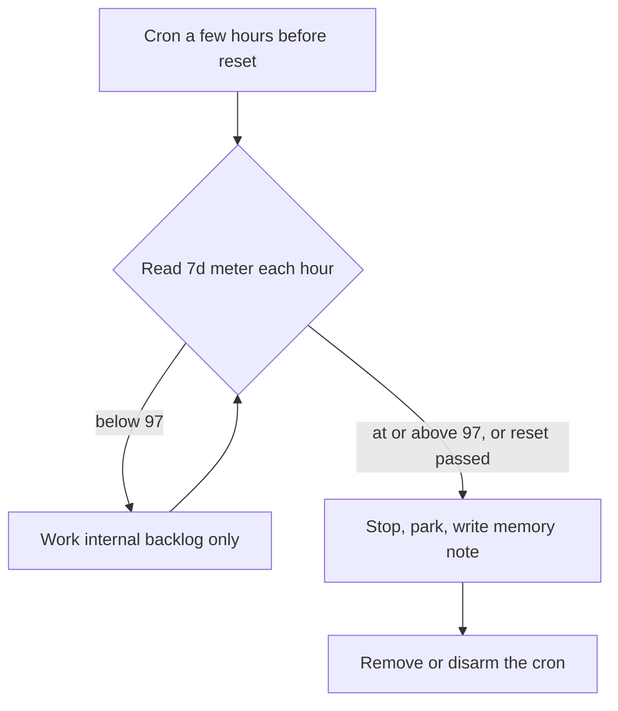
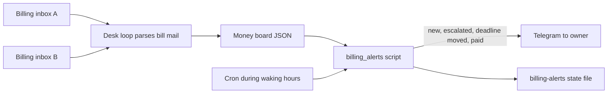

# 40. FinOps and capacity

How cost works when an OGL Cortex fleet runs on a Claude subscription plan, which limits bind first, and the disk, memory and swap rules that keep one host healthy.

Related documents: `30-sre-runbooks.md` (RB-01 cap, RB-05 disk), `31-observability-alerting.md` (quota ledger and disk sentinels), `41-support-known-issues-faq.md`. Path and role names follow `30-sre-runbooks.md`.

---

## 1. The cost model in one paragraph

On a flat Claude subscription (for example a Max plan), tokens do not cost money one by one. They cost **quota**. Every seat signed in to the same Claude account draws on one meter with two windows: a rolling 5-hour window and a 7-day window. When the 7-day window hits its cap, every seat on that account stops until the reset. So the budget you manage is weekly quota, not dollars. Other costs (hosting, domains, email sending, embeddings) are small monthly bills that arrive by mail.

---

## 2. Claude quota

### 2.1 How the meter works

| Property | Behaviour |
|---|---|
| Scope | Per Claude account. Seats do not have separate meters unless they sign in to separate accounts |
| Windows | 5-hour rolling window and 7-day window, each with its own `resets_at` |
| Reset time | Fixed per account. Read it from the API, never from memory |
| What eats quota | Mostly context re-reads. In long-running seats, cache reads make up the vast majority of tokens; output is a small fraction |
| Built-in warning | Claude Code warns near the 5-hour limit. There is no built-in warning for the 7-day window, which is why the quota ledger exists |

Read the meter:
```bash
cortextos bus check-usage-api --json         # five_hour and seven_day utilisation and resets_at (3-minute cache)
cortextos bus check-usage-api --force --json # bypass the cache
cortextos bus list-oauth-accounts            # if you configured more than one account
```

### 2.2 What makes quota burn faster

- **Long sessions with big boot files.** Every turn re-reads the context. Large bootstrap files and long transcripts multiply cost per turn.
- **Hooks that call a model on every prompt.** A prompt router or digest hook spends quota on every message.
- **Background spawns.** Memory-consolidation hooks that start `claude -p` sessions, especially several at once.
- **Model choice.** Larger models use the same window faster.

### 2.3 Measuring burn per seat

The quota ledger shows the account total. To see which seat spent it, sum the `usage` field in each seat's Claude Code transcripts:

```bash
python3 - <<'E'
import json, glob, os, collections
tot = collections.Counter()
for f in glob.glob(os.path.expanduser('~/.claude/projects/*/*.jsonl')):
    proj = os.path.basename(os.path.dirname(f))
    seen = set()
    for line in open(f, errors='ignore'):
        try: d = json.loads(line)
        except Exception: continue
        m = d.get('message') if isinstance(d, dict) else None
        if not isinstance(m, dict): continue
        u = m.get('usage'); mid = m.get('id')
        if not u or mid in seen: continue
        seen.add(mid)
        tot[proj] += sum(u.get(k, 0) or 0 for k in ('input_tokens','output_tokens','cache_creation_input_tokens','cache_read_input_tokens'))
for p, n in tot.most_common(): print(f'{n:>15,}  {p}')
E
```
Each Claude Code project folder maps to one seat's working directory. Count each message id once; transcripts can repeat a message.

### 2.4 Guarding the weekly cap

| Control | Default | Owner role |
|---|---|---|
| Quota ledger pages | `WARN80` at 7d 80%, `DEGRADED90` at 90%, `DAYBURN` when 7d rises more than 10 points in one UTC day, `STALE` when the reading is older than 15 minutes | Ops |
| Direct owner page | 7d at 90%, and on a proven cap | Ops |
| Pace projection | `pace.projected_100` in each ledger line | Ops |
| Usage meter | Hourly `7d=` and `5h=` line from the analyst seat | Analyst |
| Never restart into a cap | A restart cannot run until quota resets | Every seat |
| Park before the cap | Write state and a handoff, tell the owner the reset time | Orchestrator |

When two meters disagree slightly, they sampled at different minutes. Plan with the higher number.

### 2.5 The pre-reset burn

Quota that is unused at the reset expires. The pre-reset burn spends it on internal backlog the evening before.



Rules:
- Internal build work only. Any ship, send or deploy still goes to the owner.
- Stop at 97% to keep a 3-point buffer.
- For a weekly burn, use a weekday expression (for example `0 20 * * 1`), not a dated one. A dated expression fires once a year.
- Full recipe in `33-cookbook.md`, Recipe 11.

### 2.6 Concurrency throttle

Many seats booting at the same moment can trigger account-level rate limiting even with weekly quota left. Stagger starts and restarts:
```bash
cortextos bus soft-restart-all --stagger 30 --reason "planned restart"
```
Set `startup_delay` per seat in `config.json` to spread boots after a daemon restart. Keep the number of concurrently active Claude seats per account modest; a dozen or more seats booting together is where throttling shows up.

### 2.7 No fallback provider by default

If every seat runs on one Claude account, a cap stops the whole fleet. Options: a second account (the bus supports several OAuth accounts and `rotate-oauth`), or a second runtime for low-stakes seats. Check your plan's terms before you add accounts.

---

## 3. Other run costs

| Line | Typical shape | What the harness needs it for |
|---|---|---|
| Claude subscription | Flat monthly | Every Claude seat |
| The host | Owned hardware, power, internet | Everything |
| Telegram Bot API | Free | Owner channel |
| Web hosting (for example Vercel) | Flat monthly per team, plus usage | Sites shipped through `ship.sh` |
| DNS and object storage (for example Cloudflare) | Usage-based, often small | Zones, R2, video |
| Domains | Yearly per domain | Client and own sites |
| Email sending platform | Monthly or yearly; check which | Outbound campaigns |
| Mailboxes | Yearly per inbox | Sending identities |
| Embeddings API | Free tier or per call | Knowledge base ingest |
| Second model provider | Monthly, optional | Fallback runtime |

**Spend rule.** A line counts only if a current use needs it. A past record of a tool is not a present cost. Where a price is guessed, use its lowest plausible value and label it.

**Currency rule.** A "$" sign does not tell you the currency. Read the invoice currency before you add bills together.

### 3.1 Watching bills



The reference billing reader alerts on statuses `failing`, `overdue`, `suspended` and `deletion scheduled`. It voids a run when its input is more than 30 minutes old. Exit codes: 0 ok; 3 void; 4 a send failed; 5 credential mismatch; 6 partial. Copies of the same notice in two inboxes are deduped by bill id.

### 3.2 Free-tier limits that bind

| Service | Limit you will hit | Mitigation |
|---|---|---|
| Embeddings free tier | Per-minute and per-day 429s on large ingests | Stagger ingest crons across seats; track a daily pool; retry after the `retryDelay` |
| PageSpeed Insights API | Keyless calls run out of daily quota | Use a free API key |
| Web search tools | Occasional global 429s | Retry later; do not loop |
| Your own public tools | Rate limits you set (for example audits per device per hour) | Document them for users |

---

## 4. Telegram limits

| Limit | Value | Source |
|---|---|---|
| Text message | Split at 4,096 characters | `src/telegram/api.ts` |
| Photo caption | About 1,024 characters; longer returns Bad Request | Bot API |
| Photo dimensions | Width plus height at most 10,000 px | Bot API |
| Bot file download | 20 MB | `src/telegram/media.ts` |
| HTTP 429 | Logged as a warning, retried after a few seconds | `src/telegram/api.ts` |

---

## 5. Host capacity

### 5.1 What to measure

```bash
sysctl -n machdep.cpu.brand_string hw.ncpu hw.memsize   # CPU and RAM (macOS)
df -h /System/Volumes/Data                               # data volume (macOS)
sysctl vm.swapusage
ls /System/Volumes/VM | grep -c swapfile
memory_pressure | tail -3
ps -axo rss,comm | sort -n | tail -15
du -sh ~/Library ~/Downloads ~/.cache/* /opt/* 2>/dev/null | sort -h | tail -15
ollama list                                              # if you run local models
```

### 5.2 Why swap eats disk on macOS

macOS stores swap as files (about 1 GB each) on the same data volume as your files. Each new swap file takes about 1 GB of free disk. Under memory pressure, a large model load or a container VM can add several swap files in a minute. Free disk then falls fast, and when it runs out swap cannot grow and the fleet stalls. Swap files also shrink slowly after the pressure ends.

### 5.3 Capacity rules

| Rule | Default threshold | Owner role |
|---|---|---|
| Weekly quota stop for burn work | 97% of the 7-day meter | Orchestrator |
| Weekly quota page to owner | 90%, and on a proven cap | Ops (quota ledger) |
| Disk page | At or below 7 GiB (infra watch); under 6 GiB (disk sentinel) | Infra watch, ops |
| Disk emergency | Under 5 GiB | Infra watch |
| Swap page | Swap file count at or above 17 | Infra watch |
| Local model disk headroom | Free disk at least 2x the model size before any load | Any seat loading a model |
| Local model announce | Tell infra watch before a download over 1 GB; run with `keep_alive=0` | Every seat |
| Scratch jobs over 5 GB | Check headroom and cache inventory first | Every seat |
| No deploys under heavy swap | Pause `ship.sh` until swap settles | Every seat |
| Concurrent Claude seats | Stagger boots; keep the active count modest | Orchestrator |

**Why 2x for models.** The download costs the model's size once. Loading it into memory on a host that is already swapping costs about the same again as new swap files.

### 5.4 Sizing local models

| Model size on disk | Free disk needed (2x rule) | Safe while the fleet runs? |
|---|---|---|
| Up to about 2 GB (small Whisper, embedding and rerank models, sub-1B chat models) | Up to 4 GB | Usually yes |
| About 6 GB (7B class) | 12 GB | Only with spare RAM; watch swap |
| About 9 to 10 GB (14B class) | 18 to 20 GB | Not on a shared 36 GB host with several seats |
| 17 GB and up (27B class and larger) | 34 GB and up | Stop the fleet, or use another machine |

Try the built-in tool first. For example, the OS text-recognition API handles scanned PDFs with no download at all.

### 5.5 Cleaning up safely

- Never clear a package cache that running MCP servers import from (for example the `uv` cache) while they run. Name the consumers with `lsof +D <dir>` first.
- Container VM data can be ephemeral. Inventory what lives inside before a reset.
- The shared-surface guard blocks broad deletes in shared locations. Expect it.
- Large unused local models are the cheapest disk to reclaim. Remove with `ollama rm <model>`.

---

## 6. Enterprise items and their equivalents

| Enterprise item | Fit | Closest equivalent |
|---|---|---|
| Chargeback and showback | One payer | A per-business column on the bill list |
| Unit economics (cost per task) | Not tracked by default | Per-seat token totals (2.3) plus task ids |
| FinOps forecasting | Flat plan | `pace.projected_100` plus the burn governor |
| Autoscaling and load testing | One host | Disk and swap sentinels plus the "heavy jobs need the fleet stopped" rule |

---

## 7. Known limitations

- The quota meter is per account. OGL Cortex cannot split it by seat or by business without the transcript sum in 2.3.
- Billing visibility depends on bill mail reaching a parsed inbox.
- There is no automatic fallback when the Claude account is capped.
- On macOS, swap and user files share one volume.

## Source files

- `src/telegram/api.ts`, `src/telegram/media.ts` (Telegram limits)
- `src/cli/bus.ts` (`check-usage-api`, `list-oauth-accounts`, `rotate-oauth`, `soft-restart-all`)
- `templates/agent/config.json` (`startup_delay`, `max_session_seconds`)
