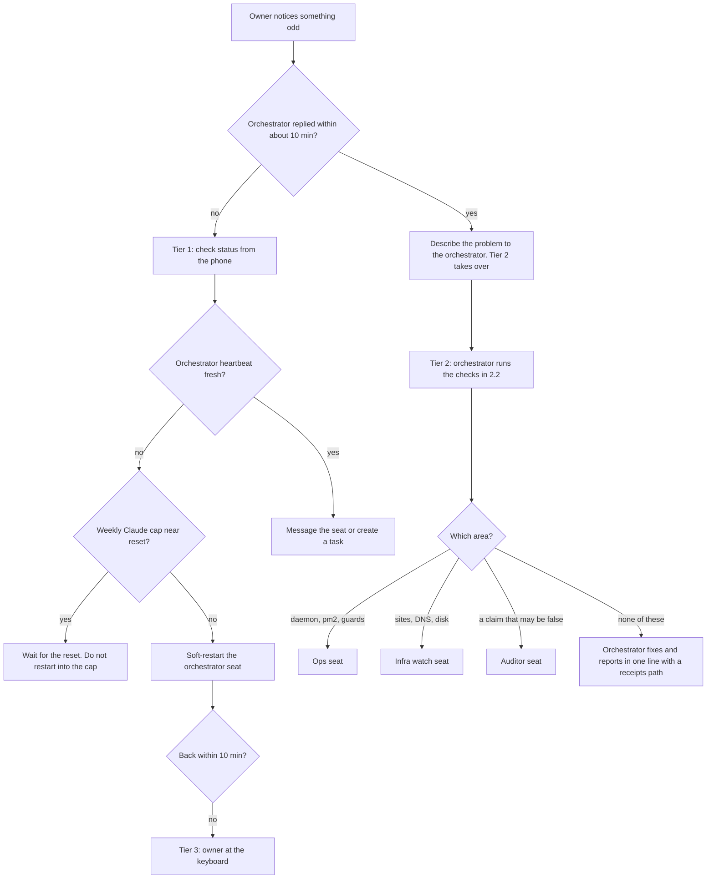

# 41. Support, known issues and FAQ

What to do when an agent acts strangely. This document has four parts: a three-tier triage flow, a registry of known issues and failure modes, a deprecation table, and an FAQ of the problems that come back.

Related documents: `30-sre-runbooks.md` (step-by-step recovery), `31-observability-alerting.md` (logs and heartbeats), `40-finops-capacity.md` (quota and disk), `42-chaos-telemetry-determinism.md` (which guards are tested), `../TROUBLESHOOTING.md` (quick index). Path and role names follow `30-sre-runbooks.md`.

**Scale.** An enterprise support model assumes a help desk, a ticket queue and an on-call rota. OGL Cortex assumes one owner and a handful of seats. Tier 1 is the owner with a phone. Tier 2 is the orchestrator seat. Tier 3 is the specialist seats and the owner at the keyboard. The ticket queue is the cortextOS task list (`cortextos bus list-tasks`) plus the approvals queue (`cortextos bus list-approvals`).

---

## 1. Triage flow

### 1.1 Tier 1: the owner, from a phone

| Surface | What it can do |
|---|---|
| Telegram chat with the orchestrator | Ask anything; approve by reply |
| A mobile control API on a private network (optional) | Fleet status, approvals, new task, message a seat, soft-restart a seat, stop and start |
| The dashboard (if exposed on a private network) | Activity, tasks, approvals |

Checklist, one tap or one message each:
1. **Is the orchestrator alive?** Look at its last heartbeat. With the default `4h` heartbeat cron, under 4 hours old is normal. Over 4 hours with no Telegram reply is a real signal.
2. **Is it the weekly cap?** If every seat went quiet at once, read `resets_at` (RB-01). Do not restart.
3. **Is something waiting on me?** A seat that seems stuck is often waiting on an approval: `cortextos bus list-approvals --format text`.
4. **Nudge it.** Send an urgent message (`cortextos notify-agent <seat> "<text>"`) or create a task.
5. **Restart one seat.** `cortextos bus soft-restart <seat> "<reason>"` keeps conversation history. Use it only after steps 1 to 4.
6. **Stop or start.** Any control surface that calls `cortextos stop` or `cortextos start` must pass `--instance <instance>`. Test those buttons once on a quiet night.

What the owner should not do from the phone: chase a "login expired" claim, flip a browser or OS setting because an agent asked, or approve a hook change with a one-word reply that does not name the artifact.

### 1.2 Tier 2: the orchestrator's checks

| # | Check | Command (read-only) | Bad looks like |
|---|---|---|---|
| 1 | Who is alive | `cortextos bus read-all-heartbeats` | A live seat marked `[STALE]` |
| 2 | Daemon up | `pm2 jlist` | `cortextos-daemon` not `online`, or restart count climbing |
| 3 | Seat status | `cortextos status --instance <instance>` | Missing PID, very short uptime repeating |
| 4 | Crons firing | `cortextos bus list-crons <seat>`, `cortextos bus get-cron-log <seat>` | Last fire older than the schedule |
| 5 | Disk and swap | `df -h /`, `sysctl vm.swapusage` | Free disk under your warn line, swap near full |
| 6 | MCP servers | `claude mcp list` | "failed to connect" |
| 7 | Seat logs | `$CTX_ROOT/logs/<seat>/stdout.log`, `crashes.log`, `restarts.log` | Repeated `type=crash` lines |
| 8 | Guards blocking | `~/.claude/hooks/orwell-lint.log`, `surface-guard.log` | The seat retries the same blocked call in a loop |
| 9 | Context | `$CTX_ROOT/state/<seat>/context_status.json` | Near `ctx_handoff_threshold` |

Rules during triage:
- Name the test that tells two causes apart before you say which one it is.
- A failing check often hit the wrong target (wrong window, wrong account, wrong instance), not a broken setting.
- Never test a send by breaking the environment. Use a sink.

### 1.3 Tier 3: specialists

| Role | Steps in when | Limit |
|---|---|---|
| Ops | Daemon, dashboard, pm2, LaunchAgents, log growth, guard installs | Read-only by default; acts on a dispatched task |
| Analyst | Health trends, heartbeat staleness, restart loops, usage meter, nightly metrics | Proposes; does not execute without a go |
| Infra watch | Hosting, DNS, TLS, external sites, disk and swap pages | Reports to the orchestrator |
| Auditor | A claim that may be false, a guardrail break, a gate on a guard change | Escalates to the owner when a wrong fact reached them |
| Owner at the keyboard | Daemon down, host reboot, Claude login, a guard change that needs explicit approval | Only the owner approves hook and guardrail changes, by named artifact |

---

## 2. Known issues and failure modes

Status: **LIMITATION** (property of the software today), **WATCH** (works, fragile under some conditions), **DOC** (a default doc or template can drift from your install).

| ID | Issue | Status | Symptom | Workaround |
|---|---|---|---|---|
| KI-01 | Retired seats keep heartbeat files | LIMITATION | `read-all-heartbeats` lists many `[STALE]` lines that hide the live ones | Archive retired seat state, or filter: `cortextos bus read-all-heartbeats \| grep -v STALE` |
| KI-02 | Lifecycle commands default to instance `default` | LIMITATION | "Daemon is not running" while seats run | Pass `--instance <instance>`, or export `CTX_INSTANCE_ID` |
| KI-03 | MCP servers fail silently at session start | WATCH | Tools missing, "Connection closed" banner | RB-07. Pin versions; fix broken config paths |
| KI-04 | A knowledge-base MCP or local database can fail to open | WATCH | Search commands abort; MCP closes | Keep the human-readable vault as the fallback record; restore from backup |
| KI-05 | Interval crons can drift | WATCH | A long-interval cron never fires | 5-field wall-clock schedule (RB-10) |
| KI-06 | Dated 5-field one-shots recur yearly | LIMITATION | A finished one-shot shows a next fire one year out | Remove it in the prompt; check with `list-crons` |
| KI-07 | Cleanup scripts can remove browser binaries | WATCH | Playwright reports the browser missing | Launch with `channel="chrome"`; reinstall browsers when disk allows |
| KI-08 | Auto-memory index has a 200-line load cap | LIMITATION | The loader cuts lines past the cap | Keep the index short; move detail to topic files |
| KI-09 | Seat docs can name logs or paths that a given version does not write | DOC | A documented file is missing | Trust the framework source; crons live in `$CTX_ROOT/.cortextOS/state/agents/<seat>/crons.json` |
| KI-10 | Unfilled identity templates | DOC | `list-agents` shows a placeholder role | Complete `IDENTITY.md` during onboarding |
| KI-11 | Crash-alert quiet hours use a fixed time zone | LIMITATION | Routine-end alerts suppressed at the wrong local hours | Edit the constants in `src/hooks/hook-crash-alert.ts` for your zone |
| KI-12 | Weekly cap stops every seat at once | LIMITATION | Fleet silent together | RB-01; pre-reset burn; park before the cap |
| KI-13 | Thin disk and swap headroom on a busy host | WATCH | Disk and swap pages | RB-05; 2x model rule |
| KI-14 | Human desktop sessions bypass seat guards | LIMITATION | Cleanups delete seat evidence; sends skip the outbound log | Register the same guards in desktop sessions; send through the bus |
| KI-15 | Disabled seats can keep enabled crons | LIMITATION | Cron audits show jobs that never fire | Remove crons when you disable a seat |
| KI-16 | One-shot temporary watchers exit after their first trip | LIMITATION | No cover after one page | Re-arm after each page, or promote to launchd |
| KI-17 | Model-calling hooks add latency | LIMITATION | Several seconds before a seat reads each message | Make the hook async or turn it off |

---

## 3. Deprecation table

| Deprecated | Status | Replaced by | Leftovers to clean |
|---|---|---|---|
| Crons in `config.json` | Deprecated | `crons.json` | Run `cortextos bus migrate-crons [seat]` |
| In-session `/loop` and `CronCreate` for persistent jobs | Deprecated | Daemon crons | `cortextos bus upgrade-cron-teaching [seat]` finds stale teaching |
| launchd `StartInterval` sentinels | Deprecated | `StartCalendarInterval` jobs | Boot out the originals after the twins are proven |
| Auth probe from the system crontab | Deprecated | pm2 loop in the login session | Remove the crontab line |
| Cross-model verification that names a runtime you no longer pay for | Remove | A fresh read-only session on the same provider | Update `AGENTS.md` in each seat |
| Retired platform integrations | Remove | Whatever replaced them | Watchers, crons, identity text and MCP entries that still name the old platform |

---

## 4. FAQ

### 4.1 "The seat keeps rewriting the same message" or "my send was blocked"

**Cause.** The send guard (`orwell-lint.py`). It lints every outgoing Telegram, email and post against a fixed rule set with word lists and regex, no model, and exits 2 with the broken rules listed.

**Fix.** Rewrite and resend. For one send that must break a rule: `touch ~/.claude/hooks/.orwell-pass-once-$CTX_AGENT_NAME` (valid 10 minutes, consumed and logged).

### 4.2 "A write was refused for a time stamp"

**Cause.** `future_time_guard.py` refuses writes to `memory/`, `STATE.md` and sends that stamp a UTC time more than 3 minutes ahead of the clock. It fails open on its own errors.

**Fix.** Print `date -u` in the same command and copy the time from the output. Stamps for other days, ranges like `10:3x`, and stamps after "yesterday" are ignored by design.

### 4.3 "My task to another seat was refused"

**Cause.** `brief_guard.py`. A `cortextos bus create-task ... --assignee <other seat>` needs `TASK:`, `FILES:`, `BAR:` and `RETURN:` lines in `--desc`.

**Fix.** Add the four lines. Wrapping the call in a heredoc or script does not bypass the check.

### 4.4 "A price arrived as `/bin/zsh.042`"

**Cause.** The shell expanded `$0` inside double quotes before the bus saw the text. The send exits 0, so it looks delivered.

**Fix.** Single quotes or a quoted heredoc for any text with `$`. Then grep the outbound log for the figure.

### 4.5 "The seat opened the page in the wrong browser profile"

**Cause.** `open` and AppleScript `open location` land in whichever Chrome profile was last active.

**Fix.** `open -na "Google Chrome" --args --profile-directory="<dir>" "<url>"`, and name the profile in the message. Never sign up for anything in a fresh automation browser when the owner wants it in their own profile.

### 4.6 "The seat asked me to turn on 'Allow JavaScript from Apple Events'"

**Cause.** AppleScript error 12. The setting is per profile, and the call used `front window`, which belonged to another profile.

**Fix.** Address the window by id. On error 12, resolve the id again and retry. Ask the owner to change a setting only after a second independent check shows it is off.

### 4.7 "Google says 404 / token expired / re-auth needed"

**Cause.** Almost always the wrong account.

**Fix.** Retry with the other account through its direct token path. Escalate only if both fail. See RB-09.

### 4.8 "A whole Google account's mail went blind"

**Cause.** A Workspace MCP session bound to account A was called with account B's address and wrote A's token into B's credential file.

**Fix.** Install `gws-account-guard.py`, re-authorise B with an identity-checking script, and use the MCP only for its bound account.

### 4.9 "Restart says the daemon is not running"

**Cause.** `cortextos restart`, `stop`, `start` and `doctor` default to `--instance default`.

**Fix.** Pass `--instance <instance>`. Never run `cortextos start` on that error while pm2 shows the daemon online. See RB-03.

### 4.10 "A command was blocked with a shared-surface message"

**Cause.** `shared-surface-guard.py` blocks changes to surfaces every seat shares: package cache prunes, global installs, `brew upgrade`, writes under `~/.claude*` outside `projects/`, credential folders, and deletes under `~/.claude/projects/`.

**Fix.** Check the consumers the block names, take a backup, then release once with `touch ~/.claude/hooks/.surface-pass-once-$CTX_AGENT_NAME` (10 minutes, one use).

### 4.11 "Playwright says the browser is missing"

**Cause.** The bundled browsers were deleted by a cleanup.

**Fix.** Launch with `channel="chrome"` to use the installed Chrome. Reinstall with `npx playwright install` when disk allows.

### 4.12 "Every seat went silent at the same time"

**Cause.** Usually the weekly Claude cap. From outside it looks like a hang.

**Fix.** Do not restart. Read `resets_at`. If it is not the cap, follow 1.2.

### 4.13 "A cron I added never ran"

**Cause.** Disabled, seat down, interval drift, or wrong time zone.

**Fix.** RB-10. Use a 5-field wall-clock schedule and confirm the first fire by its artifact.

### 4.14 "The pentest gate passed but nothing was scanned"

**Cause.** Without `--url`, the web scan is skipped and the gate can still report `pass`.

**Fix.** Run with `--url`, then print the ZAP return code and report mtime in the same command.

### 4.15 "I sent a file and the seat never saw it"

**Cause.** Telegram bots cannot download files over 20 MB. The daemon injects a `DOWNLOAD_FAILED` marker.

**Fix.** Share a cloud link, or split the file.

---

## 5. Enterprise items and their equivalents

| Enterprise item | Fit | Closest equivalent |
|---|---|---|
| Ticketing with SLAs | No | `cortextos bus list-tasks` and the approvals queue; Telegram is the intake |
| On-call rota | Partly | Sentinel pages to the orchestrator; direct owner paths for cap, login, crash and billing |
| Known-error database | Partly | This registry plus seat memory |
| Support macros | No | The FAQ above, plus guards that make some answers mechanical |

## Source files

- `src/cli/stop.ts`, `src/cli/start.ts` (instance default)
- `src/hooks/hook-crash-alert.ts` (quiet hours)
- `src/telegram/media.ts` (20 MB limit)
- `src/bus/crons-schema.ts` (cron storage path)
