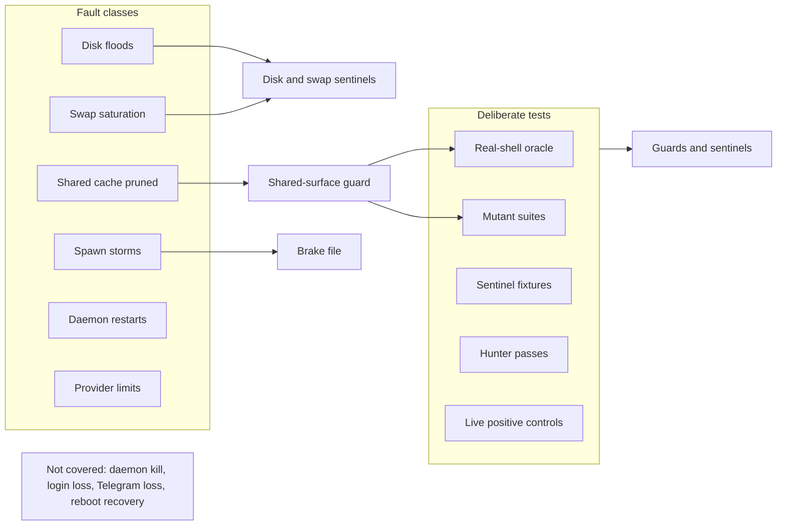
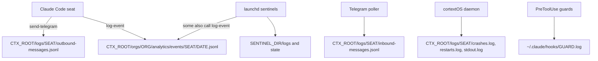
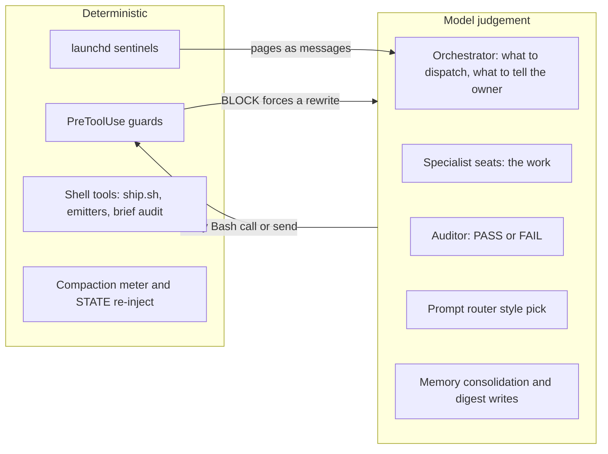

# 42. Chaos, telemetry and determinism

Three questions for any agent harness: what faults does it survive, what records does it keep, and which parts behave the same way every time?

Related documents: `31-observability-alerting.md` (alert routing), `32-security-red-team-log.md` (guard testing method), `41-support-known-issues-faq.md`. Path and role names follow `30-sre-runbooks.md`.

## Terms

- **Chaos test**: breaking something on purpose to see whether the system survives.
- **Oracle**: an independent source of truth used to grade a guard.
- **Mutant**: a deliberately broken copy of a guard. A good suite fails on it.
- **Deterministic**: the same input always gives the same output. Model judgement is not deterministic.

---

## 1. Summary

| Question | Answer |
|---|---|
| Does OGL Cortex ship a chaos programme? | No scheduled fault injection against the fleet. It ships fault classes to rehearse (section 2.3) and strong deliberate tests for guards and sentinels |
| What gets tested on purpose? | Guards (real-shell oracle, mutants, replay over real command history), sentinels (fixture suites with mutants and self-tests), fixes (hunter passes) |
| One telemetry standard? | The event log is the reference format. Sentinel and guard logs use their own line shapes; section 3.3 lists the differences |
| How much is deterministic? | Guards, sentinels and the ship wrapper are deterministic. Orchestration decisions are model judgement. A few hooks call a model |

---

## 2. Chaos and stress

### 2.1 Fault classes a single-host fleet meets

| Fault class | Typical trigger | What protects you |
|---|---|---|
| Disk flood | A model download, a scanner walking the wrong directory, a container build | Disk sentinel, floor guard, infra-watch disk watch, 2x model rule |
| Swap saturation | Many seats plus a container VM plus a local model | Swap watch; no deploys under heavy swap; stop heavy jobs |
| Background spawn storm | A Stop hook that starts `claude -p` sessions, firing in several seats at once | Brake file checked first in the hook; stagger |
| Shared dependency broken under live load | Pruning a package cache that running MCP servers import from | Shared-surface guard |
| Daemon restarts | Cleanups, network dips, external `pm2 restart` | Storm watch, commander watch, crash relay |
| Provider limits | Weekly cap, rate limits, free-tier 429s | Quota ledger, auth sentinel, pre-reset burn |
| Billing holds | Declined card | Billing alerts, site watchers |
| Wrong-account credential writes | OAuth flow finished with the wrong account | Account guard, identity check |
| Evicted LaunchAgents | Jobs without `RunAtLoad` or `KeepAlive` lost on restart | Pre-restart inventory of ancillary services |
| Wedged seat | Process up, model not reasoning (for example a session-limit screen) | Session liveness watch; PID and heartbeat alone do not prove reasoning |

Most serious stress on a single-host fleet is self-inflicted by fleet work: a scan, a model, a storm, a prune. External faults are rarer. Memory and disk pressure is the dominant failure mode.

### 2.2 Deliberate tests that ship with the harness

| Target | Method | Pass bar |
|---|---|---|
| Shared-surface guard | Real-shell oracle: each probe shape run in `bash`, `zsh` and `sh`, in script and inline forms, under `sandbox-exec`, with a must-find control first that voids the run on a miss | `MISS 0`, `over-flag 0`; every mutant killed |
| Any guard change | `mutants.py`, unit tests (must-flag and must-allow), `replay_diff.py` over real command history | Tests red on live, green on candidate; only intended verdict changes in the replay |
| Heartbeat sentinel | Fixture cases including a forged heartbeat and a reload case, plus mutants | All fixtures pass; mutants red |
| Session liveness watch | Self-test with stale, fresh, process-down and orphan cases, and a named mutant | All `PASS` lines |
| Auth sentinel | "Drive it to fail once": a bogus model id and a sink file instead of Telegram | Alert written to the sink |
| Account guard | Live positive control with an invalid address | `BLOCK` line in the guard log |
| Send guard and fail-closed paths | Corpus replays and mutant suites | Mutants killed; no new false positives on the corpus |
| Any guard, hook or fix | `hunter.sh` fenced pass on one claim | Reachable findings fixed test-first |



### 2.3 Rehearsals worth running

These faults have no shipped automated test. Run each once on a quiet night with the owner's go, and record the result.

| Rehearsal | How | Pass bar |
|---|---|---|
| Reboot recovery | Planned host restart | pm2 resurrects the daemon; every enabled seat writes a heartbeat within one interval; every launchd sentinel writes a fresh `.alive` |
| Daemon kill | `pm2 stop cortextos-daemon`, wait, `pm2 start cortextos-daemon` | Storm watch logs the event; crons catch up once; seats resume |
| Telegram loss | Block the Bot API host for 10 minutes | Poller logs `fetch failed`, recovers without a restart; no messages lost |
| Login loss | Point the auth sentinel at a bogus model id with a sink | Alert of kind `auth` or `probe` lands in the sink |
| Guard down | Rename a guard file for one minute in a test seat | Liveness canary reports a landed write |

---

## 3. Telemetry

### 3.1 Where records go



### 3.2 Line shapes

**Event log** (the reference format), one JSON object per line, file named by UTC date:
```json
{"id":"1767225600-orchestrator-a1b2c","agent":"orchestrator","org":"example","timestamp":"2026-01-01T00:00:00Z","category":"action","event":"task_dispatched","severity":"info","metadata":{"to":"ops","task":"rotate webhook secret"}}
```
`id` is epoch seconds, agent name and 5 random characters. `timestamp` is ISO 8601 UTC to the second. Writer: `src/bus/event.ts`.

Sentinels can write into the same family under a non-seat agent name such as `sentinel`:
```json
{"id":"1767225630-sentinel-x9y8z","agent":"sentinel","timestamp":"2026-01-01T00:00:30Z","category":"action","event":"disk_sentinel_alert","severity":"info","metadata":{"avail_mb":11233,"kind":"sudden-step"}}
```

**Outbound Telegram log**:
```json
{"timestamp":"2026-01-01T00:01:00Z","agent":"orchestrator","chat_id":"<chat>","text":"Deployed...","message_id":"1234","parse_mode":"html"}
```

**Inbound Telegram log** fields: `message_id`, `from`, `from_name`, `chat_id`, `text`, `timestamp` (milliseconds), `archived_at` (seconds), `agent`.

**Crash and restart logs**:
```
2026-01-01T00:02:00.000Z type=daemon-stop reason=daemon shutdown (SIGTERM) session=<uuid> last_task=...
[2026-01-01T00:03:00Z] HARD-RESTART: Context 80%; ...
```

**stdout.log**: raw terminal capture with ANSI escape codes. Strip escapes before parsing (`strip-ansi` or `sed 's/\x1b\[[0-9;]*[A-Za-z]//g'`).

**Sentinels** (examples of the reference scripts):
```
2026-01-01T00:04:00Z avail=11233MB state=warn prev=warn orch=sudden-step
2026-01-01T00:05:00Z | proc=status | watched=4 | IDLE-LATENT=0 | WEDGE(alarms)=0 | K=3 | orchestrator:OK(0h0m,ctx) | ...
2026-01-01T00:06:00Z ok proc_up=1 ctx_age=0s ctx_basis=ctx-growth decided_by=primary (TTL 36000s)
```

**Quota ledger** (JSON, `ts` key):
```json
{"ts":"2026-01-01T00:05:00Z","reading":{"five_hour":{"pct":11},"seven_day":{"pct":62},"source":"api"}}
```

**Guard logs** (`~/.claude/hooks/<guard>.log`), one line per verdict:
```
2026-01-01T00:07:00Z PASS Bash 0 issues: 'Deployed...'
2026-01-01T00:08:00Z ops BLOCK ['claude_config'] '<command>'
```
Guard logs are fleet-wide: one file holds verdicts for every seat that runs the guard. Not every guard writes a log; the brief guard and the future-time guard report only through their exit code and stderr.

### 3.3 Where the formats differ

| Dimension | Variants |
|---|---|
| Timestamp key | `timestamp` (events, Telegram), `ts` (quota, pressure), `at` (prompt router), bare prefix (sentinels, guards), bracketed prefix (`restarts.log`) |
| Precision | Seconds (events strip milliseconds); milliseconds (inbound log, `crashes.log`) |
| Line shape | JSON, `key=value`, pipe-delimited, free text, raw TTY |
| Id scheme | Epoch seconds plus agent plus random (events); epoch milliseconds (inbox ids); `task_<ms>_<rand>` (tasks); Telegram integers |
| Clock zone in content | UTC (`Z`) everywhere |
| Clock zone in schedules | Host local time for 5-field crons and launchd calendar jobs |
| Clock zone in file names | UTC for event files; the seat's local date for daily memory files |

Practical effect: a question like "what happened at 05:03" needs several greps with different patterns. If you build a merged timeline, normalise to the event-log shape: `timestamp` key, ISO 8601 seconds, UTC.

**Recommended standard for new logs.** JSON lines with `timestamp` (ISO 8601 UTC, seconds), `agent`, `event`, `severity`, and a `metadata` object. Write through `cortextos bus log-event` when a seat is the producer.

### 3.4 Retention

- The framework does not rotate `stdout.log`. Rotate it yourself (for example a launchd job that moves files over a size limit to `stdout.log.1`).
- Event files are split per day per seat, so size-based cleanups usually spare them.
- A cleanup that empties large log files erases their history. Archive before you truncate.
- Guard logs live outside `$CTX_ROOT` and need their own rotation.

---

## 4. Determinism: rule versus judgement

### 4.1 Hooks in a reference orchestrator seat

| Event | Hook | Class |
|---|---|---|
| PermissionRequest, PreToolUse AskUserQuestion | `cortextos bus hook-permission-telegram`, `hook-planmode-telegram`, and the AskUserQuestion relay | Deterministic relay |
| PreToolUse Bash and send MCPs | `orwell-lint.py` | Deterministic (regex and word lists) |
| PreToolUse Google Workspace MCP | `gws-account-guard.py` | Deterministic (account list) |
| PreToolUse Bash | `shared-surface-guard.py` | Deterministic (shell parser) |
| PreToolUse Bash | `brief_guard.py` | Deterministic |
| PreToolUse Bash, Write, Edit | `future_time_guard.py` | Deterministic, clock-dependent |
| PreToolUse Bash | `attribution-lint.py` | Deterministic, shadow tier |
| Stop | `cortextos bus hook-idle-flag` | Deterministic |
| Stop | memory consolidation hook | **Spawns a model** in the background |
| SessionEnd, PreCompact | `cortextos crash-alert`, `hook-compact-telegram`, checkpoint script | Deterministic |
| SessionEnd, PreCompact | memory digest | **Spawns a model** in the background |
| SessionStart | inject script; `after_compact.py` | Deterministic |
| PostToolUse | compaction meter; fix-commit trigger | Deterministic |
| PostCompact | `save_summary.py` | Deterministic |
| UserPromptSubmit | client recall hook | Deterministic |
| UserPromptSubmit | prompt router | **Model call on every owner message** (headless small model, one turn). Injects nothing on timeout or failure |

All of these are `type: command` hooks. A command hook can still call a model; check the script, not the hook type.

### 4.2 Schedulers

| Scheduler | Deterministic part | Judgement part |
|---|---|---|
| cortextOS daemon crons | When the prompt fires (30-second tick; one catch-up fire after downtime) | Everything after: the prompt is text a model interprets |
| launchd sentinels | Shell scripts end to end | None, except when a script pages a seat for a decision |
| pm2 loops | Schedule and pass or fail on exact output | The auth probe calls a model as its test subject, by design |

Fires are not exact. A cron can run some minutes after its slot if the seat is busy. Design prompts to tolerate late fires.

### 4.3 The design pattern



Model judgement does the work. Deterministic guards fence its outputs: every send passes the send guard, every dispatch passes the brief guard, every write to a shared surface passes the surface guard.

Not fenced deterministically:
- The decision to call something "done". It rests on seat rules ("a return is a claim; run its BAR") and on the auditor, both model judgement. The brief audit script helps, but a seat must choose to run it.
- Memory written by consolidation and digest hooks.
- The auditor's verdict. The artefacts it checks are deterministic; the verdict is not.

---

## 5. Test suites

| Suite | How to run | What it proves |
|---|---|---|
| cortextOS framework | `npm test` (Vitest) in `$CORTEX_HOME` | The source tree. Run it before and after any framework change |
| Framework CI | `.github/workflows/ci.yml` runs `npm test` on pushed commits | Only commits that reach a remote with CI |
| Guard packets | `python3 tests/test_<guard>.py`, `python3 mutants.py`, oracle and replay scripts in each packet folder | The candidate guard, at install time |
| Sentinel suites | `test-*.sh` beside the sentinel scripts; self-test modes | Sentinel logic, at build time |
| Hook builds | Each build folder's `tests/` | The hook, when its build copy is byte-identical to the installed file (`diff -q`) |
| Fleet lint | Nightly launchd job | Seat config and instructions, every night |

Two structural limits:
1. **Install-time proof, not standing proof.** Guard suites prove the guard once. Nothing re-runs them after install unless you schedule it. Freeze each gated version as `<file>.gated-<sha>` so the live file can be diffed against the version that passed.
2. **No composition suite.** Each guard is tested alone. Several PreToolUse hooks can fire on one Bash call. Interactions between them are where bugs hide; add a test that runs the full hook chain on a fixed set of calls.

---

## 6. Enterprise items and their equivalents

| Enterprise item | Fit | Closest equivalent |
|---|---|---|
| Chaos platform and game days | No | Section 2.3 rehearsals; guard oracles; hunter passes |
| Load and soak testing | No | Disk and swap sentinels measure real load continuously |
| Distributed tracing | No | Event ids and Telegram message ids |
| Central log store | No | Plain files; the dashboard reads event JSONL |
| Log schema standard | Yes, cheaply | Section 3.3 recommendation |
| Deterministic replay of agent runs | No | Guard replay over real command logs, which is deterministic |
| CI gate on every change | Partly | Install scripts that refuse without an auditor PASS |

## Design notes

- Run the framework suite on a schedule and page on red.
- Re-run each live guard's suite against the installed file nightly.
- Make model-calling hooks asynchronous where the seat does not need the result before it reads the message.

## Source files

- `src/bus/event.ts` (event format)
- `src/bus/hooks.ts` (hook dispatch)
- `src/bus/metrics.ts` (event reader)
- `src/daemon/cron-scheduler.ts` (tick and catch-up)
- `package.json`, `.github/workflows/ci.yml` (framework tests)
