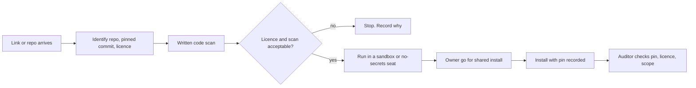

# 43. Legal, IP, licences and training

What OGL Cortex is built from, the licence of each component, what those licences let you do, how to vet third-party code before it enters your install, and what a new seat or a new human operator must learn before they get access.

This is not legal advice. It is an inventory of licence terms as published by each project. Get a lawyer's read before you redistribute OGL Cortex, sell work built on it, or ship any component inside a client deliverable.

Related documents: `32-security-red-team-log.md` (third-party code risk), `40-finops-capacity.md` (model sizes), `34-changelog.md`.

---

## 1. Component licences

### 1.1 Core

| Component | Role in OGL Cortex | Licence | Notes |
|---|---|---|---|
| cortextOS | Daemon, bus, CLI, templates | MIT (Cortext LLC) | Modification and commercial use allowed. Keep the copyright and licence notice in copies |
| Claude Code | The agent runtime in every seat | Anthropic commercial terms | Not open source. Your use is governed by your Anthropic plan and its usage policy |
| Claude models | Reasoning for every seat | Anthropic commercial terms | Output use per Anthropic's terms |
| Node.js | Runtime for cortextOS and the dashboard | MIT | |
| pm2 | Keeps the daemon and dashboard running | AGPL-3.0 | Run as a separate program. AGPL obligations attach if you modify pm2 and offer it to others over a network or distribute it. Using it unmodified as a process manager does not change the licence of your code |
| commander, node-pty, chalk, ora, chokidar, strip-ansi, @inquirer/prompts | cortextOS runtime dependencies | MIT | |

### 1.2 Dashboard

| Component | Licence |
|---|---|
| Next.js | MIT |
| better-sqlite3 | MIT |

### 1.3 Ship and security tooling

| Component | Role | Licence | Notes |
|---|---|---|---|
| Vercel CLI | Deploys in `ship.sh` | Apache-2.0 | Hosting use is governed by Vercel's terms |
| TruffleHog | Secret scan in the pentest gate | AGPL-3.0 | Run as a separate tool. Do not vendor a modified copy into a product without reviewing AGPL duties |
| OWASP ZAP | Web scan in the pentest gate, run in a container | Apache-2.0 (per the ZAP project; not checked against an installed copy during writing) | |
| Playwright | Browser automation | Apache-2.0 | Bundled browsers carry their own licences |

### 1.4 Media and speech

| Component | Role | Licence | Notes |
|---|---|---|---|
| ffmpeg (Homebrew build) | Audio and video conversion | GPL-3.0-or-later | The Homebrew build enables GPL parts. Use as a separate program; redistributing the binary brings GPL duties |
| yt-dlp | Video download | Unlicense | Downloading content can still breach a platform's terms or a creator's copyright. Use for private analysis |
| whisper.cpp (`whisper-cli`) | Voice-note transcription in the daemon | MIT | Model weights carry their own licence |
| mlx-whisper | Transcription on Apple silicon | MIT | |
| Ollama | Local model runner | MIT | Each model has its own licence (section 3) |

### 1.5 Skills commonly installed with OGL Cortex

Skills live in `~/.claude/skills/` (shared by every seat) or in a seat's `.claude/skills/`. Each keeps its own licence.

| Skill or bundle | Licence | Notes |
|---|---|---|
| frontend-design | Apache-2.0 (Anthropic) | |
| impeccable | Apache-2.0 | Based on frontend-design; keep its `NOTICE.md` if you redistribute |
| motionmaxxing | Apache-2.0 for the skill's own code | **Bundles third-party code under other licences.** GSAP uses GreenSock's own "No Charge" licence, which is not open source and has its own terms. three.js and opentype.js are MIT. The Inter font is SIL OFL 1.1. Read `NOTICE` before you ship a GSAP-driven page or film to a client |
| ogl-walk | MIT (OGL edition of Glitch Walk by Glitch Cat Club) | Keep the original copyright line and licence file with any copy |
| taste-skill, huashu-design, design-motion-principles, app-store-screenshots, seo and its `seo-*` siblings | MIT | |
| Plugin marketplaces (for example the official Claude plugins, Cloudflare plugins) | MIT or Apache-2.0 per marketplace | Check the `LICENSE` at each marketplace root |

**Skills with no licence file.** A repository with no licence grants no rights beyond reading it where it was published. Use such skills privately at most. Do not redistribute them or bundle them into anything you sell. Course material from a paid community is licensed to the member for their own use; read the community's terms before you share it.

### 1.6 The OGL Cortex layer

The hooks, guards, sentinels, ship wrapper, skills and docs in this repository are covered by the licence in the repository's `LICENSE` file. Where a guard implements a published idea (for example a writing guard based on Orwell's six rules, or an orchestration method from another author), the docstring credits the source. Ideas and methods are generally not protected by copyright; the code that implements them is. Keep the credit lines.

---

## 2. How third-party code enters an install



1. **Identify.** Repo URL, pinned commit, licence file and its type. Read `NOTICE` and any vendored directories; bundled code can carry a different licence from the top-level one.
2. **Scan.** Record network hosts the code contacts, environment variables it reads, files it writes outside its folder, `eval` or dynamic code, and model loaders with `trust_remote_code`. Save the scan as `CODE-SCAN.md` beside the clone.
3. **Isolate.** Untrusted code never runs in a seat that can both run commands and read secrets. Use a sandbox or a seat started with an empty environment and no keychain access.
4. **Approve.** Installs into shared `~/.claude` need the owner's go, cited in the install record.
5. **Pin.** Record the commit in the install record. A copy without `.git` loses its provenance unless you write it down.
6. **Audit.** The auditor seat re-checks pin, licence and the scan's claims.
7. **Register.** Keep a `THIRD-PARTY.md` beside any deliverable that ships third-party code, with name, version, licence and the notice text the licence requires.

---

## 3. Models and datasets

### 3.1 Model provenance

OGL Cortex does not train or fine-tune models. Seats use hosted models through Claude Code, and optional local models through Ollama or Hugging Face for transcription, embeddings and OCR.

| Model family (examples) | Typical licence | Check |
|---|---|---|
| Qwen 2.5 and later (Ollama library) | Apache-2.0 for many sizes; some sizes use a separate Qwen licence | `ollama show <model>` prints the licence |
| BAAI bge embedding models | MIT | The `license:` line in the Hugging Face model card |
| Whisper weights | MIT (OpenAI release); community conversions may omit the card field | Model card |
| Any other weights | Varies, including non-commercial licences | Read the card before any commercial use |

```bash
ollama show <model> | grep -A3 -i license
grep -m1 '^license:' ~/.cache/huggingface/hub/models--<org>--<name>/snapshots/*/README.md
```

### 3.2 Benchmarks and evaluation datasets

Evaluation sets often carry attribution licences (for example CC-BY-4.0) and a canary string asking that items not be republished online, so they do not leak into training data. Keep benchmark items on your own machine. Never paste them into public pages, videos or client decks.

### 3.3 Prompt and orchestration tuning

Searching over prompts and orchestration settings against a benchmark tunes your configuration, not model weights. It does not create a derived model.

---

## 4. Client material and client IP

OGL Cortex seats often build sites, documents and campaigns for clients. Put the rights in writing before you start.

| Question | Recommended default |
|---|---|
| Who owns the final site, copy and design? | The client, on full payment |
| Who owns your tooling, templates, hooks and skills? | You. The client receives a licence to use what is embedded in their deliverable |
| Who owns domains bought for the client? | The client. Register them in the client's name, or transfer on request |
| Photos, videos and reviews supplied by the client | The client warrants they hold the rights. Get that in writing, not by message |
| Prospect material used before a sale (photos, reviews, business name in a demo) | Use placeholders until the prospect agrees in writing |
| Third-party components inside the deliverable | Listed in `THIRD-PARTY.md` with their licences |

Never invent personas or first-person testimonials. A testimonial needs the named person's real words and consent.

Client data is personal data. Keep excerpts of client or prospect messages out of chat alerts where you can, and keep retention short.

---

## 5. Protecting your own install

The value in a mature install is mostly know-how: guard code, seat rules, auto-memory lessons, and the history of what worked. The main risk to it is loss, not theft.

| Protection | Recommended setting |
|---|---|
| Off-machine backup | Encrypted backup of `$CORTEX_HOME`, `$CTX_ROOT`, `~/.claude` (hooks, skills, settings, auto-memory under `projects/`) and every seat repo |
| Git remotes | A private remote for each seat repo and for your fork of the framework. Scan full history for secrets first (`32-security-red-team-log.md`, section 6) |
| Version control for `~/.claude` | Put hooks and skills you wrote in a repo; install them from there |
| Confidentiality | Mark internal documents `INTERNAL` in the file name. Keep guard code and seat rules private unless you choose to publish them |
| Secrets out of repos | Keep `.env`, token files and exports out of every repo; add them to `.gitignore` before the first commit |

**Running a modified framework.** MIT allows you to modify cortextOS. If you do, record your changes as commits on a named branch, keep upstream as a remote, and decide whether you will upstream them. A rule that says "run the framework unmodified" and a modified checkout cannot both stand; pick one and write it down.

---

## 6. Training curriculum

### 6.1 New agent seat

Seats onboard through the `onboarding` skill. A seat without `$CTX_ROOT/state/<seat>/.onboarded` runs onboarding before normal work.

| Stage | Read | Do | Gate before the next stage |
|---|---|---|---|
| 0. Identity | `IDENTITY.md`, `SOUL.md`, `USER.md` | Write its own `IDENTITY.md` and `SOUL.md` per the onboarding skill | `.onboarded` stays absent until every stage passes |
| 1. Hard lines | Org `knowledge.md` cardinal rules, `GUARDRAILS.md`, guardrails-reference skill | State back the approval categories: external comms, financial, deployment, data deletion | Send guard installed for the seat |
| 2. Fleet law | Fleet conventions in `knowledge.md`; untrusted-content rules in `GUARDRAILS.md` | One dry-run task: `create-task`, `update-task`, `complete-task`, `log-event` | The task shows on the dashboard |
| 3. Tools and accounts | `TOOLS.md`, account rules (which Google account, which browser profile) | List the accounts this seat may use | No secrets in chat |
| 4. Operating rhythm | `AGENTS.md` session start and memory protocol, `HEARTBEAT.md`, cron-management skill | Write the first daily memory entry and heartbeat | `cortextos bus list-crons <seat>` shows its daemon crons |
| 5. Scope | `GOALS.md`, `goals.json` | Accept a first real task through a four-line brief | The brief guard passes on dispatches to it |

Keep bootstrap files current. A stale `USER.md` teaches every new seat the wrong business map. A workflow step that names a runtime you no longer use sends new seats down a dead path. Long boot reads are where rules get skipped; keep them short.

### 6.2 New human operator

Grant access in stages. Reading comes with each stage.

| Stage | Access | Must read | Must do |
|---|---|---|---|
| A. Observer | Dashboard or agent office, read-only | `01` architecture, this document, `41` FAQ | Find one seat's heartbeat and last task |
| B. Approver | Telegram chat with the orchestrator, added to `ALLOWED_USER` | Approval categories in `USER.md`; cardinal rules | Approve or reject one real approval |
| C. Operator | Host account and the `cortextos` CLI | `30` runbooks, the `--instance` rule, pre-restart guardrails | Run read-only `status` and `list-crons`; no restarts alone |
| D. Owner | Secrets, billing, DNS | `32` security, `40` FinOps, sections 4 and 5 of this document | Never paste a secret into chat |

**Access review.** Quarterly, confirm that `ALLOWED_USER` in every seat `.env`, the dashboard login and any mobile API token name only current people. Remove anyone who left.

---

## 7. Enterprise items and their equivalents

| Enterprise item | Fit | Closest equivalent |
|---|---|---|
| Model cards for custom models | No custom models | Section 3.1 |
| Training data lineage | No training | Section 3.2 dataset rules |
| Open-source programme office | Small | Section 1 as the register; `THIRD-PARTY.md` per deliverable |
| Contributor licence agreements | Only if others contribute | Decide before accepting outside contributions |
| Export control review | Rarely relevant | None needed unless you ship weights or cryptography |
| Training completion records | Small team | `.onboarded` flags for seats; stage sign-off for humans |

## Source files

- `LICENSE`, `package.json` (cortextOS licence and dependencies)
- `dashboard/package.json`
- `community/` (catalog items inherit the repository licence)
- `templates/agent/`, `templates/orchestrator/` (bootstrap files)
- `templates/agent/.claude/skills/onboarding/SKILL.md` (seat onboarding)
